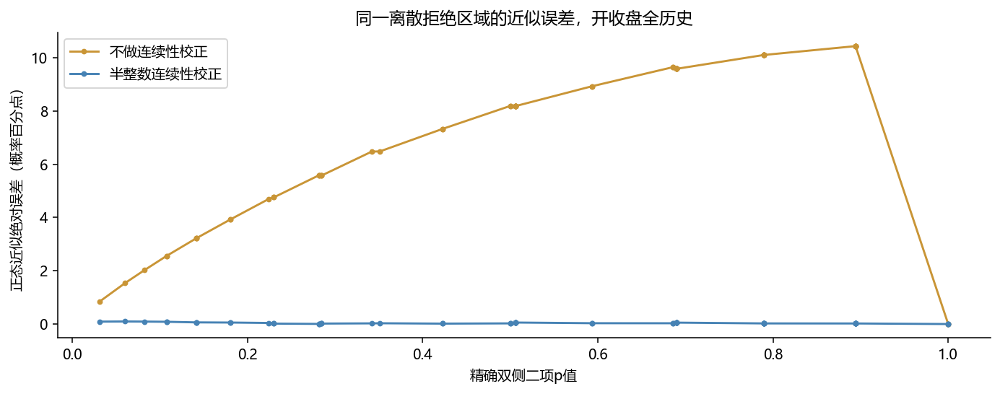
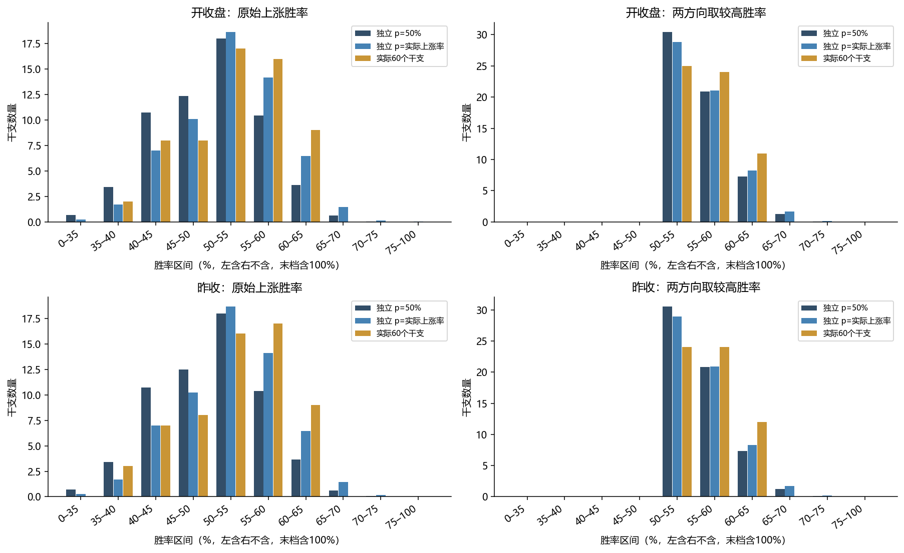
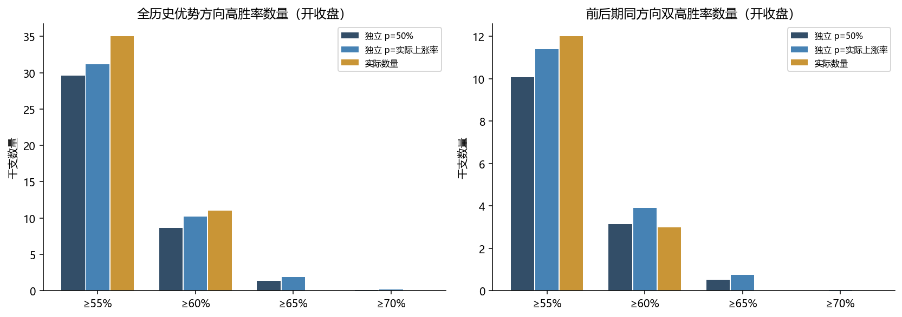
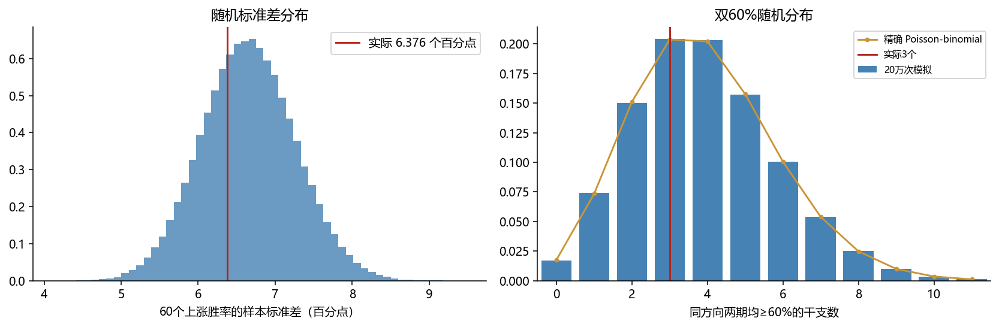
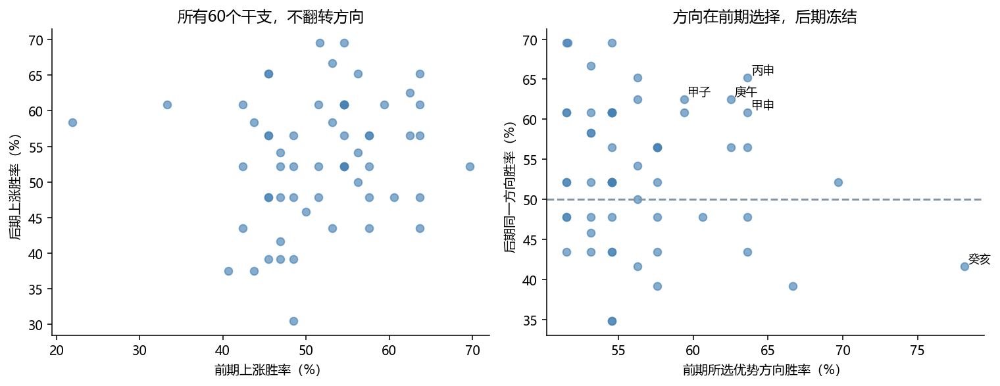

# 六十甲子胜率：二项分布、正态近似与随机显著性研究

数据冻结于 **2026-10-24**，最新完整日线 **2026-10-23**。开收盘与昨收分别计算。此次是数学与统计审计，没有调交易参数，没有修改正式系统。

## 1. 三个核心问题的回答

**A：当前高胜率和跨期持续性在无干支预测力的模型下并不罕见。** 开收盘全历史有11个优势方向胜率≥60%的干支，至少出现这么多个的精确概率，在50%基准下为 **24.2299%**，在实际上涨比例基准下为 **44.1297%**。同方向前后两期都≥60%的干支有3个，至少出现3个的概率分别为 **61.4584%**、**75.7687%**。这些是零假设成立时事件的发生频率，**不是“这些规律为假的后验概率”**。

**B：没有发现经过校正后显著的异常分布。** 原始上涨胜率、事后挑较高方向的折叠胜率、标准差、最高值、预先固定分箱的分布差异，都未超出相应随机模型的合理范围。全历史上涨胜率标准差为 **6.376 个百分点**，实际概率IID模拟的95%范围为 **5.479—7.871 个百分点**。

**C：现有证据不足以支持可预测的未来优势。** 观察到个别干支在两期持续较高胜率是事实，但数量与强度可以由小样本、60组选优和市场上涨偏向解释。它不证明干支绝对无效，也不能推出下一次必然回归；要证明未来预测力仍需预先冻结名单、规则与检验家族，用尚未查看的新数据验证。此次没有检验交易收益，不能据此声称有实际交易价值。

## 2. 真实数据、样本数与两种方向口径

| 口径 | 时期 | 有效n | 上涨 | 下跌 | 平盘 | 全部有效日上涨率 | 每干支n范围 |
| --- | --- | --- | --- | --- | --- | --- | --- |
| 开收盘 | 全部 | 3351 | 1755 | 1595 | 1 | 52.37% | 54—56 |
| 开收盘 | 2017—2022 | 1959 | 1013 | 945 | 1 | 51.71% | 31—33 |
| 开收盘 | 2023—2026-10-23 | 1392 | 742 | 650 | 0 | 53.30% | 23—24 |
| 昨收 | 全部 | 3348 | 1753 | 1594 | 1 | 52.36% | 54—56 |
| 昨收 | 2017—2022 | 1956 | 1011 | 944 | 1 | 51.69% | 31—33 |
| 昨收 | 2023—2026-10-23 | 1392 | 742 | 650 | 0 | 53.30% | 23—24 |

真实有效数据从2017-08-18起。排除上市首日、未收盘日、原始收盘时间异常的2018-02-08、2020-02-19、2020-12-21；昨收口径还排除紧随异常日的无效昨收样本。没有删除极端涨跌。原始3356根缓存、逐日排除原因和干支均保存在快照和CSV。

**不把平盘当成下跌。** 表示胜率时分母n仍包括平盘；二项模型固定平盘日期，试验数m=n−平盘，K为上涨次数、m−K为下跌次数。历史实际基准p取1755/(1755+1595)=**52.3881%**；与显示的1755/3351=52.3724%略有不同。昨收基准同理为52.3753%。全部口径和时期分别处理，不混合。

理想独立模型下，BTC整体二元上涨率相对50%的双侧p值为 **0.006004**。这反映BTC整体上涨偏向，不能归因于干支。实际p由同一数据估计，固定p的二项结果是**代入参考计算**，不是已消除未知参数影响的复合零假设精确检验；另外用固定总数超几何与条件随机化控制这个问题。

## 3. 精确数学计算及正态近似

固定p时，K~Binomial(m,p)，P(K=k)=C(m,k)p^k(1−p)^(m−k)。单方向“达到当前次数或更高”用精确尾和。个体主检验采用双侧概率排序：把概率质量不大于观察点质量的所有可能k相加，允许上涨与下跌两侧异常。不是在事后选好方向后只做单侧检验。

正态近似使用均值mp、标准差√[mp(1−p)]，分别计算不校正与±0.5连续性校正。两者近似的是**同一个精确离散拒绝区域**；p≠50%时不直接用“2×较小单侧尾概率”代替概率排序双侧p值。近似只用于比较，所有正式结论使用精确计算或明确的条件随机检验。

| 口径/时期，实际p基准 | 无校正平均绝对误差 | 连续性校正平均绝对误差 | 连续性校正最大误差 |
| --- | --- | --- | --- |
| 开收盘/full | 7.0673个百分点 | 0.0370个百分点 | 0.0965个百分点 |
| 开收盘/train | 8.9510个百分点 | 0.0452个百分点 | 0.1706个百分点 |
| 开收盘/validation | 9.5450个百分点 | 0.0599个百分点 | 0.2119个百分点 |
| 昨收/full | 7.0164个百分点 | 0.0381个百分点 | 0.0964个百分点 |
| 昨收/train | 8.8079个百分点 | 0.0462个百分点 | 0.1705个百分点 |
| 昨收/validation | 9.5446个百分点 | 0.0598个百分点 | 0.2118个百分点 |

每个干支上涨胜率K/n的理论均值mp/n、标准差√[mp(1−p)]/n。60组样本标准差S的理论平方期望为各组方差平均值，加组均值差异项Σ(μᵢ−μ̄)²/59。报告区分√E[S²]与E[S]，后者通过模拟得到，二者不完全相等。

“两边挑较高”的胜率W=max(K,m−K)/n是**折叠的离散分布**，不能当成均值50%的普通二项比例。它在纯随机下也自然高于50%。其均值、方差用全部k的精确二项权重计算，分布与离散程度另行核验，详见折叠分布结果。

## 4. 实际60组分布与理论分布

每个阈值h先换算为整数cᵢ=ceil(h×nᵢ)，精确保留不同n。固定上涨方向概率qᵢ⁺=P(K≥cᵢ)，下跌方向概率qᵢ⁻=P(K≤mᵢ−cᵢ)。当h>50%时两事件不重叠，事后允许任选方向的概率qᵢ=qᵢ⁺+qᵢ⁻。

预期数量是Σqᵢ。观察数量T的**完整精确分布**来自多项式∏[(1−qᵢ)+qᵢz]的系数，即Poisson-binomial；尾概率P(T≥实测数量)通过系数求和，不用“60×平均概率”代替。

### 开收盘：优势方向达到门槛的数量

| 门槛 | 实际 | 随机预期 p=50% | 至少实际数量的p | 随机预期 实际p | 至少实际数量的p | 60组至少有1组达门槛（实际p） |
| --- | --- | --- | --- | --- | --- | --- |
| ≥55% | 35 | 29.571 | 0.101044 | 31.185 | 0.195681 | 100.0000% |
| ≥60% | 11 | 8.663 | 0.242299 | 10.180 | 0.441297 | 99.9986% |
| ≥65% | 0 | 1.379 | 1.000000 | 1.907 | 1.000000 | 85.6069% |
| ≥70% | 0 | 0.117 | 1.000000 | 0.199 | 1.000000 | 18.0474% |

### 昨收：优势方向达到门槛的数量

| 门槛 | 实际 | 随机预期 p=50% | 至少实际数量的p | 随机预期 实际p | 至少实际数量的p | 60组至少有1组达门槛（实际p） |
| --- | --- | --- | --- | --- | --- | --- |
| ≥55% | 36 | 29.478 | 0.059365 | 31.076 | 0.125906 | 100.0000% |
| ≥60% | 12 | 8.692 | 0.151239 | 10.193 | 0.315832 | 99.9986% |
| ≥65% | 0 | 1.384 | 1.000000 | 1.907 | 1.000000 | 85.6136% |
| ≥70% | 0 | 0.120 | 1.000000 | 0.202 | 1.000000 | 18.3146% |

原始上涨方向和下跌方向的数量、完整计数分布与各时期结果也全部导出，不能把仅上涨概率与两方向任选概率混用。表中原始p值在主要68项家族内校正后均不显著。

## 5. 最高胜率：从60个中挑第一名

观察最高率r时，对每组按ceil(r×nᵢ)计算“任一方向≥r”的概率qᵢ，P(60组最大值≥r)=1−∏(1−qᵢ)。这已经纳入60组选优，不能只报告排名第一那一个的单组二项尾概率。

| 口径/时期 | 实际最高率 | 50%基准：至少这么高 | 实际p基准：至少这么高 |
| --- | --- | --- | --- |
| 开收盘/full | 64.29% | 92.4401% | 96.7008% |
| 开收盘/train | 78.12% | 8.8684% | 12.2041% |
| 开收盘/validation | 69.57% | 99.5853% | 99.7599% |
| 昨收/full | 64.29% | 92.2986% | 96.5923% |
| 昨收/train | 78.12% | 8.8997% | 12.2021% |
| 昨收/validation | 69.57% | 99.5853% | 99.7585% |

开收盘全历史第一名丙申36/56=64.29%，在实际p的60组随机试验中，最大值至少达到该水平的概率为 **96.7008%**。条件在实际总上涨数的精确多项式计算给出 **97.0204%**。前期癸亥25/32=78.125%看起来突出，但在60组最大值比较中的实际p概率为 **12.2041%**，仍不是小于5%的全局异常。

## 6. 前后时期同方向持续：按实际样本计算

前期为2017实际开始至2022-12-31，后期为2023-01-01至2026-10-23。先在前期确定方向，后期不能换方向。阈值55%、60%、65%、70%全部事先固定。不是两个时期各自重选更好方向。

对每个干支，联合概率 = P(前期上涨达标)×P(后期上涨达标) + P(前期下跌达标)×P(后期下跌达标)。两期在理想IID模型中独立，60组联合事件再用Poisson-binomial求总数量尾概率。

| 口径 | 两期门槛 | 前期入选 | 两期同向达标 | 50%预期 | 50%精确p | 实际p预期 | 实际p精确p |
| --- | --- | --- | --- | --- | --- | --- | --- |
| 开收盘 | ≥55% | 25 | 12 | 10.074 | 0.301026 | 11.389 | 0.471838 |
| 开收盘 | ≥60% | 11 | 3 | 3.141 | 0.614584 | 3.904 | 0.757687 |
| 开收盘 | ≥65% | 3 | 0 | 0.522 | 1.000000 | 0.753 | 1.000000 |
| 开收盘 | ≥70% | 1 | 0 | 0.020 | 1.000000 | 0.037 | 1.000000 |
| 昨收 | ≥55% | 25 | 11 | 10.106 | 0.431194 | 11.408 | 0.605217 |
| 昨收 | ≥60% | 12 | 3 | 3.122 | 0.610313 | 3.873 | 0.752801 |
| 昨收 | ≥65% | 3 | 0 | 0.524 | 1.000000 | 0.753 | 1.000000 |
| 昨收 | ≥70% | 1 | 0 | 0.020 | 1.000000 | 0.037 | 1.000000 |

同方向双60%的三组仍为 **庚午、甲申、丙申**。它们值得如实记录，但“发现3个”相对于随机预期3.14—3.90个，没有显示数量上的超额。

### 32次与23次：仅作为数学示例

| 门槛 | 32次所需成功 | 23次所需成功 | 32次单向概率 | 23次单向概率 | 两期同方向任一边概率 | 60组预期双高数 |
| --- | --- | --- | --- | --- | --- | --- |
| ≥55% | 18 | 13 | 29.8307% | 33.8820% | 20.2145% | 12.129 |
| ≥60% | 20 | 14 | 10.7664% | 20.2436% | 4.3590% | 2.615 |
| ≥65% | 21 | 15 | 5.5092% | 10.5020% | 1.1572% | 0.694 |
| ≥70% | 23 | 17 | 1.0031% | 1.7345% | 0.0348% | 0.021 |

这张示例不能替代真实分母：32次≥60%需20次成功，33次也需20次，但尾概率不同。真实前期31—33次、后期23—24次，因此实际双60%预期3.141个，与统一32/23示例的2.615个不同。低样本量下，整数门槛造成明显的离散跳跃。

### 固定实际前期名单的另一种问题

如果条件在“已经挑出这25个名字及其方向”，只问它们后期继续达标的概率，必须使用各自冻结方向的后期概率重新卷积。开收盘前期≥55%的25组中12组继续达标，实际p下条件预期 **9.035组**，尾概率 **0.148160**。这和完整重筛流程的p=0.471838回答不同问题，均未显著；报告保留两者，未只挑较小的一个。

## 7. 最高的若干组，后期理论上该有多少胜率

预先固定top5、top10、top20，按前期精确分数排序、同分用干支序号打破，不使用后期排序。理想无效模型下，未来胜率不继承前期60%或70%：冻结做多方向的成功率是p，做空是1−p。组合后期成功次数的分布由两种二项分布卷积精确求得，固定名单结果如下。

| 口径 | 前期排名前k | 后期成功/总数 | 实际后期率 | 无效模型期望率 | 后期至少这么好p |
| --- | --- | --- | --- | --- | --- |
| 开收盘 | 5 | 56/116 | 48.28% | 50.45% | 0.713064 |
| 开收盘 | 10 | 122/232 | 52.59% | 51.42% | 0.386242 |
| 开收盘 | 20 | 243/463 | 52.48% | 51.18% | 0.303494 |
| 昨收 | 5 | 56/116 | 48.28% | 50.45% | 0.712883 |
| 昨收 | 10 | 122/232 | 52.59% | 51.41% | 0.385354 |
| 昨收 | 20 | 247/464 | 53.23% | 50.93% | 0.172091 |

模拟另外每次重新选top-k，完整检验筛选流程。所有次要家族校正后均未形成持续优势证据。回落可由选优偏差与随机波动解释，但不意味着市场必须在下一段“补跌”或“补涨”。

## 8. 全分布与时间相关性

| 随机基准（开收盘） | 上涨率标准差上尾p | 固定分箱差异p | 双55%至少12组p | 双60%至少3组p | 前后上涨率Pearson正相关p |
| --- | --- | --- | --- | --- | --- |
| 独立 p=50% | 0.675002 | 0.098455 | 0.299824 | 0.613397 | 0.135194 |
| 独立 p=实际上涨率 | 0.672482 | 0.832561 | 0.472923 | 0.758921 | 0.135294 |
| 固定分期涨跌总数 | 0.671580 | 0.751100 | 0.456080 | 0.757640 | 0.135340 |
| 年×星期内置换 | 0.676100 | 0.751560 | 0.458180 | 0.759160 | 0.138480 |
| 每年独立整周循环 | 0.654740 | 0.744280 | 0.445700 | 0.750280 | 0.134600 |

原始上涨率的前后Pearson相关为0.1442，Spearman为0.1774。正相关尾概率在不同基准下分别约0.135—0.138和0.086—0.088，没有形成显著持续性。前期优势方向胜率与后期冻结方向胜率也计算在内，不能用后期重新翻转方向制造正相关。

固定分箱差异统计量使用事先定义的胜率区间，将观察频数与每组二项概率累加后的预期频数比较；因为稀疏分箱和不相同n，不套用简单渐近卡方自由度，而由对应模拟校准。原始上涨率与折叠优势率都计算。

折叠优势率的实际标准差为 **3.835个百分点**，实际p的IID模拟均值为4.264个百分点，双侧p=0.344298；折叠分布补充家族校正后亦无显著异常。原始标准差与最高值还做了对称双尾检查，未通过校正。后补诊断的时间与性质在 `diagnostics_supplement.json` 单独披露，不当作新的独立证据。

### 结构条件随机化保留和破坏什么

1. **固定分期总数：** 分别在两个不重叠时期置换非平盘涨跌，精确保留时期总上涨数，破坏年内和局部序列结构。
2. **年×星期：** 只在相同年份、星期内置换完整收益标记束，保留这些层内的实际涨跌比例，打散连续行情。
3. **每年独立整周循环：** 对完整有效的周序列逐年使用不同的整周偏移；不完整周、含无效或平盘日期的周保留。控制年份和星期，并保留大多数连续行情。

整周错位在审计样本中保留 **98.95%** 的相邻日链接；原始绝对收益lag1相关0.2741，错位后均值0.2707。涨跌lag1相关由-0.0511变为-0.0497。这是保留波动聚集的条件参考，仍非完全正确的市场生成模型。

不能全历史统一移动60甲子相位后把它当随机检验：那通常只是重命名60个组，不改变分布或高胜率数量。此处逐年偏移不同、固定边界周，审计未发现单一全局相位重命名；样本数、平盘日期与分期总数保持，构造逻辑与抽样映射均核查。不同随机基准共享数据，不能把多个不显著p值相乘。

## 9. 蒙特卡洛规模、误差和整数复核

两个理想基准×两口径×每组200,000次，加三个结构基准×两口径×每组49,999次，共 **1,099,994 次**。每次重新筛选前期方向、阈值和top-k。种子为202610246055，加口径偏移100000和模型序号偏移10000；批次512。完整种子、源哈希与模拟代码哈希随结果保存。

蒙特卡洛p=(超过次数+1)/(有效模拟次数+1)，附95% Wilson模拟误差区间。在尾概率50%附近，20万次的95%半宽约0.219个百分点，49,999次约0.438个百分点。最低可报告模拟p分别约0.000005、0.000020，不写p=0。精确概率不受这些模拟精度限制。

| 事件，开收盘 | 精确实际p基准 | 模拟频率估计 | 模拟尾概率95%区间 |
| --- | --- | --- | --- |
| full_either55 | 0.195681 | 0.195299 | [0.193563, 0.197038] |
| full_either60 | 0.441297 | 0.442023 | [0.439845, 0.444198] |
| full_max | 0.967008 | 0.967305 | [0.966517, 0.968075] |
| joint55 | 0.471838 | 0.472923 | [0.470732, 0.475109] |
| joint60 | 0.757687 | 0.758921 | [0.757040, 0.760790] |

68项精确/模拟对照全部通过预先固定的6倍蒙特卡洛标准误数值核验，66/68项精确值落在各自点态95%模拟区间内；不能要求68个95%区间必然全部覆盖。**68项主要聚合概率再用Python任意精度整数与50位十进制复算，最大与常规数值结果差异5.22×10⁻¹⁵；720个个体二项p值也用整数权重核对。** 所谓精确指有限样本分布与求和定义，不是假装普通浮点具有无限位精度。完整整数分子/分母可还原。

## 10. 多重检验与个体案例

主要校正为Holm家族错误率控制，BH仅作探索性FDR对照。家族事先明确：主要精确聚合68项；全历史个体240项；两分期个体480项；条件超几何个体360项；主要模拟200项。次要精确138项、次要模拟210项和分布补充各20项分开披露，绝不将不同家族当独立复现。

以上主要家族均没有校正后p<0.05的结果。个体原始小p只能说明“如果事先只指定这一组会怎样”；不能省略我们同时看了60组、多个门槛、两种方向口径和分期这一事实。完整个体双侧p、正常近似误差、置信区间、Holm/BH均在CSV中。

| 开收盘干支 | 前期冻结方向 | 前期成功/总数 | 前期率 | 后期同方向成功/总数 | 后期率 | 后期二项95%区间 |
| --- | --- | --- | --- | --- | --- | --- |
| 甲子 | 下跌 | 19/32 | 59.38% | 15/24 | 62.50% | [40.59%, 81.20%] |
| 庚午 | 上涨 | 20/32 | 62.50% | 15/24 | 62.50% | [40.59%, 81.20%] |
| 甲申 | 上涨 | 21/33 | 63.64% | 14/23 | 60.87% | [38.54%, 80.29%] |
| 丙申 | 上涨 | 21/33 | 63.64% | 15/23 | 65.22% | [42.73%, 83.62%] |
| 甲戌 | 上涨 | 18/32 | 56.25% | 15/23 | 65.22% | [42.73%, 83.62%] |
| 乙亥 | 上涨 | 19/32 | 59.38% | 14/23 | 60.87% | [38.54%, 80.29%] |
| 癸亥 | 下跌 | 25/32 | 78.12% | 10/24 | 41.67% | [22.11%, 63.36%] |

这些区间是单组、独立二项假设下的点态区间，不是60组同时或时间相关稳健区间，不能拿“区间内某一较高概率”当成功证明。甲子等持续表现与癸亥的后期失效都保留，不从60组中只讲赢家。全60组真实排名与逐期成功次数见 [完整明细](GANZHI_TABLES.md)。

## 11. 证据边界与后续使用

这项审计回答“若无干支效应，这些统计量有多常见”。它没有计算贝叶斯P(无效|数据)，没有证明随机模型就是真实市场，也没有证明所有可能的干支作用不存在。年度环境、星期和连续结构控制后依旧没有看到超额证据，当前更符合市场偏向、有限样本与筛选效应的解释。

所有历史日期此前已经在本项目被多轮查看；此次是独立复算的回顾性统计审计，不能重新包装成从未查看的新样本外验证。训练期筛选冻结可防止验证方向泄漏，却不能抹掉此前研究选择问题。统计关联、未来预测能力、扣费后实际交易价值是三个层次，不能互相替代。

若继续验证，应在未来新数据到来前冻结少量候选、方向、截止日期、成功定义和多重检验范围，按原计划记录失败与成功。当前没有足够依据把观察到的60%左右历史胜率直接当成未来同样的真实概率，也没有依据为了回归而反向下注。

## 12. 可复核文件与核验

实际完成 **15 个数学/数据测试、4,796 项正式口径与历法核对、6,274 项独立数值核验、56,320 个已保存模拟统计量的种子重放**。正式统计、API、日历和交易代码均未改变。

[复现说明](README.md)列出完整命令。主要CSV含60组原始次数、二项/正态概率、门槛期望和完整计数PMF、跨期联合、top-k、条件检验、多重比较、模拟频数及结构审计。关键连续统计量分布保存在NPZ；源数据与协议单独做SHA256，最终bundle_manifest覆盖交付文件。

可直接复核：[60组排名CSV](results/rankings60.csv)、[逐干支理论概率与标准差](results/theoretical_probabilities.csv)、[各胜率区间预期/实际数量](results/theoretical_distribution_bins.csv)、[跨期全部60组](results/split60.csv)、[全部模拟检验](results/monte_carlo_tests.csv)、[精确与模拟对照](results/exact_vs_monte_carlo.csv)、[任意精度整数审计](results/integer_exact_primary_audit.csv)。

方法参考：[NIST二项分布定义及方差](https://www.itl.nist.gov/div898/handbook/eda/section3/eda366i.htm)、[SciPy精确二项检验](https://docs.scipy.org/doc/scipy/reference/generated/scipy.stats.binomtest.html)、[SciPy超几何分布](https://docs.scipy.org/doc/scipy/reference/generated/scipy.stats.hypergeom.html)、[statsmodels多重比较](https://www.statsmodels.org/stable/generated/statsmodels.stats.multitest.multipletests.html)。
