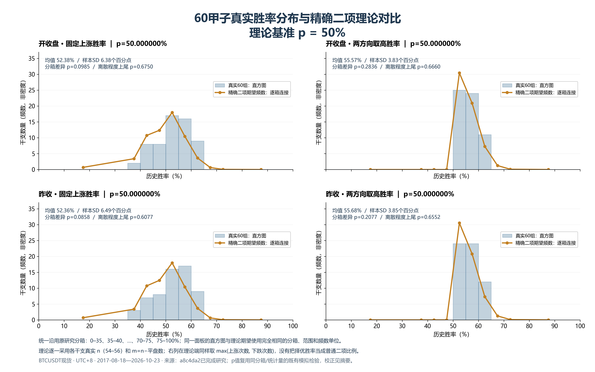
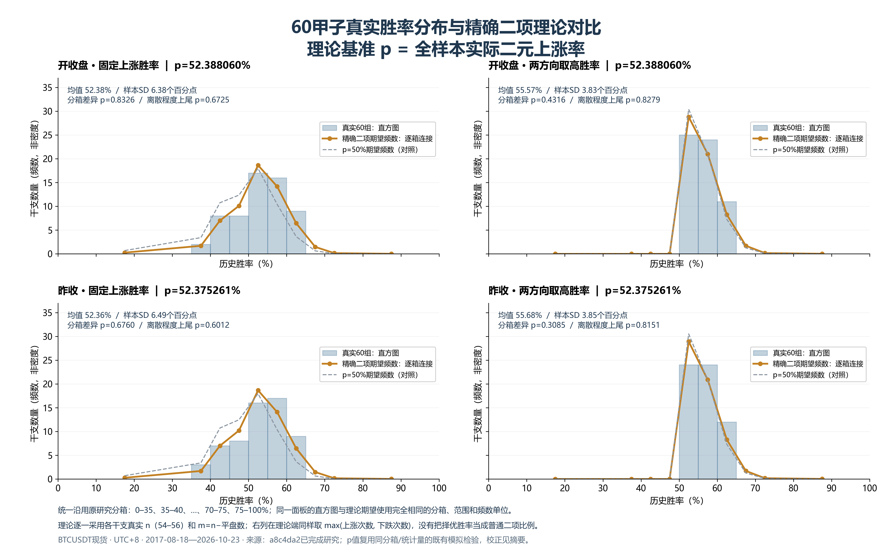
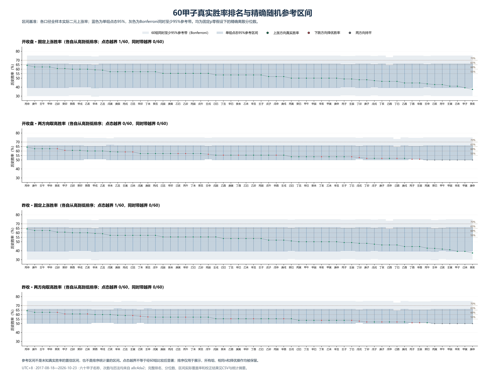

# 60甲子真实胜率与精确二项理论对比图

严格读取 Git 提交 **a8c4da2e4d0045e3ac05f92a5ecdcf29f0e2fc28** 中已完成研究的JSON，不读取后续实时行情，不重新训练或回测，也不修改正式功能。源数据有效区间为 **2017-08-18—2026-10-23，UTC+8**。每张图四个面板，分别对应两种价格口径与两种成功定义。

## 成功定义与图的读法

左列/第1和第3排名面板：**固定上涨胜率**，成功是收盘高于开盘（oc）或高于连续前一日有效收盘（cc）。右列/第2和第4排名面板：沿用原研究排名的**两方向取高胜率**，成功次数为max(上涨次数,下跌次数)，保留该组择优方向。后者是择优后的折叠分布，在纯随机下平均胜率也高于50%，不能直接与普通Binomial比例比较。

所有显示分母n包括平盘，m=n−平盘；在随机模型中固定平盘日期，K~Binomial(m,p)，下跌=m−K。各组n为54—56，逐组计算精确PMF，再在原研究预先固定的相同分箱累加期望频数。未使用正态近似、核密度、平滑或密度归一化。连线只是各分箱期望频数的连接，不代表连续概率密度。

图1使用p=50%；图2使用全样本二元实际上涨率：oc为1755/3350=52.388060%，cc为1753/3347=52.375261%。这不是60个择优胜率的平均值。将约55.57%的择优均值再当作p进行相同择优，会重复引入筛选偏差。图2另保留50%理论虚线方便比较。

## 均值与标准差

实际均值为60组胜率的非加权平均，实际标准差使用样本定义ddof=1，和原研究一致。理论主对照为 **√E[S²]**，同时给出原模拟的 **E[S]**，避免把二者混为一谈。完整CSV还给出理论混合分布的总体标准差。标准差数值单位均为百分点。

| 口径/定义 | 基准p | 实际均值 | 实际样本SD | 理论均值 | 理论√E[S²] | 原模拟E[S] |
| --- | --- | --- | --- | --- | --- | --- |
| 开收盘 · 固定上涨胜率 | 50% | 52.377% | 6.3760 | 49.985% | 6.6907 | 6.6598 |
| 开收盘 · 固定上涨胜率 | 实际率 | 52.377% | 6.3760 | 52.372% | 6.6831 | 6.6548 |
| 开收盘 · 两方向取高胜率 | 50% | 55.568% | 3.8350 | 55.305% | 4.0572 | 4.0314 |
| 开收盘 · 两方向取高胜率 | 实际率 | 55.568% | 3.8350 | 55.640% | 4.2880 | 4.2636 |
| 昨收 · 固定上涨胜率 | 50% | 52.358% | 6.4915 | 49.985% | 6.6937 | 6.6668 |
| 昨收 · 固定上涨胜率 | 实际率 | 52.358% | 6.4915 | 52.360% | 6.6863 | 6.6564 |
| 昨收 · 两方向取高胜率 | 50% | 55.678% | 3.8533 | 55.309% | 4.0581 | 4.0358 |
| 昨收 · 两方向取高胜率 | 实际率 | 55.678% | 3.8533 | 55.639% | 4.2865 | 4.2619 |

对每组随机胜率Xᵢ，理论混合方差 = 平均Var(Xᵢ)+平均(μᵢ−μ̄)²；E[S²] = 平均Var(Xᵢ)+Σ(μᵢ−μ̄)²/59。K/n与max(K,m−K)/n都按其精确离散分布求矩，未用平均n替代真实n。

## 高胜率数量与精确尾概率

### 开收盘 · 固定上涨胜率

| 门槛 | 实际数量 | p50理论数量 | p50精确尾p | p50 Holm68 | 实际率理论数量 | 实际率精确尾p | 实际率 Holm68 |
| --- | --- | --- | --- | --- | --- | --- | --- |
| ≥55% | 25 | 14.7856 | 0.002769 | 0.185508 | 22.2908 | 0.275044 | 1.000000 |
| ≥60% | 9 | 4.3316 | 0.027526 | 1.000000 | 8.1036 | 0.422758 | 1.000000 |
| ≥65% | 0 | 0.6894 | 1.000000 | 1.000000 | 1.6507 | 1.000000 | 1.000000 |
| ≥70% | 0 | 0.0587 | 1.000000 | 1.000000 | 0.1819 | 1.000000 | 1.000000 |

### 开收盘 · 两方向取高胜率

| 门槛 | 实际数量 | p50理论数量 | p50精确尾p | p50 Holm68 | 实际率理论数量 | 实际率精确尾p | 实际率 Holm68 |
| --- | --- | --- | --- | --- | --- | --- | --- |
| ≥55% | 35 | 29.5712 | 0.101044 | 1.000000 | 31.1852 | 0.195681 | 1.000000 |
| ≥60% | 11 | 8.6631 | 0.242299 | 1.000000 | 10.1799 | 0.441297 | 1.000000 |
| ≥65% | 0 | 1.3788 | 1.000000 | 1.000000 | 1.9071 | 1.000000 | 1.000000 |
| ≥70% | 0 | 0.1174 | 1.000000 | 1.000000 | 0.1987 | 1.000000 | 1.000000 |

### 昨收 · 固定上涨胜率

| 门槛 | 实际数量 | p50理论数量 | p50精确尾p | p50 Holm68 | 实际率理论数量 | 实际率精确尾p | 实际率 Holm68 |
| --- | --- | --- | --- | --- | --- | --- | --- |
| ≥55% | 26 | 14.7389 | 0.001109 | 0.075382 | 22.1867 | 0.186966 | 1.000000 |
| ≥60% | 9 | 4.3460 | 0.028042 | 1.000000 | 8.0989 | 0.422048 | 1.000000 |
| ≥65% | 0 | 0.6921 | 1.000000 | 1.000000 | 1.6484 | 1.000000 | 1.000000 |
| ≥70% | 0 | 0.0601 | 1.000000 | 1.000000 | 0.1845 | 1.000000 | 1.000000 |

### 昨收 · 两方向取高胜率

| 门槛 | 实际数量 | p50理论数量 | p50精确尾p | p50 Holm68 | 实际率理论数量 | 实际率精确尾p | 实际率 Holm68 |
| --- | --- | --- | --- | --- | --- | --- | --- |
| ≥55% | 36 | 29.4778 | 0.059365 | 1.000000 | 31.0763 | 0.125906 | 1.000000 |
| ≥60% | 12 | 8.6920 | 0.151239 | 1.000000 | 10.1930 | 0.315832 | 1.000000 |
| ≥65% | 0 | 1.3842 | 1.000000 | 1.000000 | 1.9075 | 1.000000 | 1.000000 |
| ≥70% | 0 | 0.1203 | 1.000000 | 1.000000 | 0.2019 | 1.000000 | 1.000000 |

尾概率是随机模型下至少出现当前数量的概率，复用原研究逐组精确概率卷积得到的Poisson-binomial计数分布；不是用Binomial(60,平均q)近似。原始整数阈值100×成功次数≥h×n保持不变。所有主要门槛检验均未通过原预先规定的68项Holm校正。

## 分布与离散程度的显著性

| 口径/定义 | 基准 | 分箱整体差异p | 分箱检验Holm | 标准差增大上尾p | 标准差双尾p | 离散检验Holm |
| --- | --- | --- | --- | --- | --- | --- |
| 开收盘 · 固定上涨胜率 | iid50 | 0.098455 | 1.000000 | 0.675002 | 0.650007 | 1.000000 |
| 开收盘 · 固定上涨胜率 | iid_actual | 0.832561 | 1.000000 | 0.672482 | 0.655047 | 1.000000 |
| 开收盘 · 两方向取高胜率 | iid50 | 0.283554 | 1.000000 | 0.665992 | 0.668027 | 1.000000 |
| 开收盘 · 两方向取高胜率 | iid_actual | 0.431593 | 1.000000 | 0.827856 | 0.344298 | 1.000000 |
| 昨收 · 固定上涨胜率 | iid50 | 0.085825 | 1.000000 | 0.607672 | 0.784666 | 1.000000 |
| 昨收 · 固定上涨胜率 | iid_actual | 0.676022 | 1.000000 | 0.601217 | 0.797576 | 1.000000 |
| 昨收 · 两方向取高胜率 | iid50 | 0.207729 | 1.000000 | 0.655172 | 0.689667 | 1.000000 |
| 昨收 · 两方向取高胜率 | iid_actual | 0.308478 | 1.000000 | 0.815081 | 0.369848 | 1.000000 |

分箱差异和标准差p值直接复用a8c4da2中的同分箱、同统计量和相同模拟，不新开模拟选择更好看的p值。每个理想模型每口径200,000次；原始上涨率分箱检验属于原主要200项家族，择优分布属于原补充20项家族；离散程度双尾诊断亦沿用各自原家族。完整模拟次数、种子与Wilson误差区间保留在上级研究。不同检验不是独立证据，不把p值相乘。

开收盘原始上涨率：相对实际p理论，整体分箱差异p=0.832561，标准差增大上尾p=0.672482；择优胜率对应p分别为0.431593、0.827856。没有发现更宽的尾部或更大的整体离散程度。

### 均值偏移与干支效应必须分开

| 合并样本口径 | 上涨/非平盘总数 | 实际二元上涨率 | 相对50%的精确双侧p |
| --- | --- | --- | --- |
| oc | 1755/3350 | 52.388% | 0.006004 |
| cc | 1753/3347 | 52.375% | 0.006305 |

这里存在一个需要保留的区别：**BTC合并样本的上涨比例相对50%有均值偏移**，在理想IID二项检验下具有原始显著性；它是整个市场的上涨偏向，并非特定干支的额外作用。p=实际上涨率基准正是对这一偏向的控制。上表合并样本检验检验加权市场上涨率，不冒充60组非加权平均值的精确检验；它与分箱整体检验针对不同备择，因此p值可以不同。

择优胜率均值约55.57%，不能被解释为相对50%有5.57个百分点的预测优势，因为随机二项模型经过相同择优操作后，预期均值已经约55.3%—55.6%。另外，实际p从同一数据估计，属于固定参数代入参考，不能把它当成未知参数复合零假设的精确检验；原研究另有条件超几何、固定涨跌总数、年星期和整周错位检验控制此问题，均无校正后优势证据。

## 排名图与95%随机参考区间

每个面板按自己的真实胜率精确分数降序排列，同分按原干支序号。每个干支仍使用自己的n、m。蓝带为固定实际p零假设下的精确2.5%与97.5%分位数；灰带把单组α设为0.05/60，给出Bonferroni同时至少95%参考。离散分位数使实际覆盖率通常高于标称值，CSV保留真实覆盖率。

| 口径/定义 | 点态95%区间外数量 | 同时95%参考带外数量 |
| --- | --- | --- |
| 开收盘 · 固定上涨胜率 | 1 | 0 |
| 开收盘 · 两方向取高胜率 | 0 | 0 |
| 昨收 · 固定上涨胜率 | 1 | 0 |
| 昨收 · 两方向取高胜率 | 0 | 0 |

这些是**随机胜率的参考区间**，不是未知真实成功率参数的置信区间；排序后也不能把单组点态带当作第1名、第2名等排序统计量的区间。点态越界允许偶然发生，不能忽略60组选优。图中另画55%、60%、65%、70%线，它们是阅读参考，不是事后调参筛选线。原研究个体二项检验Holm240值也保留在完整CSV中。

## 客观结论与交付

**现有60甲子胜率分布没有显示经多重比较校正后显著超出精确随机二项参考的尾部或离散异常。** 50%基准下能看到市场总体上涨均值偏移；控制实际市场基准后，没有证据将其归因于干支。择优胜率高于50%的大部分表象是取高操作自身造成的，不能直接解释成预测优势。

这不证明所有可能的干支效应绝对不存在；也不提供P(规律为真|数据)的后验概率。这批历史数据已被多次查看，图表不是新的样本外预测验证，更不能据统计描述推出未来有效或扣费后可交易。未来预测能力需要预先冻结规则并用未查看数据验证。

目录含三张300 DPI高清PNG、唯一绘图脚本、60组名称/次数/分位数CSV、理论频数、矩与阈值摘要、复用检验结果、源文件哈希和测试记录。运行：从仓库根目录用原科研环境执行 `python research/binomial_randomness_2026-10-24/results/distribution_figures_a8c4da2/plot_distributions.py`；依赖沿用上级 `requirements-research.txt`，中文字体Microsoft YaHei。所有输入通过 `git show a8c4da2:路径` 读取，不受工作区或实时数据库改变影响。
