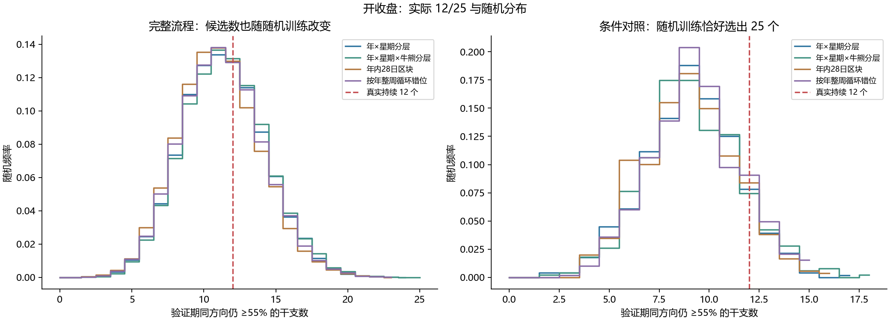
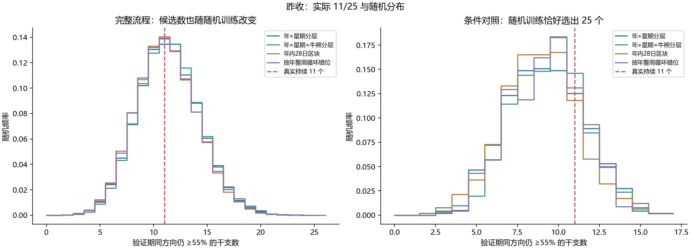
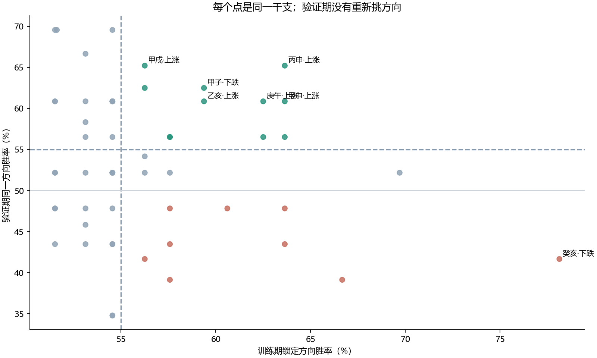
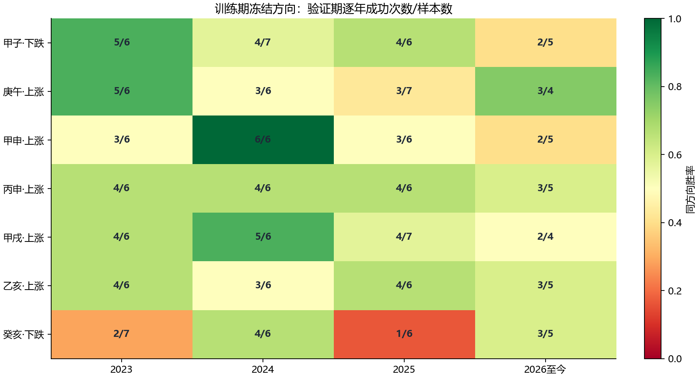

# jiexu-btc｜六十甲子高胜率持续性与跨周期验证

[全部60干支与分割明细](GANZHI_DETAILS.md) · [复现说明](REPRODUCE.md) · [主分割120行CSV](results/main60_details.csv) · [随机检验CSV](results/null_persistence_tests.csv)

## 1. 先回答本次真正关心的三个问题

**哪些个体持续？** 独立从原始OHLC重算，确认开收盘口径25个训练≥55%候选中，12个在2023以后同方向仍≥55%；昨收口径为11/25。庚午、甲申、丙申确实在两期都≥60%。这些个体结果完整保留，没有用约52%的汇总命中率替代。

**超出随机多少？** 四种完整流程随机检验下，实际持续数量处于正常随机范围。即使限定随机训练也恰好选出25个，12/25及11/25仍未显著超过随机预期。主216项门槛/口径/分割/方法检验、多分割个体检验及关联检验均未形成整体稳健证据。

**能否提前认出未来赢家？** 固定名单、方向、滚动过去30次→未来10/20次均没有通过校正的可重复优势。但有应当披露的局部线索：癸亥在2017—2020筛选后，2021—2022下跌11/12，在一种控制牛熊的条件零假设下有较强局部证据；2023以后却降至10/24。因此它支持“早期阶段值得研究”，不支持“已经找到稳定跨期赢家”。

本报告是方向持续性研究，不讨论EV、波动预测或虚构交易收益。只新增研究文件，正式日历、统计、API及交易逻辑没有修改。

## 2. 数据与固定研究设计

使用仓库真实Binance BTCUSDT现货UTC+8日线，最新已收盘为 **2026-10-20**。上市首根不完整日、三处源收盘时间异常、未收盘数据排除；昨收口径另外排除前收无效的日期。原始Decimal价格比较决定方向，平盘保留分母。时间和干支标签按正式系统核对，且所有已完成源K线已与当前本地行情库只读核对一致。

| 口径 | 有效样本 | 第一日 | 最后日 | 上涨 | 下跌 | 平盘 |
| --- | --- | --- | --- | --- | --- | --- |
| 开收盘 | 3348 | 2017-08-18 | 2026-10-20 | 1753 | 1594 | 1 |
| 昨收 | 3345 | 2017-08-18 | 2026-10-20 | 1751 | 1593 | 1 |

| 分割 | 训练 | 冻结验证 | 用途 |
| --- | --- | --- | --- |
| S1 | 2017-01-01—2022-12-31 | 2023-01-01—2026-10-20 | 主要预定分割 |
| S2 | 2017-01-01—2020-12-31 | 2021-01-01—2022-12-31 | 主要预定分割 |
| S3 | 2021-01-01—2023-12-31 | 2024-01-01—2026-10-20 | 主要预定分割 |

每个分割内部训练、验证完全不重叠；但S1的2023验证也是S3的训练，S2的2021—2022验证也是S1训练的一部分。因此不能把三次结果相乘或称为三个独立重复试验。额外的逐年3年训练→1年验证也明确属于相关的探索性检查。

方向仅由训练期多数决定，平票不预测；三个训练门槛为55%、60%、65%，三个验证门槛也固定为55%、60%、65%，使用整数次数比较，不用四舍五入百分比筛选。验证期绝不重新选择优势方向。所有60干支都导出，包含没入选者。

## 3. 三档高胜率：到底延续了多少

| 口径 | 训练门槛 | 入选 | 验证仍≥55% | 验证仍≥60% | 验证仍≥65% |
| --- | --- | --- | --- | --- | --- |
| 开收盘 | 55% | 25 | 12 | 7 | 2 |
| 开收盘 | 60% | 11 | 5 | 3 | 1 |
| 开收盘 | 65% | 3 | 0 | 0 | 0 |
| 昨收 | 55% | 25 | 11 | 7 | 2 |
| 昨收 | 60% | 12 | 5 | 3 | 1 |
| 昨收 | 65% | 3 | 0 | 0 | 0 |

“前期≥55%的25个中，后期7个≥60%”和“两个时期都≥60%的3个”是不同统计，不能混淆。小样本还使门槛离散化：验证只有23次时，≥55%需要13/23，≥60%需要14/23，≥65%需要15/23。

### 两期都至少60%的全部个体

| 干支 | 冻结方向 | 训练成功/总数 | 训练胜率 | 验证成功/总数 | 验证胜率 | 变化 | 仍≥55% | 匹配市场差 | 个体校正p |
| --- | --- | --- | --- | --- | --- | --- | --- | --- | --- |
| 庚午 | 上涨 | 20/32 | 62.50% | 14/23 | 60.87% | -1.63个百分点 | 是 | +8.05个百分点 | 1.0000 |
| 甲申 | 上涨 | 21/33 | 63.64% | 14/23 | 60.87% | -2.77个百分点 | 是 | +7.52个百分点 | 1.0000 |
| 丙申 | 上涨 | 21/33 | 63.64% | 15/23 | 65.22% | +1.58个百分点 | 是 | +11.70个百分点 | 1.0000 |

这三例在昨收口径的训练/验证次数相同；两种口径来自同一批相近价格路径，不是独立复制证据。

### 开收盘口径：训练≥55%的25个逐一验证

| 干支 | 冻结方向 | 训练成功/总数 | 训练胜率 | 验证成功/总数 | 验证胜率 | 变化 | 仍≥55% | 匹配市场差 | 个体校正p |
| --- | --- | --- | --- | --- | --- | --- | --- | --- | --- |
| 甲子 | 下跌 | 19/32 | 59.38% | 15/24 | 62.50% | +3.12个百分点 | 是 | +16.84个百分点 | 1.0000 |
| 己巳 | 上涨 | 18/32 | 56.25% | 12/23 | 52.17% | -4.08个百分点 | 否 | -0.71个百分点 | 1.0000 |
| 庚午 | 上涨 | 20/32 | 62.50% | 14/23 | 60.87% | -1.63个百分点 | 是 | +8.05个百分点 | 1.0000 |
| 癸酉 | 上涨 | 20/32 | 62.50% | 13/23 | 56.52% | -5.98个百分点 | 是 | +4.15个百分点 | 1.0000 |
| 甲戌 | 上涨 | 18/32 | 56.25% | 15/23 | 65.22% | +8.97个百分点 | 是 | +12.25个百分点 | 1.0000 |
| 乙亥 | 上涨 | 19/32 | 59.38% | 14/23 | 60.87% | +1.49个百分点 | 是 | +7.27个百分点 | 1.0000 |
| 壬午 | 上涨 | 23/33 | 69.70% | 12/23 | 52.17% | -17.52个百分点 | 否 | -1.58个百分点 | 1.0000 |
| 甲申 | 上涨 | 21/33 | 63.64% | 14/23 | 60.87% | -2.77个百分点 | 是 | +7.52个百分点 | 1.0000 |
| 乙酉 | 下跌 | 22/33 | 66.67% | 9/23 | 39.13% | -27.54个百分点 | 否 | -8.00个百分点 | 1.0000 |
| 己丑 | 上涨 | 21/33 | 63.64% | 11/23 | 47.83% | -15.81个百分点 | 否 | -6.05个百分点 | 1.0000 |
| 庚寅 | 上涨 | 21/33 | 63.64% | 10/23 | 43.48% | -20.16个百分点 | 否 | -10.01个百分点 | 1.0000 |
| 辛卯 | 上涨 | 19/33 | 57.58% | 13/23 | 56.52% | -1.05个百分点 | 是 | +3.09个百分点 | 1.0000 |
| 乙未 | 上涨 | 19/33 | 57.58% | 11/23 | 47.83% | -9.75个百分点 | 否 | -5.09个百分点 | 1.0000 |
| 丙申 | 上涨 | 21/33 | 63.64% | 15/23 | 65.22% | +1.58个百分点 | 是 | +11.70个百分点 | 1.0000 |
| 己亥 | 下跌 | 19/33 | 57.58% | 13/23 | 56.52% | -1.05个百分点 | 是 | +9.79个百分点 | 1.0000 |
| 癸卯 | 上涨 | 21/33 | 63.64% | 13/23 | 56.52% | -7.11个百分点 | 是 | +2.84个百分点 | 1.0000 |
| 甲辰 | 下跌 | 19/33 | 57.58% | 9/23 | 39.13% | -18.45个百分点 | 否 | -7.74个百分点 | 1.0000 |
| 丁未 | 上涨 | 19/33 | 57.58% | 13/23 | 56.52% | -1.05个百分点 | 是 | +2.35个百分点 | 1.0000 |
| 庚戌 | 上涨 | 19/33 | 57.58% | 10/23 | 43.48% | -14.10个百分点 | 否 | -10.48个百分点 | 1.0000 |
| 丙辰 | 上涨 | 20/33 | 60.61% | 11/23 | 47.83% | -12.78个百分点 | 否 | -5.09个百分点 | 1.0000 |
| 戊午 | 上涨 | 19/33 | 57.58% | 12/23 | 52.17% | -5.40个百分点 | 否 | -1.11个百分点 | 1.0000 |
| 己未 | 下跌 | 18/32 | 56.25% | 15/24 | 62.50% | +6.25个百分点 | 是 | +16.37个百分点 | 1.0000 |
| 庚申 | 下跌 | 18/32 | 56.25% | 10/24 | 41.67% | -14.58个百分点 | 否 | -5.75个百分点 | 1.0000 |
| 壬戌 | 上涨 | 18/32 | 56.25% | 13/24 | 54.17% | -2.08个百分点 | 否 | +1.82个百分点 | 1.0000 |
| 癸亥 | 下跌 | 25/32 | 78.12% | 10/24 | 41.67% | -36.46个百分点 | 否 | -5.91个百分点 | 1.0000 |

### 昨收口径：训练≥55%的25个逐一验证

| 干支 | 冻结方向 | 训练成功/总数 | 训练胜率 | 验证成功/总数 | 验证胜率 | 变化 | 仍≥55% | 匹配市场差 | 个体校正p |
| --- | --- | --- | --- | --- | --- | --- | --- | --- | --- |
| 甲子 | 下跌 | 19/32 | 59.38% | 15/24 | 62.50% | +3.12个百分点 | 是 | +16.84个百分点 | 1.0000 |
| 己巳 | 上涨 | 18/32 | 56.25% | 12/23 | 52.17% | -4.08个百分点 | 否 | -0.71个百分点 | 1.0000 |
| 庚午 | 上涨 | 20/32 | 62.50% | 14/23 | 60.87% | -1.63个百分点 | 是 | +8.05个百分点 | 1.0000 |
| 癸酉 | 上涨 | 20/32 | 62.50% | 13/23 | 56.52% | -5.98个百分点 | 是 | +4.15个百分点 | 1.0000 |
| 甲戌 | 上涨 | 18/32 | 56.25% | 15/23 | 65.22% | +8.97个百分点 | 是 | +12.25个百分点 | 1.0000 |
| 乙亥 | 上涨 | 19/32 | 59.38% | 14/23 | 60.87% | +1.49个百分点 | 是 | +7.27个百分点 | 1.0000 |
| 壬午 | 上涨 | 23/33 | 69.70% | 12/23 | 52.17% | -17.52个百分点 | 否 | -1.58个百分点 | 1.0000 |
| 癸未 | 上涨 | 19/33 | 57.58% | 12/23 | 52.17% | -5.40个百分点 | 否 | -1.12个百分点 | 1.0000 |
| 甲申 | 上涨 | 21/33 | 63.64% | 14/23 | 60.87% | -2.77个百分点 | 是 | +7.52个百分点 | 1.0000 |
| 乙酉 | 下跌 | 22/33 | 66.67% | 9/23 | 39.13% | -27.54个百分点 | 否 | -8.00个百分点 | 1.0000 |
| 己丑 | 上涨 | 21/33 | 63.64% | 11/23 | 47.83% | -15.81个百分点 | 否 | -6.05个百分点 | 1.0000 |
| 庚寅 | 上涨 | 21/33 | 63.64% | 10/23 | 43.48% | -20.16个百分点 | 否 | -10.01个百分点 | 1.0000 |
| 乙未 | 上涨 | 19/33 | 57.58% | 11/23 | 47.83% | -9.75个百分点 | 否 | -5.09个百分点 | 1.0000 |
| 丙申 | 上涨 | 21/33 | 63.64% | 15/23 | 65.22% | +1.58个百分点 | 是 | +11.70个百分点 | 1.0000 |
| 己亥 | 下跌 | 19/32 | 59.38% | 13/23 | 56.52% | -2.85个百分点 | 是 | +9.79个百分点 | 1.0000 |
| 癸卯 | 上涨 | 21/33 | 63.64% | 13/23 | 56.52% | -7.11个百分点 | 是 | +2.84个百分点 | 1.0000 |
| 甲辰 | 下跌 | 19/33 | 57.58% | 9/23 | 39.13% | -18.45个百分点 | 否 | -7.74个百分点 | 1.0000 |
| 丁未 | 上涨 | 19/33 | 57.58% | 13/23 | 56.52% | -1.05个百分点 | 是 | +2.35个百分点 | 1.0000 |
| 庚戌 | 上涨 | 19/33 | 57.58% | 10/23 | 43.48% | -14.10个百分点 | 否 | -10.48个百分点 | 1.0000 |
| 丙辰 | 上涨 | 20/33 | 60.61% | 11/23 | 47.83% | -12.78个百分点 | 否 | -5.09个百分点 | 1.0000 |
| 戊午 | 上涨 | 20/33 | 60.61% | 12/23 | 52.17% | -8.43个百分点 | 否 | -1.11个百分点 | 1.0000 |
| 己未 | 下跌 | 19/32 | 59.38% | 15/24 | 62.50% | +3.12个百分点 | 是 | +16.37个百分点 | 1.0000 |
| 庚申 | 下跌 | 18/32 | 56.25% | 10/24 | 41.67% | -14.58个百分点 | 否 | -5.75个百分点 | 1.0000 |
| 壬戌 | 上涨 | 18/32 | 56.25% | 13/24 | 54.17% | -2.08个百分点 | 否 | +1.82个百分点 | 1.0000 |
| 癸亥 | 下跌 | 25/32 | 78.12% | 10/24 | 41.67% | -36.46个百分点 | 否 | -5.91个百分点 | 1.0000 |

“仍≥55%”只是算术达标，不等于已证明真实概率高于BTC。表中个体校正p使用全部3分割×2口径×60干支×4方法的1,440项随机化检验，展示最小值也没有通过；完整各方法p和较窄家族诊断全部保留。

## 4. 随机零假设如何建立，为什么不只是换名字

随机检验针对“干支标签没有稳定的独立方向关联”。BTC整体并非固定50%上涨，因此没有把每根日K当成公平硬币。每个模拟完整重排、重算训练多数方向、重新按门槛选名单，然后在不重选方向的验证期计数。每方法/口径19,999次，共159,992个完整模拟路径；同一条路径同时评价所有分割和门槛。

| 方法 | 精确保留 | 主要破坏/限制 |
| --- | --- | --- |
| 年×星期分层 | 每年每星期的上涨/下跌/平盘总数 | 破坏连续顺序；依赖分层内可交换假设 |
| 年×星期×牛熊分层 | 上述总数及事前牛熊状态内方向比例 | 仍破坏序列；条件协变量固定，不重建自洽价格路径 |
| 年内28日整块重排 | 每年及星期总数、块内连续方向/幅度序列 | 跨块连接破坏；移动28的倍数还保留干支序号mod4，因此是较受限敏感性 |
| 按年整周循环错位 | 每年及星期总数，绝大多数连续序列 | 每年独立错位，年内循环接缝及无效周间断打破少量连接 |

无效日、年初年末不完整周/块保持原位，不跨年份偷换样本；完整周/块只在同年移动，星期位置不变。映射同时可用于方向、收益和幅度整束，聚集性审计直接计算原始收益绝对值的lag1相关。方向检验本身不使用幅度作为预测指标。

特别避免错误零假设：对所有日期只给干支统一加一个常数，只会把60个名字轮换，持续达标的总数完全不变。该错误方法已用测试演示，未用于统计。60日整块移动也会保留相位而失效。整周移动的7与60互质，并且每年独立，审计中512个抽样映射均没有出现单一全局干支相位替换。28与60最大公约数4的限制明确保留，不能把28日方法当成唯一“完全随机”零假设。

| 口径 | 方法 | 保留原始相邻日连接 | 方向lag1：原始→模拟 | 绝对收益lag1：原始→模拟 | 全局只改名字映射 |
| --- | --- | --- | --- | --- | --- |
| 开收盘 | 年×星期分层 | 2.10% | -0.051 → 0.002 | 0.274 → 0.103 | 0/512 |
| 开收盘 | 年×星期×牛熊分层 | 4.90% | -0.051 → -0.001 | 0.274 → 0.135 | 0/512 |
| 开收盘 | 年内28日区块 | 96.67% | -0.051 → -0.053 | 0.274 → 0.267 | 0/512 |
| 开收盘 | 按年整周循环错位 | 99.04% | -0.051 → -0.049 | 0.274 → 0.271 | 0/512 |
| 昨收 | 年×星期分层 | 2.07% | -0.049 → 0.004 | 0.276 → 0.106 | 0/512 |
| 昨收 | 年×星期×牛熊分层 | 4.93% | -0.049 → 0.001 | 0.276 → 0.135 | 0/512 |
| 昨收 | 年内28日区块 | 96.68% | -0.049 → -0.051 | 0.276 → 0.268 | 0/512 |
| 昨收 | 按年整周循环错位 | 99.04% | -0.049 → -0.048 | 0.276 → 0.273 | 0/512 |

这些是不同假设下的条件参考分布，尤其时间块并非对真实非平稳金融过程的精确生成模型。分层方法严格固定相应比例，区块/错位方法尽量保留依赖；四者一致的结果比任选一种更可信，但它们不是独立实验。

## 5. 12/25与11/25究竟异常吗

必须区分两个问题：完整流程中随机候选数量也变化；另一个是已经知道候选恰好25个之后，持续数量是否异常。两种都报告，避免把“随机平均持续11个”误读为“在固定25个中随机应有11个”。

| 口径 | 方法 | 真实持续/入选 | 随机候选均值 | 随机持续均值 | 随机持续95%范围 | 经验p | p的MC95%区间 | 主家族Holm p |
| --- | --- | --- | --- | --- | --- | --- | --- | --- |
| 开收盘 | 年×星期分层 | 12/25 | 31.41 | 11.38 | [6, 17] | 0.4717 | [0.4648, 0.4786] | 1.0000 |
| 开收盘 | 年×星期×牛熊分层 | 12/25 | 31.44 | 11.51 | [6, 18] | 0.4873 | [0.4804, 0.4942] | 1.0000 |
| 开收盘 | 年内28日区块 | 12/25 | 31.15 | 11.06 | [6, 17] | 0.4254 | [0.4186, 0.4323] | 1.0000 |
| 开收盘 | 按年整周循环错位 | 12/25 | 31.03 | 11.26 | [6, 17] | 0.4545 | [0.4476, 0.4614] | 1.0000 |
| 昨收 | 年×星期分层 | 11/25 | 31.57 | 11.43 | [6, 17] | 0.6124 | [0.6056, 0.6191] | 1.0000 |
| 昨收 | 年×星期×牛熊分层 | 11/25 | 31.44 | 11.49 | [6, 18] | 0.6206 | [0.6138, 0.6273] | 1.0000 |
| 昨收 | 年内28日区块 | 11/25 | 31.53 | 11.20 | [6, 17] | 0.5853 | [0.5784, 0.5921] | 1.0000 |
| 昨收 | 按年整周循环错位 | 11/25 | 31.11 | 11.26 | [6, 17] | 0.5896 | [0.5827, 0.5964] | 1.0000 |

### 补充：实际25个名字和方向也完全固定，只随机验证期

这项次级条件对照从既有个体零分布推导，在查看主要结果后为澄清条件含义追加，完整覆盖同样门槛/分割/口径/方法216项并校正。它没有替代每次都重新筛选的主检验，也不是一份新增独立确认。

| 口径 | 方法 | 实际持续/固定候选 | 随机持续均值 | 95%范围 | 经验p | 次级Holm p |
| --- | --- | --- | --- | --- | --- | --- |
| 开收盘 | 年×星期分层 | 12/25 | 9.67 | [5, 14] | 0.2086 | 1.0000 |
| 开收盘 | 年×星期×牛熊分层 | 12/25 | 9.93 | [6, 14] | 0.2423 | 1.0000 |
| 开收盘 | 年内28日区块 | 12/25 | 9.82 | [6, 14] | 0.2240 | 1.0000 |
| 开收盘 | 按年整周循环错位 | 12/25 | 9.77 | [6, 14] | 0.2125 | 1.0000 |
| 昨收 | 年×星期分层 | 11/25 | 9.62 | [5, 14] | 0.3451 | 1.0000 |
| 昨收 | 年×星期×牛熊分层 | 11/25 | 9.77 | [6, 14] | 0.3668 | 1.0000 |
| 昨收 | 年内28日区块 | 11/25 | 10.02 | [6, 14] | 0.4108 | 1.0000 |
| 昨收 | 按年整周循环错位 | 11/25 | 9.81 | [6, 14] | 0.3726 | 1.0000 |

| 口径 | 方法 | 随机中恰好选25的次数 | 条件随机持续均值 | 条件95%范围 | 条件经验p | 条件p的MC95%区间 |
| --- | --- | --- | --- | --- | --- | --- |
| 开收盘 | 年×星期分层 | 511 | 9.08 | [5, 14] | 0.1465 | [0.1170, 0.1780] |
| 开收盘 | 年×星期×牛熊分层 | 498 | 9.18 | [5, 14] | 0.1623 | [0.1310, 0.1955] |
| 开收盘 | 年内28日区块 | 548 | 9.00 | [5, 13] | 0.1494 | [0.1205, 0.1800] |
| 开收盘 | 按年整周循环错位 | 584 | 9.29 | [5, 14] | 0.1778 | [0.1476, 0.2094] |
| 昨收 | 年×星期分层 | 471 | 9.24 | [5, 14] | 0.3051 | [0.2638, 0.3466] |
| 昨收 | 年×星期×牛熊分层 | 507 | 9.37 | [5, 14] | 0.3150 | [0.2748, 0.3553] |
| 昨收 | 年内28日区块 | 466 | 8.92 | [5, 13] | 0.2355 | [0.1977, 0.2744] |
| 昨收 | 按年整周循环错位 | 580 | 9.30 | [5, 13] | 0.2995 | [0.2625, 0.3367] |

**结论：12/25和11/25均可由正常随机波动解释，没有显著超出零假设。** 条件样本只有约几百次，因此另外给出Monte Carlo区间；它只描述模拟p值的数值误差，不是经济规律的真实概率区间。主结果同时比较持续比例和恰好同候选数的次级统计，校正后也没有显著结果。

主计数家族：3训练门槛×3验证门槛×3时间分割×2口径×4零假设=216项，联合Holm；年度滚动另432项。持续比例/同候选数是次级家族，不能事后用最有利的一项替换主指标。经验p按(尾部次数+1)/(模拟数+1)，不会出现“p=0”。所有原始、校正值及直方分布均已导出。

## 6. 逐个代表性干支：基准、区间与证据强弱

验证期市场上涨比例本身约53%，所以看涨60%与看跌60%的超额大小不同。除了同方向整体BTC基准，还按每个干支验证日的年份×星期匹配、排除该干支后计算市场基准。以下使用更长的180日历日区块区间，尽量保留相邻几次流日（相隔60天）的依赖；60日区块主区间和Wilson区间另外保留。区间是逐点而非60组同时区间。

| 干支 | 冻结方向 | 前期成功/总数 | 后期成功/总数 | 后期胜率 | 同方向整体BTC | 年×星期匹配基准 | 超额及180日95%区间 | 分层原始p | 全部个体Holm p |
| --- | --- | --- | --- | --- | --- | --- | --- | --- | --- |
| 甲子 | 下跌 | 19/32 | 15/24 | 62.50% | 46.72% | 45.66% | +16.84个百分点 [-0.50个百分点, +34.94个百分点] | 0.0757 | 1.0000 |
| 庚午 | 上涨 | 20/32 | 14/23 | 60.87% | 53.28% | 52.82% | +8.05个百分点 [-13.14个百分点, +27.20个百分点] | 0.2882 | 1.0000 |
| 甲申 | 上涨 | 21/33 | 14/23 | 60.87% | 53.28% | 53.35% | +7.52个百分点 [-14.14个百分点, +26.61个百分点] | 0.3116 | 1.0000 |
| 丙申 | 上涨 | 21/33 | 15/23 | 65.22% | 53.28% | 53.51% | +11.70个百分点 [-6.51个百分点, +28.23个百分点] | 0.1887 | 1.0000 |
| 甲戌 | 上涨 | 18/32 | 15/23 | 65.22% | 53.28% | 52.96% | +12.25个百分点 [-4.50个百分点, +28.39个百分点] | 0.1735 | 1.0000 |
| 乙亥 | 上涨 | 19/32 | 14/23 | 60.87% | 53.28% | 53.60% | +7.27个百分点 [-9.38个百分点, +23.31个百分点] | 0.3229 | 1.0000 |
| 癸亥 | 下跌 | 25/32 | 10/24 | 41.67% | 46.72% | 47.57% | -5.91个百分点 [-28.76个百分点, +17.31个百分点] | 0.7852 | 1.0000 |

甲子下跌19/32→15/24是准确的个体持续现象，后期比匹配基准约高16.84个百分点，但只有24次，180日区块区间仍触及零，普通分层随机化p约0.076，未达未校正的5%门槛，更不能越过60组搜索问题。庚午、甲申、丙申都在60%以上，但其区间宽，尚不足证明超过普通BTC上涨倾向。

### 不应忽略的局部线索：癸亥在2021—2022

癸亥在S2训练期下跌 **14/20（70.00%）**，冻结方向后2021—2022下跌 **11/12（91.67%）**。这不是可以忽略的普通52%汇总现象。两种独立分层零假设还可作解析校验：同干支每个年×星期最多只有一个验证日期，因此成功次数服从不同概率Bernoulli之和，卷积可算出同一零假设的精确尾部概率，避免罕见事件的模拟误差。

| 分层零假设 | 模拟p | 同一零假设解析p | 只限该口径/该分割60组校正 | 该方法全部分割/口径360组校正 | 两种解析零假设720项校正 |
| --- | --- | --- | --- | --- | --- |
| 年×星期分层 | 0.002900 | 0.003004 | 0.180265 | 1.000000 | 1.000000 |
| 年×星期×牛熊分层 | 0.000700 | 0.000548 | 0.032888 | 0.197327 | 0.394654 |

在控制牛熊的这一分层假设下，若研究范围事先仅限S2、开收盘口径、60干支，解析Holm p约0.033，属于有一定强度的局部线索；普通年×星期假设下，60组校正约0.18。扩大到本次实际考察的多个分割/口径/方法后，证据不再通过校正。两种解析概率只是同一分层随机化的数值核验，不是两份新的独立证据。

更关键的是，癸亥2023以后只有10/24下跌。早期相邻两段的强表现不能保证第三段继续。统计结果无法证明它为何改变：可能是小样本选择后的回归、市场阶段性关系或偶然排列；没有因果证据将失效归因于某个宏观事件，也不能据此断言将来必然均值回归或反向。其早期线索值得透明披露，但没有形成跨2023的稳定优势。

## 7. 逐年与牛熊环境：是否仅由一两个年份贡献

主验证期每组通常每年只有5—6次，年度比例以大步长跳动，不能把4/6与3/6的差别当精确概率变化。下表每格直接展示成功/总数。2026为截至10月20日的部分年度。

| 干支 | 冻结方向 | 2023 | 2024 | 2025 | 2026至今 | 年度≥55%次数 | 年度≥60%次数 | 超过年度BTC基准次数 |
| --- | --- | --- | --- | --- | --- | --- | --- | --- |
| 甲子 | 下跌 | 5/6 | 4/7 | 4/6 | 2/5 | 3 | 2 | 3 |
| 庚午 | 上涨 | 5/6 | 3/6 | 3/7 | 3/4 | 2 | 2 | 2 |
| 甲申 | 上涨 | 3/6 | 6/6 | 3/6 | 2/5 | 1 | 1 | 1 |
| 丙申 | 上涨 | 4/6 | 4/6 | 4/6 | 3/5 | 4 | 4 | 4 |
| 甲戌 | 上涨 | 4/6 | 5/6 | 4/7 | 2/4 | 3 | 2 | 3 |
| 乙亥 | 上涨 | 4/6 | 3/6 | 4/6 | 3/5 | 3 | 3 | 3 |
| 癸亥 | 下跌 | 2/7 | 4/6 | 1/6 | 3/5 | 2 | 2 | 2 |

丙申的逐年形状值得单独保留：2023—2025各4/6、2026至今3/5，四个验证年度都≥60%，比甲申、庚午更均匀。它不只是某一个年度贡献全部优势。但每年仅5—6次，总计15/23；在本次预定的个体验证随机检验中仍未超过多重比较门槛。不能因其他组失效就忽视它，也不能事后专挑“连续四年达标”这一形状另算一个未校正的成功概率。

牛熊标签只用当日开始前的有效收盘：前收相对过去200个收盘均线、过去90个有效收盘涨跌超过±10%，否则震荡；历史不足200个为unknown。状态是控制因素，不是事后根据完整周期挑选。

| 干支 | 冻结方向 | 环境 | 成功/总数 | 胜率 | 同环境其他BTC基准 |
| --- | --- | --- | --- | --- | --- |
| 甲子 | 下跌 | bear | 4/6 | 66.67% | 45.85% |
| 甲子 | 下跌 | bull | 6/10 | 60.00% | 45.83% |
| 甲子 | 下跌 | sideways | 5/8 | 62.50% | 47.79% |
| 庚午 | 上涨 | bear | 3/6 | 50.00% | 53.85% |
| 庚午 | 上涨 | bull | 5/9 | 55.56% | 53.92% |
| 庚午 | 上涨 | sideways | 6/8 | 75.00% | 51.52% |
| 甲申 | 上涨 | bear | 2/6 | 33.33% | 54.15% |
| 甲申 | 上涨 | bull | 7/10 | 70.00% | 53.68% |
| 甲申 | 上涨 | sideways | 5/7 | 71.43% | 51.63% |
| 丙申 | 上涨 | bear | 3/4 | 75.00% | 53.52% |
| 丙申 | 上涨 | bull | 8/12 | 66.67% | 53.69% |
| 丙申 | 上涨 | sideways | 4/7 | 57.14% | 51.86% |
| 甲戌 | 上涨 | bear | 4/6 | 66.67% | 53.54% |
| 甲戌 | 上涨 | bull | 6/9 | 66.67% | 53.76% |
| 甲戌 | 上涨 | sideways | 5/8 | 62.50% | 51.75% |
| 乙亥 | 上涨 | bear | 3/5 | 60.00% | 53.68% |
| 乙亥 | 上涨 | bull | 5/9 | 55.56% | 53.92% |
| 乙亥 | 上涨 | sideways | 6/9 | 66.67% | 51.64% |
| 癸亥 | 下跌 | bear | 2/5 | 40.00% | 46.32% |
| 癸亥 | 下跌 | bull | 3/10 | 30.00% | 46.32% |
| 癸亥 | 下跌 | sideways | 5/9 | 55.56% | 47.90% |

完整25候选及全部60组逐年/环境表都在CSV中。分层控制牛熊的零假设没有使主12/25现象显著；环境内更小的个体样本不足以证明某流日在牛熊都稳定有效。

## 8. 前期越高，后期是否越强

同时报告原始上涨率相关、冻结训练多数方向后的相关，以及训练≥55/60/65的候选内相关。它们不同：验证期不能重新改成更成功的方向。稀少候选的相关系数尤其不稳。正相关的显著性同样在每次随机模拟中重新选训练方向与候选，4方法合计240项校正。

| 口径 | 队列 | Pearson | Spearman | 四方法正关联p范围 | 最小Holm p |
| --- | --- | --- | --- | --- | --- |
| 开收盘 | raw_up_all | 0.14259301761490883 | 0.17467533205860533 | 0.0877—0.1565 | 1.0000 |
| 开收盘 | frozen_majority_all | -0.16110458259490865 | -0.09111712026140537 | 0.8232—0.9373 | 1.0000 |
| 开收盘 | selected55 | -0.2466399911378868 | -0.14354446778910965 | 0.8161—0.9388 | 1.0000 |
| 开收盘 | selected60 | -0.4505344871362097 | -0.4330979263045569 | 0.9532—0.9667 | 1.0000 |
| 开收盘 | selected65 | -0.08105331070389055 | 0.5 | 0.2031—0.5854 | 1.0000 |
| 昨收 | raw_up_all | 0.15522398230184015 | 0.18121300831718198 | 0.0809—0.1326 | 1.0000 |
| 昨收 | frozen_majority_all | -0.15294616499465477 | -0.07504713730006235 | 0.7935—0.9334 | 1.0000 |
| 昨收 | selected55 | -0.20550954016943476 | -0.06268465492474116 | 0.6883—0.9081 | 1.0000 |
| 昨收 | selected60 | -0.4341172033915064 | -0.3591695893257264 | 0.9173—0.9617 | 1.0000 |
| 昨收 | selected65 | -0.08105331070389055 | 0.5 | 0.1981—0.5847 | 1.0000 |

| 口径 | 前期胜率区间 | 干支数 | 前期平均胜率 | 后期个体平均胜率 | 后期成功/总数 |
| --- | --- | --- | --- | --- | --- |
| 开收盘 | [55,60) | 14 | 57.36% | 53.66% | 175/326 |
| 开收盘 | [60,65) | 8 | 62.97% | 54.89% | 101/184 |
| 开收盘 | [65,101) | 3 | 71.50% | 44.32% | 31/70 |
| 昨收 | [55,60) | 13 | 57.72% | 53.44% | 162/303 |
| 昨收 | [60,65) | 9 | 62.71% | 54.59% | 113/207 |
| 昨收 | [65,101) | 3 | 71.50% | 44.32% | 31/70 |

没有证据表明前期更高的方向胜率能稳定排序出未来更高者。主≥55候选的Pearson反而为负，但这不证明存在可交易的“反向规律”；不能看见负号就事后把原先冻结方向翻过来。

## 9. 多种分割与年度滚动稳健性

| 分割 | 口径 | 训练门槛 | 入选 | 后期≥55% | 后期≥60% | 后期≥65% |
| --- | --- | --- | --- | --- | --- | --- |
| S2 | 开收盘 | 55% | 48 | 12 | 5 | 5 |
| S2 | 开收盘 | 60% | 26 | 6 | 2 | 2 |
| S2 | 开收盘 | 65% | 15 | 6 | 2 | 2 |
| S2 | 昨收 | 55% | 49 | 13 | 6 | 6 |
| S2 | 昨收 | 60% | 27 | 7 | 2 | 2 |
| S2 | 昨收 | 65% | 16 | 6 | 2 | 2 |
| S3 | 开收盘 | 55% | 49 | 20 | 10 | 2 |
| S3 | 开收盘 | 60% | 22 | 8 | 5 | 0 |
| S3 | 开收盘 | 65% | 14 | 5 | 2 | 0 |
| S3 | 昨收 | 55% | 49 | 20 | 10 | 2 |
| S3 | 昨收 | 60% | 22 | 8 | 5 | 0 |
| S3 | 昨收 | 65% | 14 | 5 | 2 | 0 |

另在每年1月1日用此前完整3年冻结名单，预测下一公历年；年际训练重叠，最后一年未完整。下表仅列训练55%主门槛，其他门槛已包含在探索性432项校正家族。

| 验证年度 | 口径 | 候选 | 仍≥55% | 仍≥60% | 仍≥65% |
| --- | --- | --- | --- | --- | --- |
| 2021 | 开收盘 | 45 | 14 | 13 | 13 |
| 2021 | 昨收 | 44 | 14 | 13 | 13 |
| 2022 | 开收盘 | 41 | 11 | 10 | 10 |
| 2022 | 昨收 | 41 | 11 | 10 | 10 |
| 2023 | 开收盘 | 44 | 17 | 15 | 15 |
| 2023 | 昨收 | 44 | 17 | 15 | 15 |
| 2024 | 开收盘 | 49 | 20 | 19 | 19 |
| 2024 | 昨收 | 49 | 20 | 19 | 19 |
| 2025 | 开收盘 | 44 | 16 | 15 | 15 |
| 2025 | 昨收 | 44 | 16 | 15 | 15 |
| 2026 | 开收盘 | 49 | 22 | 22 | 8 |
| 2026 | 昨收 | 49 | 22 | 22 | 8 |

各年度验证通常只有约6次/干支，因此55%、60%、65%有时对应完全相同的成功次数门槛。没有通过年度滚动家族校正的持续数量异常，不能将几个相关年份中的好看比例拼成独立确认。

## 10. 过去30次≥60%，未来10/20/30次怎么样

每个流日仅用过去30个有效出现记录，达到至少18/30才选定同一方向；接下来10、20、30次冻结预测。主版本每次出现都可启动一个窗口，因此大量重叠；另用事先固定的每H次启动一次的网格，展示未来窗口不重叠的对照。网格推进不依赖上一窗口是否入选，避免挑选最好起点。

| 口径 | 未来次数 | 窗口规则 | 入选窗口 | 重复计数成功/总数 | 去重实际日期 | 命中率 | 相对匹配基准差 | 校正p最小—最大 |
| --- | --- | --- | --- | --- | --- | --- | --- | --- |
| 开收盘 | 10 | overlap | 332 | 1740/3320 | 725 | 52.41% | +0.97个百分点 | 1.0000—1.0000 |
| 开收盘 | 10 | nonoverlap | 37 | 199/370 | 370 | 53.78% | +2.53个百分点 | 1.0000—1.0000 |
| 开收盘 | 20 | overlap | 119 | 1262/2380 | 695 | 53.03% | +1.70个百分点 | 1.0000—1.0000 |
| 开收盘 | 20 | nonoverlap | 15 | 163/300 | 300 | 54.33% | +2.84个百分点 | 1.0000—1.0000 |
| 昨收 | 10 | overlap | 335 | 1749/3350 | 754 | 52.21% | +0.85个百分点 | 1.0000—1.0000 |
| 昨收 | 10 | nonoverlap | 37 | 199/370 | 370 | 53.78% | +2.53个百分点 | 1.0000—1.0000 |
| 昨收 | 20 | overlap | 120 | 1272/2400 | 734 | 53.00% | +1.77个百分点 | 1.0000—1.0000 |
| 昨收 | 20 | nonoverlap | 15 | 163/300 | 300 | 54.33% | +2.84个百分点 | 1.0000—1.0000 |

完整流程随机化也重新执行“过去30次筛选”，控制年度/星期或状态基准后，32项未来超额命中检验没有显著优势。重复窗口中的3,320等计数不是3,320根独立日K，也不是几百个独立交易试验；模拟保持同样重叠，不能用普通二项标准误制造小p值。

**未来30次：没有完整可用窗口。** 每个干支目前最多56次出现，过去30＋未来30至少需要60次。因此本研究没有用少于30次的未完成窗口冒充验证。一个干支大约60个自然日出现一次，未来10/20/30次约跨600/1200/1800天，样本增长很慢。

## 11. 具体哪些持续，哪些反转

开收盘持续≥55%：甲子（下跌 15/24）、庚午（上涨 14/23）、癸酉（上涨 13/23）、甲戌（上涨 15/23）、乙亥（上涨 14/23）、甲申（上涨 14/23）、辛卯（上涨 13/23）、丙申（上涨 15/23）、己亥（下跌 13/23）、癸卯（上涨 13/23）、丁未（上涨 13/23）、己未（下跌 15/24）。

开收盘跌至同方向不足50%：乙酉（9/23）、己丑（11/23）、庚寅（10/23）、乙未（11/23）、甲辰（9/23）、庚戌（10/23）、丙辰（11/23）、庚申（10/24）、癸亥（10/24）。

昨收持续≥55%：甲子（下跌 15/24）、庚午（上涨 14/23）、癸酉（上涨 13/23）、甲戌（上涨 15/23）、乙亥（上涨 14/23）、甲申（上涨 14/23）、丙申（上涨 15/23）、己亥（下跌 13/23）、癸卯（上涨 13/23）、丁未（上涨 13/23）、己未（下跌 15/24）。

昨收跌至同方向不足50%：乙酉（9/23）、己丑（11/23）、庚寅（10/23）、乙未（11/23）、甲辰（9/23）、庚戌（10/23）、丙辰（11/23）、庚申（10/24）、癸亥（10/24）。

其中“明显反转”预先定义为后期同方向≤40%，并不自动等于统计上证实有反向优势。完整名单、成功次数、变化幅度、逐年及冻结池未来出现次数曲线均在CSV。没有按验证表现重新选择方向或修改训练名单。

| 口径 | 验证前几次出现 | 具备完整记录的干支 | 同方向成功/总数 | 汇总命中 | 个体仍≥55%数量 |
| --- | --- | --- | --- | --- | --- |
| 开收盘 | 1 | 25 | 18/25 | 72.00% | 18 |
| 开收盘 | 5 | 25 | 72/125 | 57.60% | 17 |
| 开收盘 | 10 | 25 | 130/250 | 52.00% | 12 |
| 开收盘 | 15 | 25 | 201/375 | 53.60% | 9 |
| 开收盘 | 20 | 25 | 268/500 | 53.60% | 14 |
| 开收盘 | 24 | 5 | 63/120 | 52.50% | 2 |
| 开收盘 | 30 | 0 | 0/0 | — | 0 |
| 昨收 | 1 | 25 | 17/25 | 68.00% | 17 |
| 昨收 | 5 | 25 | 71/125 | 56.80% | 16 |
| 昨收 | 10 | 25 | 126/250 | 50.40% | 11 |
| 昨收 | 15 | 25 | 196/375 | 52.27% | 8 |
| 昨收 | 20 | 25 | 267/500 | 53.40% | 14 |
| 昨收 | 24 | 5 | 63/120 | 52.50% | 2 |
| 昨收 | 30 | 0 | 0/0 | — | 0 |

这些曲线只是事先固定的期限描述，没有从1、5、10、15、20、24次中挑出最高者作为结论；30次缺失保持缺失。个体可在几个阶段持续，也可能在更晚阶段失效，不能把一次漂亮的验证视为永久参数。

## 12. 证据分级与后续建议

**得到数据支持的事实：** 指定12/25、11/25及三个双60%个体均被独立复算确认；甲子存在真实记录的同方向持续，癸亥存在早期强、后期失效的阶段变化。

**局部值得保留的线索：** 癸亥2021—2022在特定事前状态分层零假设、限定单一分割单一口径60组时有一定显著性。但更广研究家族和2023以后均不支持稳定延续。不能因为总体没有优势就删掉这个例子，也不能因这个例子好看就忽略失败的第三期。

**尚无充分证据的主张：** 存在可预先识别、跨时期稳定高于BTC基准的干支集合；训练胜率越高后期必然更好；或者可以把当期高胜率名单直接变成自动交易规则。主检验、完整个体家族、相关性及滚动未来窗口均未提供足够支持。

最终建议是保留为个体研究与未来验证清单，暂不改变正式预测/交易功能。若要确认，必须在未使用的新数据上事先冻结方向、门槛、名单、验证期限、基准和检验家族；当前已观察历史的追加分割不能冒充新确认样本。没有证据断言所有规律永久不存在，亦没有证据承诺这些个体将继续保持约60%。

## 13. 已执行核验、数值误差与方法来源

| 项目 | 实际结果 |
| --- | --- |
| status | PASS |
| research_tests | 16 |
| observed_threshold_count_cells | 162 |
| null_and_individual_p_values_recomputed | 2304 |
| analytical_vs_montecarlo_checks | 720 |
| simulations_per_method_basis | 19999 |
| total_null_draws | 159992 |
| production_rule_checks | 14022 |
| current_cache_completed_candles_matched | 3352 |
| production_changes | False |

研究从原始价格重新解析，不导入此前EV或波动分析代码。所有训练/验证方向计数与当前正式系统只读交叉核对；完整模拟原始数组、分布直方、p值、校正家族和16项实际测试均保留。部分运行日志包含中断后重启记录，以evaluation-final.log及核验文件为准，不将中断当作完成。

随机化的精确性依赖各自的可交换性/近似平稳假设；年份和状态分层无法完美描述金融结构变动。bootstrap区间是逐点近似，60日与180日结果均保留。过多窗口、极少验证样本和研究者已看过历史会限制结论，不应把不显著当成“真实效果严格为零”。

参考：[SciPy随机化检验及加一p值](https://docs.scipy.org/doc/scipy/reference/generated/scipy.stats.permutation_test.html)、[Phipson与Smyth原论文](https://gksmyth.github.io/pubs/PermPValuesPreprint.pdf)、[Holm多重检验](https://www.statsmodels.org/v0.14.4/generated/statsmodels.stats.multitest.multipletests.html)。外部来源只支持统计方法，所有行情结果来自仓库实际执行。
