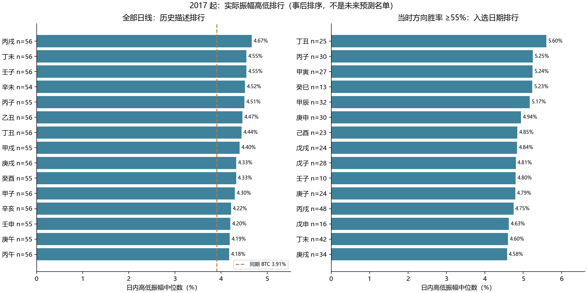
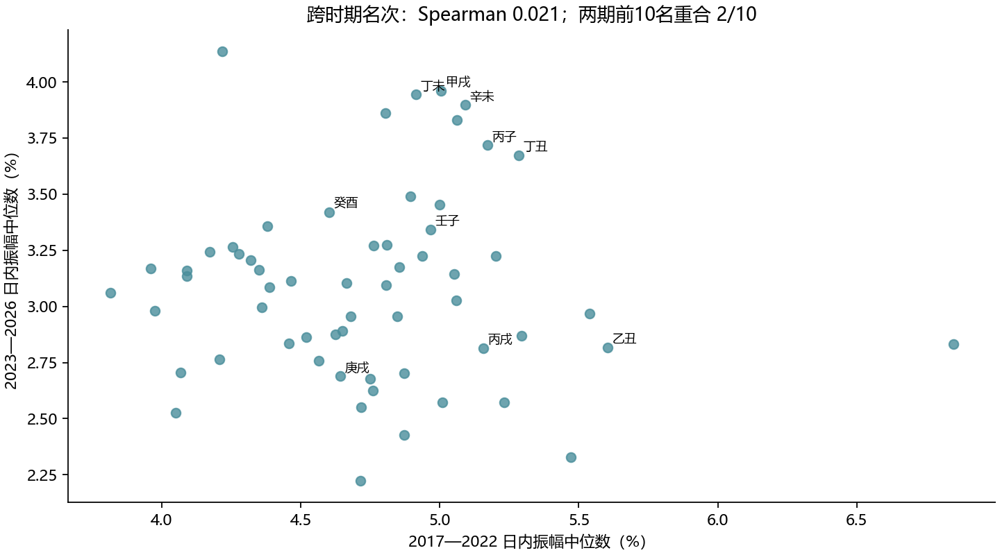

# jiexu-btc｜2017 起流日日内振幅排行与滚动回测

[全部排行与附表](RANKINGS.md) · [复现方法](REPRODUCE.md) · [全历史60干支排序 CSV](results/ranking_history_all_oc.csv) · [滚动55%筛选排序 CSV](results/ranking_rolling55_oc.csv) · [按平均振幅排序 CSV](results/ranking_rolling55_oc_by_mean.csv)

**结论 C：有历史高低差异，但未发现足够证据证明高振幅流日能提前、稳定识别。** 排行中的“高振幅”首先是实际历史分布的描述；是否能提前识别，另用滚动预测和控制波动环境后的检验回答，不能由名次本身推断。

## 1. 本次“从2017开始”的含义

使用同一份真实 Binance BTCUSDT 现货 UTC+8 日线，最新已收盘日为 **2026-10-20**。振幅本轮也使用 **2017 起全部有效历史**，用于回答扩展研究问题；没有更改正式系统“2017 起方向、2023 起强度”的配置。首根有效整日为 2017-08-18，共 3,348 根开收盘口径有效日线；昨收/共同有效集为 3,345 根。

主排序指标是 **日内振幅 = (最高−最低)÷开盘**。采用中位数降序作为“典型振幅”主排行，减少少数暴涨暴跌的影响；另给完整平均数降序名次，便于查看极端事件贡献。开收盘绝对收益、昨收绝对收益单独导出，绝不把它们当成日内高低振幅。

方向筛选沿用上次规则：每个历史日开始之前，以 2017 起已收盘同干支记录计算上涨/下跌频率，任一方向 ≥55% 才入选；平盘在分母，原始 Decimal 方向、整数比较 55%，不根据本轮结果调整门槛。名单随历史推进变化。

2017 年最初出现的同干支没有先前历史，不能虚构预测。简单模型至少有 30 根整体历史和 1 根同干支历史，首次可回测为 **2017-10-17**。复杂模型需先积累 90 根历史来生成特征，再有至少 180 个可训练特征样本，首次同模型比较为 **2018-05-17**。2017 初期只参与描述和后来训练，不能宣称全17模型已在上市第一天就做过预测。

| 方向筛选口径 | 简单模型起点 | 简单比较日数 | 入选日数 | 最少同干支训练 n | 17模型起点 | 共同日期 | 入选日期 |
| --- | --- | --- | --- | --- | --- | --- | --- |
| 收盘比开盘 | 2017-10-17 | 3285 | 2054 | 1 | 2018-05-17 | 3075 | 1883 |
| 收盘比昨收 | 2017-10-17 | 3285 | 2100 | 1 | 2018-05-17 | 3075 | 1932 |

## 2. 全部六十流日：历史典型振幅最高的前20名

同期普通 BTC 的日内振幅中位数为 **3.91%**，平均值为 **4.87%**。本表包含每个流日的全部有效日期，不做方向筛选，因此是最直接的全历史对照；两个方向筛选口径下的这张表相同。

| 名次 | 流日 | 样本 | 典型日内振幅 | 平均日内振幅 | 2023起典型振幅 | ≥10% 次数率 | 截至最新方向状态 |
| --- | --- | --- | --- | --- | --- | --- | --- |
| 1 | 丙戌 | 56 | 4.67% | 5.28% | 2.81% | 5.36% | 偏多 |
| 2 | 丁未 | 56 | 4.55% | 4.77% | 3.94% | 3.57% | 偏多 |
| 3 | 壬子 | 56 | 4.55% | 5.18% | 3.34% | 5.36% | 未达55% |
| 4 | 辛未 | 54 | 4.52% | 5.35% | 3.90% | 9.26% | 偏多 |
| 5 | 丙子 | 55 | 4.51% | 4.92% | 3.72% | 7.27% | 未达55% |
| 6 | 乙丑 | 56 | 4.47% | 5.77% | 2.82% | 14.29% | 偏多 |
| 7 | 丁丑 | 56 | 4.44% | 5.19% | 3.67% | 8.93% | 未达55% |
| 8 | 甲戌 | 55 | 4.40% | 5.38% | 3.96% | 10.91% | 偏多 |
| 9 | 庚戌 | 56 | 4.33% | 5.47% | 2.69% | 12.50% | 未达55% |
| 10 | 癸酉 | 55 | 4.33% | 5.14% | 3.42% | 10.91% | 偏多 |
| 11 | 甲子 | 56 | 4.30% | 4.88% | 2.87% | 8.93% | 偏空 |
| 12 | 辛亥 | 56 | 4.22% | 5.08% | 3.49% | 10.71% | 未达55% |
| 13 | 壬申 | 55 | 4.20% | 5.51% | 3.45% | 14.55% | 偏空 |
| 14 | 庚午 | 55 | 4.19% | 5.51% | 3.83% | 9.09% | 偏多 |
| 15 | 丙午 | 56 | 4.18% | 4.82% | 4.14% | 7.14% | 偏空 |
| 16 | 戊辰 | 55 | 4.17% | 5.37% | 3.23% | 10.91% | 未达55% |
| 17 | 己卯 | 56 | 4.14% | 4.53% | 3.22% | 3.57% | 偏多 |
| 18 | 丙辰 | 56 | 4.12% | 4.87% | 3.27% | 8.93% | 偏多 |
| 19 | 戊寅 | 56 | 4.11% | 4.97% | 3.09% | 7.14% | 偏多 |
| 20 | 甲辰 | 56 | 4.05% | 5.22% | 2.97% | 10.71% | 未达55% |

## 3. 按上次方式：当时方向胜率 ≥55% 的日期，振幅从高到低

这是本次要求的滚动筛选排行。**只汇总该流日在当时满足 ≥55% 的日期**，不是先用今天的胜率筛名单，再回看 2017 年。某流日可能在早期达标，后来不达标，因此历史排行靠前并不意味着现在仍入选。表中“2023起典型振幅”为该池内 2023 起的入选日期，空白表示没有这种样本。

### 收盘比开盘方向筛选：前20名

| 名次 | 流日 | 样本 | 典型日内振幅 | 平均日内振幅 | 2023起典型振幅 | ≥10% 次数率 | 截至最新方向状态 |
| --- | --- | --- | --- | --- | --- | --- | --- |
| 1 | 丁丑 | 25 | 5.60% | 6.72% | — | 20.00% | 未达55% |
| 2 | 丙子 | 30 | 5.25% | 6.02% | 7.01% | 13.33% | 未达55% |
| 3 | 甲寅 | 27 | 5.24% | 6.78% | 6.53% | 18.52% | 未达55% |
| 4 | 癸巳 | 13 | 5.23% | 5.35% | — | 15.38% | 未达55% |
| 5 | 甲辰 | 32 | 5.17% | 5.43% | 1.94% | 9.38% | 未达55% |
| 6 | 庚申 | 30 | 4.94% | 5.58% | 2.63% | 6.67% | 未达55% |
| 7 | 己酉 | 23 | 4.85% | 6.13% | — | 8.70% | 未达55% |
| 8 | 戊戌 | 24 | 4.84% | 4.76% | 3.59% | 4.17% | 未达55% |
| 9 | 戊子 | 28 | 4.81% | 5.45% | — | 10.71% | 未达55% |
| 10 | 壬子 | 10 | 4.80% | 6.18% | — | 10.00% | 未达55% |
| 11 | 庚子 | 24 | 4.79% | 6.55% | — | 16.67% | 未达55% |
| 12 | 丙戌 | 48 | 4.75% | 5.38% | 3.01% | 6.25% | 偏多 |
| 13 | 戊申 | 16 | 4.63% | 6.41% | — | 12.50% | 未达55% |
| 14 | 丁未 | 42 | 4.60% | 4.92% | 4.13% | 4.76% | 偏多 |
| 15 | 庚戌 | 34 | 4.58% | 6.37% | 3.41% | 14.71% | 未达55% |
| 16 | 丙午 | 15 | 4.55% | 5.35% | 4.64% | 13.33% | 偏空 |
| 17 | 乙卯 | 24 | 4.42% | 5.02% | 3.32% | 12.50% | 偏多 |
| 18 | 辛亥 | 38 | 4.36% | 5.05% | 3.49% | 7.89% | 未达55% |
| 19 | 乙丑 | 35 | 4.35% | 5.24% | 3.05% | 11.43% | 偏多 |
| 20 | 丁亥 | 19 | 4.29% | 5.26% | — | 10.53% | 未达55% |

### 收盘比昨收方向筛选：前20名

| 名次 | 流日 | 样本 | 典型日内振幅 | 平均日内振幅 | 2023起典型振幅 | ≥10% 次数率 | 截至最新方向状态 |
| --- | --- | --- | --- | --- | --- | --- | --- |
| 1 | 丁丑 | 25 | 5.60% | 6.72% | — | 20.00% | 未达55% |
| 2 | 丙子 | 30 | 5.25% | 6.02% | 7.01% | 13.33% | 未达55% |
| 3 | 甲寅 | 27 | 5.24% | 6.78% | 6.53% | 18.52% | 未达55% |
| 4 | 甲辰 | 32 | 5.17% | 5.43% | 1.94% | 9.38% | 未达55% |
| 5 | 庚申 | 30 | 4.94% | 5.58% | 2.63% | 6.67% | 未达55% |
| 6 | 己酉 | 23 | 4.85% | 6.13% | — | 8.70% | 未达55% |
| 7 | 戊戌 | 24 | 4.84% | 4.76% | 3.59% | 4.17% | 未达55% |
| 8 | 戊子 | 28 | 4.81% | 5.45% | — | 10.71% | 未达55% |
| 9 | 壬子 | 10 | 4.80% | 6.18% | — | 10.00% | 未达55% |
| 10 | 庚子 | 24 | 4.79% | 6.55% | — | 16.67% | 未达55% |
| 11 | 丙戌 | 48 | 4.75% | 5.38% | 3.01% | 6.25% | 偏多 |
| 12 | 戊申 | 16 | 4.63% | 6.41% | — | 12.50% | 未达55% |
| 13 | 丁未 | 42 | 4.60% | 4.92% | 4.13% | 4.76% | 偏多 |
| 14 | 庚戌 | 34 | 4.58% | 6.37% | 3.41% | 14.71% | 未达55% |
| 15 | 丙午 | 15 | 4.55% | 5.35% | 4.64% | 13.33% | 偏空 |
| 16 | 乙卯 | 24 | 4.42% | 5.02% | 3.32% | 12.50% | 偏多 |
| 17 | 辛亥 | 38 | 4.36% | 5.05% | 3.49% | 7.89% | 未达55% |
| 18 | 乙丑 | 35 | 4.35% | 5.24% | 3.05% | 11.43% | 偏多 |
| 19 | 丁亥 | 19 | 4.29% | 5.26% | — | 10.53% | 未达55% |
| 20 | 丙辰 | 53 | 4.27% | 4.94% | 3.12% | 9.43% | 偏多 |

早期每个干支只有 1—数根训练记录，观察到一次上涨就可能形成 100% 的历史上涨率；这会大量入选，却不代表胜率可靠。为避免把这种现象遗漏，另提供预先固定的训练 n≥10 和 n≥20 两种敏感性排行，保留原始 n≥1 主结果，没有挑选最有利版本。完整 60 干支及样本起止、四分位、最大值、开收/昨收幅度均在附表和 CSV。

## 4. 现在仍然达到55%的流日，历史振幅排行

这是截至最新收盘的当前描述池，只用于查看现在的名单，不参与历史预测。这里的样本包含该干支所有有效历史，而不是仅含过去曾经达标的日期。

| 名次 | 流日 | 样本 | 典型日内振幅 | 平均日内振幅 | 2023起典型振幅 | ≥10% 次数率 | 截至最新方向状态 |
| --- | --- | --- | --- | --- | --- | --- | --- |
| 1 | 丙戌 | 56 | 4.67% | 5.28% | 2.81% | 5.36% | 偏多 |
| 2 | 丁未 | 56 | 4.55% | 4.77% | 3.94% | 3.57% | 偏多 |
| 3 | 辛未 | 54 | 4.52% | 5.35% | 3.90% | 9.26% | 偏多 |
| 4 | 乙丑 | 56 | 4.47% | 5.77% | 2.82% | 14.29% | 偏多 |
| 5 | 甲戌 | 55 | 4.40% | 5.38% | 3.96% | 10.91% | 偏多 |
| 6 | 癸酉 | 55 | 4.33% | 5.14% | 3.42% | 10.91% | 偏多 |
| 7 | 甲子 | 56 | 4.30% | 4.88% | 2.87% | 8.93% | 偏空 |
| 8 | 壬申 | 55 | 4.20% | 5.51% | 3.45% | 14.55% | 偏空 |
| 9 | 庚午 | 55 | 4.19% | 5.51% | 3.83% | 9.09% | 偏多 |
| 10 | 丙午 | 56 | 4.18% | 4.82% | 4.14% | 7.14% | 偏空 |
| 11 | 己卯 | 56 | 4.14% | 4.53% | 3.22% | 3.57% | 偏多 |
| 12 | 丙辰 | 56 | 4.12% | 4.87% | 3.27% | 8.93% | 偏多 |
| 13 | 戊寅 | 56 | 4.11% | 4.97% | 3.09% | 7.14% | 偏多 |
| 14 | 丙申 | 56 | 3.99% | 5.01% | 2.63% | 8.93% | 偏多 |
| 15 | 庚辰 | 56 | 3.89% | 4.80% | 2.84% | 5.36% | 偏多 |
| 16 | 癸卯 | 56 | 3.87% | 5.59% | 3.86% | 10.71% | 偏多 |
| 17 | 己未 | 56 | 3.85% | 4.58% | 3.18% | 3.57% | 偏空 |
| 18 | 乙亥 | 55 | 3.84% | 5.30% | 2.83% | 10.91% | 偏多 |
| 19 | 壬戌 | 56 | 3.82% | 5.26% | 3.16% | 10.71% | 偏多 |
| 20 | 甲申 | 56 | 3.81% | 4.41% | 2.76% | 3.57% | 偏多 |

## 5. 按平均振幅排序：检查极端日是否改变名次

| 平均数名次 | 流日 | n | 平均振幅 | 中位振幅 | 最大单日振幅 | 去掉最大值后均值 | 最大值占总振幅 |
| --- | --- | --- | --- | --- | --- | --- | --- |
| 1 | 乙丑 | 56 | 5.77% | 4.47% | 18.92% | 5.53% | 5.85% |
| 2 | 癸卯 | 56 | 5.59% | 3.87% | 24.78% | 5.24% | 7.91% |
| 3 | 壬申 | 55 | 5.51% | 4.20% | 22.59% | 5.20% | 7.45% |
| 4 | 庚午 | 55 | 5.51% | 4.19% | 23.22% | 5.18% | 7.66% |
| 5 | 庚戌 | 56 | 5.47% | 4.33% | 29.57% | 5.03% | 9.66% |
| 6 | 甲戌 | 55 | 5.38% | 4.40% | 18.32% | 5.14% | 6.19% |
| 7 | 己巳 | 55 | 5.38% | 4.00% | 20.93% | 5.09% | 7.08% |
| 8 | 戊辰 | 55 | 5.37% | 4.17% | 26.62% | 4.98% | 9.01% |
| 9 | 辛未 | 54 | 5.35% | 4.52% | 22.52% | 5.03% | 7.79% |
| 10 | 乙卯 | 56 | 5.35% | 3.63% | 39.92% | 4.72% | 13.33% |
| 11 | 乙亥 | 55 | 5.30% | 3.84% | 16.71% | 5.09% | 5.73% |
| 12 | 丙戌 | 56 | 5.28% | 4.67% | 24.97% | 4.93% | 8.44% |
| 13 | 壬戌 | 56 | 5.26% | 3.82% | 20.38% | 4.98% | 6.92% |
| 14 | 甲辰 | 56 | 5.22% | 4.05% | 17.64% | 5.00% | 6.03% |
| 15 | 戊申 | 56 | 5.22% | 4.05% | 24.87% | 4.86% | 8.51% |

平均数排行反映“包含尾部的大幅波动贡献”，中位数反映“普通一次出现时的典型水平”，两者回答不同问题。去掉最大值仅是敏感性诊断，主结果没有删除任何真实极端行情；另外逐行提供分别删除2017、2020、2021、2022后的中位数，不能把这些事后删样本结果当可执行筛选。

## 6. 跨时期能否维持高振幅名次

将所有流日分成 2017—2022 与2023—2026两期，日内振幅中位数的 Spearman 名次相关为 **0.021**；两期前10名重合 **2/10**。两期的 BTC 波动环境不同，绝对振幅整体下降，所以不能把早期5%直接当作今天的预期。该分期对比是描述性稳定性诊断，不是重新选择表现最好的训练窗口。

## 7. 控制普通BTC波动环境后，哪些流日还突出

在17模型可比较的日期，使用事前发布的 F 模型预测（多尺度近期状态＋星期）作为基准，计算实际日内振幅÷F预测−1，再按日历年减去当年入选池的平均相对残差。这样避免某个干支只是碰巧更多落在高波动年份。年度分组均值用于事后关联检验，不能当成预测输入。

对两个筛选器的共 **120 项**逐干支关联比较一起 Holm 校正。年度聚类 t 区间是近似，尤其某干支出现年份少时功效有限。正向关联通过校正的项目数为 **0**；即使有关联，也必须继续通过下面的真正事前分组检验。

| 口径 | 流日 | 样本 | 实际平均振幅 | F事前平均预测 | 年份调整后超额比例 | 95%区间 | Holm p |
| --- | --- | --- | --- | --- | --- | --- | --- |
| 收盘比昨收 | 癸丑 | 19 | 5.02% | 4.73% | +22.569% | [-53.221%, +98.359%] | 1.0000 |
| 收盘比开盘 | 癸丑 | 19 | 5.02% | 4.73% | +22.548% | [-53.005%, +98.102%] | 1.0000 |
| 收盘比开盘 | 丁未 | 38 | 4.59% | 4.48% | +21.533% | [-22.015%, +65.081%] | 1.0000 |
| 收盘比昨收 | 丁未 | 38 | 4.59% | 4.48% | +21.266% | [-22.328%, +64.860%] | 1.0000 |
| 收盘比开盘 | 甲寅 | 24 | 6.62% | 5.41% | +18.101% | [-35.932%, +72.134%] | 1.0000 |
| 收盘比昨收 | 甲寅 | 24 | 6.62% | 5.41% | +17.947% | [-35.845%, +71.739%] | 1.0000 |
| 收盘比开盘 | 丙戌 | 44 | 4.89% | 4.21% | +17.736% | [-9.504%, +44.977%] | 1.0000 |
| 收盘比昨收 | 丙戌 | 44 | 4.89% | 4.21% | +17.647% | [-9.352%, +44.647%] | 1.0000 |
| 收盘比开盘 | 丁丑 | 22 | 6.52% | 5.67% | +16.139% | [+0.124%, +32.154%] | 1.0000 |
| 收盘比开盘 | 庚辰 | 24 | 4.30% | 4.32% | +15.779% | [-68.968%, +100.527%] | 1.0000 |
| 收盘比昨收 | 庚辰 | 24 | 4.30% | 4.32% | +15.764% | [-69.017%, +100.545%] | 1.0000 |
| 收盘比昨收 | 丁丑 | 22 | 6.52% | 5.67% | +15.757% | [-0.346%, +31.861%] | 1.0000 |
| 收盘比开盘 | 乙丑 | 33 | 4.97% | 4.61% | +15.196% | [-3.823%, +34.214%] | 1.0000 |
| 收盘比昨收 | 乙丑 | 33 | 4.97% | 4.61% | +15.123% | [-3.942%, +34.188%] | 1.0000 |
| 收盘比开盘 | 辛亥 | 36 | 5.01% | 4.70% | +14.032% | [-32.521%, +60.586%] | 1.0000 |
| 收盘比昨收 | 辛亥 | 36 | 5.01% | 4.70% | +13.738% | [-32.955%, +60.432%] | 1.0000 |
| 收盘比开盘 | 壬戌 | 40 | 5.12% | 4.55% | +13.319% | [-6.900%, +33.538%] | 1.0000 |
| 收盘比昨收 | 壬戌 | 40 | 5.12% | 4.55% | +13.140% | [-7.255%, +33.535%] | 1.0000 |
| 收盘比开盘 | 庚午 | 51 | 5.06% | 4.71% | +12.808% | [-18.420%, +44.035%] | 1.0000 |
| 收盘比开盘 | 庚戌 | 31 | 5.34% | 4.96% | +12.665% | [-27.050%, +52.379%] | 1.0000 |

这里的“超额比例”是相对 F 所预测振幅的比例差，不是 BTC 收益率百分点，也不表示能赚到同等利润。

## 8. 真正事前选“高波动流日”，之后是否更高

每日只用此前365个自然日已经产生的诚实 F 预测及真实结果，估计60干支各自的“实际/F预测”比例，按20个样本向整体收缩；60组均至少有5个过去预测后才发布名单。事前取前10组，固定规则不搜索前5/前15等版本，再看当天是否落在这个名单。之后才用当日真实振幅评分，绝不使用本报告的事后排行作为历史预测名单。

| 方向口径 | 指标 | 检验起点 | 前10组实际日数 | 其他组实际日数 | 前10组均值 | 其他组均值 | 差值 | 95%区间 | Holm p |
| --- | --- | --- | --- | --- | --- | --- | --- | --- | --- |
| 收盘比开盘 | actual_range | 2019-03-14 | 281 | 1347 | 4.42% | 4.62% | -0.201% | [-0.547%, +0.149%] | 1.0000 |
| 收盘比开盘 | relative_excess_over_F | 2019-03-14 | 281 | 1347 | -2.91% | -0.41% | -2.500% | [-9.540%, +5.221%] | 1.0000 |
| 收盘比昨收 | actual_range | 2019-03-14 | 285 | 1389 | 4.44% | 4.64% | -0.195% | [-0.533%, +0.152%] | 1.0000 |
| 收盘比昨收 | relative_excess_over_F | 2019-03-14 | 285 | 1389 | -2.57% | -0.32% | -2.243% | [-9.200%, +5.377%] | 1.0000 |

原始振幅更高可能是市场状态更高；相对 F 的超额比例才是是否超越近期波动基准的关键。置信区间在原始自然日日历上做60日区块配对重抽样，同时重抽两个池的指示与结果；源无效日仍保留零权重，未将相隔数月的同干支日期压缩成连续日。4个比较一起校正。

## 9. 与上次相同的17模型比较：起点前移后的结果

全部11个目标分别回测，模型、时间窗口、月度拟合及训练内部顺序验证沿用上次协议；本轮重新生成早期预测，不把2021起缓存冒充2017起结果。E在C上增加干支，G在F上增加干支，是最重要的独立增量比较。F_retro/G_retro使用最终宏观公布日，只能作为条件性分析；仓库缺少历史事前公告版本。

| 口径 | 目标 | 比较 | n | MSE/Brier相对改善 | 95%区间 | Holm p |
| --- | --- | --- | --- | --- | --- | --- |
| 收盘比开盘 | abs_oc | E 对 C | 1883 | -0.070% | [-0.231%, +0.081%] | 1.0000 |
| 收盘比开盘 | abs_oc | G 对 F | 1883 | -0.078% | [-0.278%, +0.101%] | 1.0000 |
| 收盘比开盘 | abs_cc | E 对 C | 1883 | -0.068% | [-0.228%, +0.083%] | 1.0000 |
| 收盘比开盘 | abs_cc | G 对 F | 1883 | -0.084% | [-0.286%, +0.096%] | 1.0000 |
| 收盘比开盘 | range | E 对 C | 1883 | -0.099% | [-0.430%, +0.176%] | 1.0000 |
| 收盘比开盘 | range | G 对 F | 1883 | -0.109% | [-0.501%, +0.221%] | 1.0000 |
| 收盘比开盘 | range5 | E 对 C | 1883 | -0.032% | [-0.357%, +0.322%] | 1.0000 |
| 收盘比开盘 | range5 | G 对 F | 1883 | -0.190% | [-0.620%, +0.240%] | 1.0000 |
| 收盘比开盘 | range10 | E 对 C | 1883 | -0.498% | [-1.021%, -0.049%] | 1.0000 |
| 收盘比开盘 | range10 | G 对 F | 1883 | -0.388% | [-0.873%, +0.026%] | 1.0000 |
| 收盘比昨收 | abs_oc | E 对 C | 1932 | -0.103% | [-0.292%, +0.070%] | 1.0000 |
| 收盘比昨收 | abs_oc | G 对 F | 1932 | -0.114% | [-0.338%, +0.088%] | 1.0000 |
| 收盘比昨收 | abs_cc | E 对 C | 1932 | -0.100% | [-0.287%, +0.072%] | 1.0000 |
| 收盘比昨收 | abs_cc | G 对 F | 1932 | -0.121% | [-0.350%, +0.082%] | 1.0000 |
| 收盘比昨收 | range | E 对 C | 1932 | -0.149% | [-0.471%, +0.107%] | 1.0000 |
| 收盘比昨收 | range | G 对 F | 1932 | -0.168% | [-0.548%, +0.147%] | 1.0000 |
| 收盘比昨收 | range5 | E 对 C | 1932 | -0.126% | [-0.455%, +0.217%] | 1.0000 |
| 收盘比昨收 | range5 | G 对 F | 1932 | -0.299% | [-0.759%, +0.145%] | 1.0000 |
| 收盘比昨收 | range10 | E 对 C | 1932 | -0.463% | [-0.971%, -0.036%] | 1.0000 |
| 收盘比昨收 | range10 | G 对 F | 1932 | -0.372% | [-0.854%, +0.038%] | 1.0000 |

连续目标表中改善是 MSE；RMSE 改善另外记录于CSV，不能把两个百分比混用。主176项比较一起 Holm 校正；14/180日区块敏感性、全部MAE/RMSE/Brier/Log Loss/AUC/AP及逐年表现保留。简单模型2017起结果与17模型共同起点结果分开，不跨不同日期直接排优劣。

| 区块 | 全部显著有利项 | E−C/G−F显著有利项 |
| --- | --- | --- |
| 14 | 9 | 0 |
| 60 | 6 | 0 |
| 180 | 5 | 0 |

## 10. 应怎样使用这份排序

本次可明确指出历史上哪些流日振幅较大，并提供全部降序清单；但“特别突出”若指可提前重复预测，需要控制状态、样本量、多重比较和事前排序。当前判断为 **C：有历史高低差异，但未发现足够证据证明高振幅流日能提前、稳定识别**。本轮正向逐干支关联有 0 项，事前分组的状态调整后显著正差异有 0 项，主同等模型显著正改善有 0 项，三者不得互相替代。

继续在已看过的历史上追加排序属于探索研究，没有新的未使用确认期。范围扩到2017也会增加早期巨大振幅和低样本筛选的影响。某流日的高低价差不等于可实现方向收益，不能据此声称有交易盈利；没有模拟不存在的入场出场成交。本次只新增研究文件，正式日历、API和统计逻辑未修改。

## 11. 实际验证与交付

| 核验项目 | 实际结果 |
| --- | --- |
| status | PASS |
| unit_tests | 12 |
| scalar_gate_checks | 6690 |
| ranking_rows_checked | 547 |
| true_target_prediction_rows | 936375 |
| score_rows_checked | 891 |
| all_exante_top10_lists_checked | 2775 |
| source_sha256 | 40e6cf1d0176722a9a9fbb7cf2f95e6badd06e171ad3280d13b22130bf0fcc30 |
| production_changes | False |

数据和源代码输入哈希见 manifest.json；逐日筛选、完整逐日预测、各目标模型指标、全60干支排序和敏感性结果均可复现。方法参考：[滚动时间序列交叉验证](https://otexts.com/fpp3/tscv.html)。所有数值来自本次实际执行。
