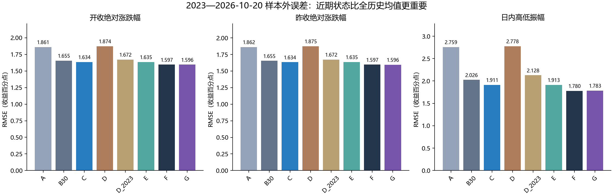
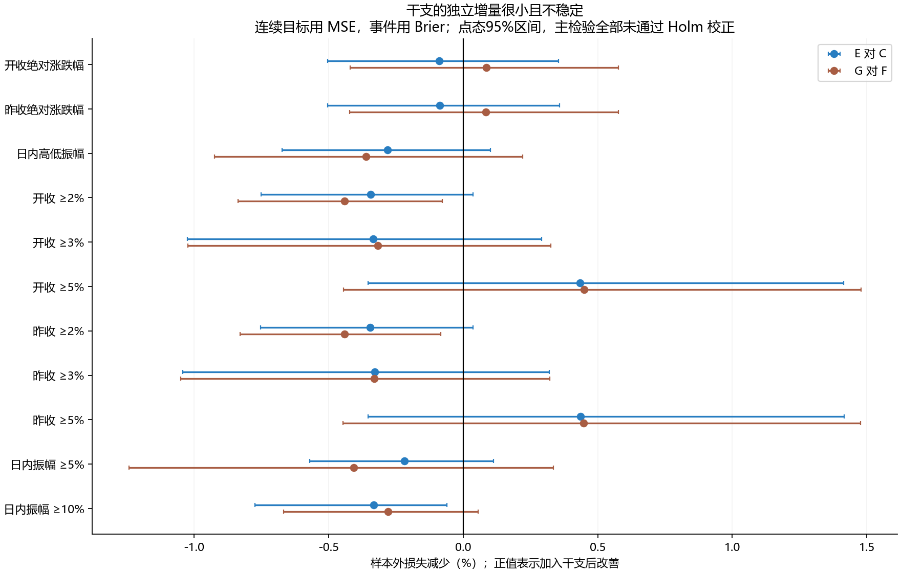
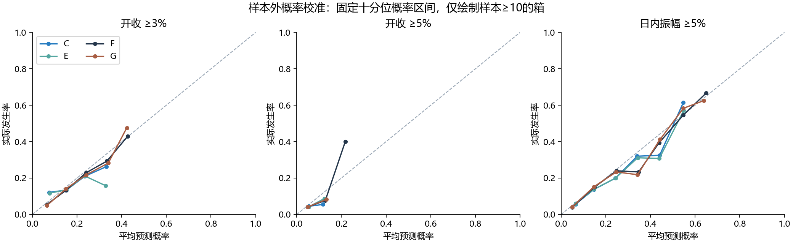

# jiexu-btc｜六十甲子与 BTC 波动强度独立研究报告

**结论分类：C——目前无法证明干支日具有独立的波动预测价值，不建议据此继续开发预测模型。**

研究仅新增独立代码、数据快照、测试和报告。正式日历、API、现有干支统计及生产运行环境没有修改。方向 EV 不属于本轮研究目标，没有将方向胜率与幅度中位数混合计算。

[六十干支完整附表](GANZHI_APPENDIX.html) · [60 行统计 CSV](results/sixty_ganzhi_statistics.csv) · [模型对比 CSV](results/model_comparison.csv) · [复现与文件说明](REPRODUCE.html)

## 1. 研究结论与实际改善幅度

不同干支的历史平均幅度、事件比例确实有可见差异，但这些差异没有超出本轮保留波动聚集的置换检验可解释的随机范围。控制近期波动与星期后，干支修正没有提供可靠的样本外增量。

C 表示近期波动状态模型，F 表示加入已知星期信息的基准。**宏观历史预告版本不全：严格F/G主版本未使用最终公布日，宏观日期只在明确标记的条件性对照中使用。**

最重要的结果来自加入干支前后的同基准比较：E 对 C、G 对 F，而不是只看 E 是否超过全历史或30日均值。主区间为 2023-01-01 至 2026-10-20，共 **1,389 天**；扩展区间 2021-01-01 至同日，共 **2,119 天**。

| 目标 | C | E= C+干支 | E 改善 | F | G= F+干支 | G 改善 |
| --- | --- | --- | --- | --- | --- | --- |
| 开收绝对涨跌幅 | 1.6339% | 1.6346% | -0.044% | 1.5965% | 1.5958% | +0.043% |
| 昨收绝对涨跌幅 | 1.6344% | 1.6351% | -0.043% | 1.5967% | 1.5960% | +0.042% |
| 日内高低振幅 | 1.9108% | 1.9135% | -0.140% | 1.7800% | 1.7833% | -0.180% |
| 开收 ≥2% | 0.205915 | 0.206625 | -0.344% | 0.197135 | 0.198004 | -0.441% |
| 开收 ≥3% | 0.130374 | 0.130809 | -0.334% | 0.126125 | 0.126525 | -0.317% |
| 开收 ≥5% | 0.045786 | 0.045588 | +0.434% | 0.045643 | 0.045438 | +0.450% |
| 昨收 ≥2% | 0.205927 | 0.206639 | -0.345% | 0.197145 | 0.198014 | -0.441% |
| 昨收 ≥3% | 0.130381 | 0.130809 | -0.328% | 0.126395 | 0.126811 | -0.330% |
| 昨收 ≥5% | 0.045786 | 0.045586 | +0.436% | 0.045643 | 0.045438 | +0.448% |
| 日内振幅 ≥5% | 0.125648 | 0.125923 | -0.219% | 0.118793 | 0.119277 | -0.407% |
| 日内振幅 ≥10% | 0.014821 | 0.014870 | -0.332% | 0.014950 | 0.014991 | -0.278% |

连续目标表中使用 RMSE，事件目标使用 Brier，均越低越好；改善为相对减少百分比，负值表示变差。**E 对 C 和 G 对 F 的所有主检验，经 88 项 Holm 校正后均未显著。**

开收绝对幅度的 G 相对 F，RMSE 仅降低约 0.043%；日内振幅反而增加约 0.180%。5% 开收大行情的 Brier 小幅改善约 0.450%，但 2%、3% 档变差，且5%改善未获得统计确认。不能把这项小幅有利结果单独宣传为干支有效。

历史排名与真正验证的排名不同：60 个干支中，没有一个通过本研究的样本外分组验证标准。附表仍完整列出历史排名和所有检验，不把排名最高者写成“未来高波动日”。

## 2. 数据核对与有效性

仓库远端为 Lammmmm/jiexu-btc，本地正式代码基线 304628df3ee37eea3b63bdbe85592c13c22db52e。行情来源为仓库 Binance BTCUSDT 现货日线，按 Asia/Shanghai（UTC+8）自然日；干支标签直接使用本地历法数据库，验证每日按 60 循环。实际可用起点是 **2017-08-18**，没有补造 2017 年 1 月行情。

冻结原始记录 3353 根，包含上市首日与尚未完成的 2026-10-21；最新完整日线为 **2026-10-20**。研究全部使用这份固定快照，后续行情自动更新不改变此次结果。快照 SHA-256：40e6cf1d0176722a9a9fbb7cf2f95e6badd06e171ad3280d13b22130bf0fcc30。

| 规则 | 有效全历史 | 2023年以来 | 首/末有效日 |
| --- | --- | --- | --- |
| oc | 3348 | 1389 | 2017-08-18 → 2026-10-20 |
| cc | 3345 | 1389 | 2017-08-18 → 2026-10-20 |
| common | 3345 | 1389 | 2017-08-18 → 2026-10-20 |

oc 为开收与日内振幅的自身有效规则，cc 为昨收规则，common 是二者交集。排除上市日、未收盘日，以及源收盘时间异常的 2018-02-08、2020-02-19、2020-12-21；昨收口径另排除上述异常日的下一日。

**所有模型和所有目标的训练、测试采用 common 规则**，避免某个模型多用几条异常附近数据。历史描述附表保留各目标自身有效规则，所以开收/振幅全历史样本比 common 多 3 条；这三条都早于主测试区间。每条预测保留当时同干支全历史样本数、2023年以来样本数、干支残差训练样本数及训练收盘上界。

已与正式服务逐干支核对有效样本和 2/3/5% 原始门槛计数，840 项核对通过。研究进程只读正式数据库。

## 3. 目标、信息时点和模型定义

三个连续目标分别为 |C/O−1|、|C/Cprev−1|、(H−L)/O。百分比仅用于显示，程序内部用小数。开收和昨收分别建立模型，不互相替代。

事件目标为开收和昨收各自的绝对涨跌 ≥2%、≥3%、≥5%，以及独立的日内振幅 ≥5%、≥10%。门槛从原始十进制价格计算，使用 Decimal 判断，不使用显示四舍五入后的数值。收盘大行情和日内极端振幅从未混成一类。

这是提前预测当日波动的研究，不是开盘成交交易回测。主预测在目标日 00:00 发出，只能使用此前收盘时间严格早于该时刻的完整日线，通常可以使用 d−1。没有使用当日 O/H/L/C、成交量、当日宏观结果或之后价格作为输入。若真实部署要求收到日线后再计算，可稍延迟发出预警；本研究不声称日界线零延迟成交。最初方案曾考虑前日23:59，首次计算前已书面澄清为日界线信息集，初版协议保留。

基础状态特征包括过去已知幅度的上一日、7/14/30/90 日均值，近期日内振幅7/30日均值、开收绝对幅度7/30日均值；事件模型另使用平滑后的近期事件比例。目标历史窗口内无效日直接排除，不填造价格。星期几为预先已知的日历信息。

C/F 参数每月滚动重估，使用过去1095个公历日的训练标签，每天更新输入状态；每次在历史最后252条可用记录上做3段顺序验证，选择正则强度1/10/100。连续模型拟合 log(幅度+1e−6)，用训练期残差的 smearing 因子还原条件均值；概率模型用正则 logistic 回归。连续预测均值主要用 RMSE/MSE 检验，MAE同时报告，不能仅凭MAE判断均值预测有效。

| 模型 | 内容 |
| --- | --- |
| A | 所有已知历史的无条件均值/事件基准 |
| B30 | 过去30个公历日平均幅度；概率采用Beta(1,1)平滑 |
| C7/C14/C90/C365 | 固定7/14/90/365日近期基准 |
| Cewma | 14日半衰期指数近期基准 |
| C | 多时间尺度近期波动状态模型 |
| D_raw | 各干支独立全历史统计；概率有Beta(1,1)平滑 |
| D | 各干支全历史统计，向同窗口整体均值收缩20个伪样本 |
| D_2023 | 2023年以来同干支统计，向2023年以来整体均值收缩20；初期整体不足30条时回退D |
| E30 | B30 + 从历史预测残差学习的干支修正 |
| E | C + 从历史预测残差学习的干支修正 |
| F | 近期状态 + 星期；严格主版本的宏观历史预告缺失，未冒用最终公布日 |
| G | F + 干支修正 |
| F_retro / G_retro | 加入最终CPI/非农日期的条件性对照，仅作回顾敏感性 |

E/G 的干支效应来自过去真正发出过的基础预测与之后实际幅度之间的偏差，不使用当前模型在训练集上的拟合残差。连续修正做样本收缩并减去整体偏差；概率修正在 logit 空间估计并按历史频数居中，避免把一般校准改善冒称为干支作用。

干支正则强度20/60/180/关闭，在过去的3段顺序验证中选择。允许关闭；同损失时优先关闭。选择、效应拟合与窗口都只使用当时已收盘的标签。早期用于建立诚实残差的回溯预测从2018年7月开始，2017—2020年没有冒充主测试结果。每个目标/模型共享全部测试日，没有按事后表现筛选干支或删日期。

## 4. CPI、非农与严格历史版本的限制

**这是本研究最重要的数据限制。** 仓库经济日历是2026年抓取的最终发布日期和未来日程，不是逐年留存的历史预告快照。最终某日确实公布，不等于该日期在历史预测时就可提前确认；延期、取消和特殊日程会使这种区别真实存在。

核对后，在已完成行情范围内，没有一条“抓取时已是未来日程、且抓取早于该日开始”的可证明提前已知事件记录。因此主 F/G 使用近期波动与星期，不把未证实的宏观预告当成零事件，更不把最终发布日期悄悄塞进严格主预测。**完整的历史宏观日历 F/G 可执行检验，在现有仓库数据下尚无法确认。**

为尽可能控制混淆，另做两种明确不同用途的分析：历史关联检验可以条件化最终已知的 CPI/非农日期，因为它只解释历史关联；F_retro/G_retro 则用这些日期训练和评分，作为“假设这些日期当时都能提前获知”的条件性敏感性。后者不进入17模型中的可部署主模型结论，也不能替代真正的日程版本数据。它同样没有产生可靠干支增量。

如将来继续宏观风险预警，应先积累带有抓取时间、修改时间、原计划日期和实际日期的历史日程版本；当前结果不能宣称已经彻底验证了真实宏观预警能力。

## 5. 全部模型：幅度预测与排序

### 开收绝对涨跌幅

| 模型 | 测试日 | MAE | RMSE | RMSE相对B30改善 | Spearman | 前10%预测日实际均幅 | 前10%幅度提升倍数 |
| --- | --- | --- | --- | --- | --- | --- | --- |
| A | 1389 | 1.5673% | 1.8606% | -12.44% | -0.037 | 1.89% | 1.16 |
| B30 | 1389 | 1.1931% | 1.6548% | +0.00% | 0.131 | 1.74% | 1.07 |
| C7 | 1389 | 1.2298% | 1.7165% | -3.73% | 0.126 | 1.89% | 1.16 |
| C14 | 1389 | 1.2090% | 1.6822% | -1.66% | 0.144 | 1.84% | 1.13 |
| C90 | 1389 | 1.1903% | 1.6490% | +0.35% | 0.097 | 1.66% | 1.01 |
| C365 | 1389 | 1.2269% | 1.6539% | +0.05% | -0.038 | 1.71% | 1.05 |
| Cewma | 1389 | 1.1806% | 1.6418% | +0.79% | 0.147 | 1.86% | 1.14 |
| C | 1389 | 1.1825% | 1.6339% | +1.26% | 0.164 | 2.06% | 1.26 |
| D | 1389 | 1.5803% | 1.8740% | -13.25% | -0.009 | 1.76% | 1.08 |
| D_raw | 1389 | 1.5926% | 1.8928% | -14.38% | -0.006 | 1.79% | 1.09 |
| D_2023 | 1389 | 1.2385% | 1.6723% | -1.06% | -0.037 | 1.56% | 0.95 |
| E30 | 1389 | 1.1986% | 1.6567% | -0.11% | 0.128 | 1.86% | 1.14 |
| E | 1389 | 1.1862% | 1.6346% | +1.22% | 0.159 | 2.06% | 1.26 |
| F | 1389 | 1.1247% | 1.5965% | +3.52% | 0.279 | 2.19% | 1.34 |
| G | 1389 | 1.1265% | 1.5958% | +3.56% | 0.277 | 2.23% | 1.37 |
| F_retro | 1389 | 1.1256% | 1.5980% | +3.43% | 0.278 | 2.21% | 1.35 |
| G_retro | 1389 | 1.1283% | 1.5982% | +3.42% | 0.274 | 2.22% | 1.36 |

### 昨收绝对涨跌幅

| 模型 | 测试日 | MAE | RMSE | RMSE相对B30改善 | Spearman | 前10%预测日实际均幅 | 前10%幅度提升倍数 |
| --- | --- | --- | --- | --- | --- | --- | --- |
| A | 1389 | 1.5691% | 1.8622% | -12.53% | -0.037 | 1.89% | 1.16 |
| B30 | 1389 | 1.1931% | 1.6548% | +0.00% | 0.131 | 1.74% | 1.07 |
| C7 | 1389 | 1.2298% | 1.7165% | -3.73% | 0.126 | 1.89% | 1.16 |
| C14 | 1389 | 1.2090% | 1.6822% | -1.66% | 0.144 | 1.84% | 1.13 |
| C90 | 1389 | 1.1903% | 1.6490% | +0.35% | 0.097 | 1.66% | 1.01 |
| C365 | 1389 | 1.2269% | 1.6539% | +0.05% | -0.038 | 1.71% | 1.05 |
| Cewma | 1389 | 1.1806% | 1.6418% | +0.79% | 0.147 | 1.86% | 1.14 |
| C | 1389 | 1.1832% | 1.6344% | +1.23% | 0.162 | 2.06% | 1.26 |
| D | 1389 | 1.5821% | 1.8753% | -13.32% | -0.009 | 1.75% | 1.07 |
| D_raw | 1389 | 1.5942% | 1.8938% | -14.44% | -0.005 | 1.77% | 1.08 |
| D_2023 | 1389 | 1.2386% | 1.6722% | -1.05% | -0.037 | 1.56% | 0.95 |
| E30 | 1389 | 1.1986% | 1.6567% | -0.11% | 0.128 | 1.86% | 1.14 |
| E | 1389 | 1.1868% | 1.6351% | +1.19% | 0.158 | 2.06% | 1.26 |
| F | 1389 | 1.1249% | 1.5967% | +3.51% | 0.279 | 2.20% | 1.35 |
| G | 1389 | 1.1268% | 1.5960% | +3.55% | 0.277 | 2.23% | 1.37 |
| F_retro | 1389 | 1.1257% | 1.5983% | +3.42% | 0.278 | 2.21% | 1.35 |
| G_retro | 1389 | 1.1285% | 1.5985% | +3.41% | 0.274 | 2.24% | 1.37 |

### 日内高低振幅

| 模型 | 测试日 | MAE | RMSE | RMSE相对B30改善 | Spearman | 前10%预测日实际均幅 | 前10%幅度提升倍数 |
| --- | --- | --- | --- | --- | --- | --- | --- |
| A | 1389 | 2.4044% | 2.7592% | -36.21% | 0.041 | 3.87% | 1.11 |
| B30 | 1389 | 1.4183% | 2.0257% | +0.00% | 0.336 | 4.30% | 1.24 |
| C7 | 1389 | 1.4069% | 1.9933% | +1.60% | 0.404 | 4.97% | 1.43 |
| C14 | 1389 | 1.4156% | 2.0186% | +0.35% | 0.377 | 4.58% | 1.32 |
| C90 | 1389 | 1.4680% | 2.0615% | -1.77% | 0.218 | 3.77% | 1.08 |
| C365 | 1389 | 1.5446% | 2.0962% | -3.48% | 0.051 | 3.87% | 1.11 |
| Cewma | 1389 | 1.3944% | 1.9893% | +1.80% | 0.361 | 4.60% | 1.32 |
| C | 1389 | 1.3646% | 1.9108% | +5.67% | 0.449 | 5.19% | 1.49 |
| D | 1389 | 2.4156% | 2.7777% | -37.12% | 0.037 | 3.72% | 1.07 |
| D_raw | 1389 | 2.4265% | 2.7998% | -38.21% | 0.035 | 3.75% | 1.08 |
| D_2023 | 1389 | 1.5495% | 2.1278% | -5.04% | 0.022 | 3.59% | 1.03 |
| E30 | 1389 | 1.4271% | 2.0344% | -0.43% | 0.327 | 4.29% | 1.23 |
| E | 1389 | 1.3682% | 1.9135% | +5.54% | 0.447 | 5.17% | 1.49 |
| F | 1389 | 1.2162% | 1.7800% | +12.13% | 0.613 | 5.55% | 1.60 |
| G | 1389 | 1.2192% | 1.7833% | +11.97% | 0.610 | 5.44% | 1.56 |
| F_retro | 1389 | 1.2170% | 1.7813% | +12.07% | 0.612 | 5.54% | 1.59 |
| G_retro | 1389 | 1.2206% | 1.7845% | +11.91% | 0.610 | 5.43% | 1.56 |

高波动排序不只看平均误差，还看预测最高10%日期是否实际更剧烈。该10%是同一测试区间内按预测分数分配的统一评估配额，用于公平比较排序，未用实际结果挑选；它不是可事先知道整个未来区间分数分位点的交易规则。在线阈值的独立结果见后文。

## 6. 全部模型：大行情概率预测

### 开收 ≥2%；实际发生 412 / 1389（29.66%）

| 模型 | Brier | Log Loss | ROC-AUC | PR-AUC(AP) | 校准ECE | 最高10%预警发生率 | 捕获全部事件比例 |
| --- | --- | --- | --- | --- | --- | --- | --- |
| A | 0.225161 | 0.64307 | 0.486 | 0.278 | 12.54% | 26.62% | 8.98% |
| B30 | 0.212218 | 0.61690 | 0.547 | 0.322 | 5.42% | 32.37% | 10.92% |
| C7 | 0.222169 | 0.63989 | 0.553 | 0.327 | 8.99% | 35.97% | 12.14% |
| C14 | 0.216610 | 0.62762 | 0.544 | 0.325 | 7.85% | 37.41% | 12.62% |
| C90 | 0.209217 | 0.60949 | 0.547 | 0.317 | 2.77% | 28.78% | 9.71% |
| C365 | 0.210881 | 0.61315 | 0.500 | 0.295 | 4.16% | 30.22% | 10.19% |
| Cewma | 0.209387 | 0.60946 | 0.559 | 0.330 | 3.12% | 33.09% | 11.17% |
| C | 0.205915 | 0.60143 | 0.579 | 0.354 | 1.72% | 36.69% | 12.38% |
| D | 0.227543 | 0.64768 | 0.499 | 0.292 | 12.65% | 26.62% | 8.98% |
| D_raw | 0.230579 | 0.65378 | 0.501 | 0.294 | 13.13% | 28.78% | 9.71% |
| D_2023 | 0.214339 | 0.62180 | 0.483 | 0.283 | 5.78% | 25.18% | 8.50% |
| E30 | 0.212671 | 0.61804 | 0.545 | 0.324 | 5.55% | 34.53% | 11.65% |
| E | 0.206625 | 0.60323 | 0.573 | 0.353 | 1.87% | 38.13% | 12.86% |
| F | 0.197135 | 0.57774 | 0.650 | 0.402 | 1.00% | 44.60% | 15.05% |
| G | 0.198004 | 0.57984 | 0.646 | 0.398 | 1.58% | 44.60% | 15.05% |
| F_retro | 0.197775 | 0.57882 | 0.646 | 0.396 | 1.55% | 43.88% | 14.81% |
| G_retro | 0.198502 | 0.58064 | 0.642 | 0.394 | 1.97% | 43.17% | 14.56% |

### 开收 ≥3%；实际发生 217 / 1389（15.62%）

| 模型 | Brier | Log Loss | ROC-AUC | PR-AUC(AP) | 校准ECE | 最高10%预警发生率 | 捕获全部事件比例 |
| --- | --- | --- | --- | --- | --- | --- | --- |
| A | 0.148709 | 0.47965 | 0.528 | 0.165 | 13.05% | 19.42% | 12.44% |
| B30 | 0.134153 | 0.44003 | 0.558 | 0.174 | 3.63% | 16.55% | 10.60% |
| C7 | 0.144886 | 0.46215 | 0.567 | 0.178 | 7.91% | 15.83% | 10.14% |
| C14 | 0.138564 | 0.44873 | 0.559 | 0.172 | 5.33% | 15.83% | 10.14% |
| C90 | 0.132531 | 0.43529 | 0.542 | 0.168 | 2.57% | 17.27% | 11.06% |
| C365 | 0.132529 | 0.43581 | 0.520 | 0.168 | 1.23% | 17.99% | 11.52% |
| Cewma | 0.133351 | 0.43594 | 0.565 | 0.177 | 3.07% | 17.99% | 11.52% |
| C | 0.130374 | 0.42873 | 0.589 | 0.217 | 2.32% | 25.18% | 16.13% |
| D | 0.150112 | 0.48197 | 0.520 | 0.170 | 13.15% | 19.42% | 12.44% |
| D_raw | 0.154211 | 0.49079 | 0.519 | 0.169 | 14.13% | 18.71% | 11.98% |
| D_2023 | 0.134954 | 0.44373 | 0.480 | 0.150 | 2.93% | 14.39% | 9.22% |
| E30 | 0.134360 | 0.44078 | 0.556 | 0.187 | 4.42% | 20.86% | 13.36% |
| E | 0.130809 | 0.43001 | 0.582 | 0.214 | 2.54% | 21.58% | 13.82% |
| F | 0.126125 | 0.41102 | 0.667 | 0.259 | 1.62% | 30.94% | 19.82% |
| G | 0.126525 | 0.41182 | 0.662 | 0.261 | 1.85% | 29.50% | 18.89% |
| F_retro | 0.126396 | 0.41171 | 0.664 | 0.255 | 1.69% | 30.22% | 19.35% |
| G_retro | 0.126655 | 0.41213 | 0.661 | 0.256 | 1.80% | 28.06% | 17.97% |

### 开收 ≥5%；实际发生 67 / 1389（4.82%）

| 模型 | Brier | Log Loss | ROC-AUC | PR-AUC(AP) | 校准ECE | 最高10%预警发生率 | 捕获全部事件比例 |
| --- | --- | --- | --- | --- | --- | --- | --- |
| A | 0.053625 | 0.23500 | 0.538 | 0.060 | 8.79% | 9.35% | 19.40% |
| B30 | 0.047721 | 0.20161 | 0.569 | 0.058 | 2.82% | 7.19% | 14.93% |
| C7 | 0.058333 | 0.24384 | 0.593 | 0.066 | 10.04% | 7.91% | 16.42% |
| C14 | 0.051197 | 0.21517 | 0.581 | 0.060 | 5.65% | 7.19% | 14.93% |
| C90 | 0.046467 | 0.19666 | 0.534 | 0.051 | 0.86% | 4.32% | 8.96% |
| C365 | 0.046041 | 0.19469 | 0.529 | 0.058 | 0.58% | 8.63% | 17.91% |
| Cewma | 0.047928 | 0.20367 | 0.584 | 0.062 | 3.95% | 4.32% | 8.96% |
| C | 0.045786 | 0.19261 | 0.604 | 0.083 | 1.54% | 7.91% | 16.42% |
| D | 0.054325 | 0.23594 | 0.544 | 0.069 | 8.85% | 7.19% | 14.93% |
| D_raw | 0.058369 | 0.24996 | 0.541 | 0.069 | 10.49% | 7.19% | 14.93% |
| D_2023 | 0.046742 | 0.19925 | 0.518 | 0.064 | 1.39% | 7.19% | 14.93% |
| E30 | 0.047550 | 0.20018 | 0.588 | 0.067 | 2.89% | 8.63% | 17.91% |
| E | 0.045588 | 0.19141 | 0.618 | 0.101 | 1.48% | 8.63% | 17.91% |
| F | 0.045643 | 0.18920 | 0.649 | 0.101 | 1.58% | 7.91% | 16.42% |
| G | 0.045438 | 0.18776 | 0.664 | 0.112 | 1.37% | 9.35% | 19.40% |
| F_retro | 0.045713 | 0.18960 | 0.645 | 0.096 | 1.53% | 7.19% | 14.93% |
| G_retro | 0.045532 | 0.18831 | 0.660 | 0.104 | 1.43% | 9.35% | 19.40% |

### 昨收 ≥2%；实际发生 412 / 1389（29.66%）

| 模型 | Brier | Log Loss | ROC-AUC | PR-AUC(AP) | 校准ECE | 最高10%预警发生率 | 捕获全部事件比例 |
| --- | --- | --- | --- | --- | --- | --- | --- |
| A | 0.224961 | 0.64267 | 0.486 | 0.278 | 12.46% | 26.62% | 8.98% |
| B30 | 0.212218 | 0.61690 | 0.547 | 0.322 | 5.42% | 32.37% | 10.92% |
| C7 | 0.222169 | 0.63989 | 0.553 | 0.327 | 8.99% | 35.97% | 12.14% |
| C14 | 0.216610 | 0.62762 | 0.544 | 0.325 | 7.85% | 37.41% | 12.62% |
| C90 | 0.209217 | 0.60949 | 0.547 | 0.317 | 2.77% | 28.78% | 9.71% |
| C365 | 0.210881 | 0.61315 | 0.500 | 0.295 | 4.16% | 30.22% | 10.19% |
| Cewma | 0.209387 | 0.60946 | 0.559 | 0.330 | 3.12% | 33.09% | 11.17% |
| C | 0.205927 | 0.60146 | 0.579 | 0.354 | 1.60% | 36.69% | 12.38% |
| D | 0.227461 | 0.64751 | 0.498 | 0.292 | 12.57% | 26.62% | 8.98% |
| D_raw | 0.230590 | 0.65380 | 0.501 | 0.294 | 13.06% | 28.78% | 9.71% |
| D_2023 | 0.214336 | 0.62179 | 0.483 | 0.284 | 5.78% | 25.18% | 8.50% |
| E30 | 0.212671 | 0.61804 | 0.545 | 0.324 | 5.55% | 34.53% | 11.65% |
| E | 0.206639 | 0.60326 | 0.573 | 0.353 | 1.87% | 38.13% | 12.86% |
| F | 0.197145 | 0.57776 | 0.650 | 0.402 | 0.94% | 44.60% | 15.05% |
| G | 0.198014 | 0.57985 | 0.645 | 0.398 | 1.59% | 44.60% | 15.05% |
| F_retro | 0.197967 | 0.57920 | 0.644 | 0.394 | 1.48% | 43.17% | 14.56% |
| G_retro | 0.198707 | 0.58105 | 0.640 | 0.392 | 1.93% | 42.45% | 14.32% |

### 昨收 ≥3%；实际发生 217 / 1389（15.62%）

| 模型 | Brier | Log Loss | ROC-AUC | PR-AUC(AP) | 校准ECE | 最高10%预警发生率 | 捕获全部事件比例 |
| --- | --- | --- | --- | --- | --- | --- | --- |
| A | 0.148810 | 0.47990 | 0.528 | 0.165 | 13.08% | 19.42% | 12.44% |
| B30 | 0.134153 | 0.44003 | 0.558 | 0.174 | 3.63% | 16.55% | 10.60% |
| C7 | 0.144886 | 0.46215 | 0.567 | 0.178 | 7.91% | 15.83% | 10.14% |
| C14 | 0.138564 | 0.44873 | 0.559 | 0.172 | 5.33% | 15.83% | 10.14% |
| C90 | 0.132531 | 0.43529 | 0.542 | 0.168 | 2.57% | 17.27% | 11.06% |
| C365 | 0.132565 | 0.43591 | 0.519 | 0.168 | 1.27% | 19.42% | 12.44% |
| Cewma | 0.133351 | 0.43594 | 0.565 | 0.177 | 3.07% | 17.99% | 11.52% |
| C | 0.130381 | 0.42877 | 0.589 | 0.217 | 2.47% | 25.18% | 16.13% |
| D | 0.150186 | 0.48215 | 0.521 | 0.170 | 13.18% | 19.42% | 12.44% |
| D_raw | 0.154275 | 0.49094 | 0.520 | 0.169 | 14.17% | 18.71% | 11.98% |
| D_2023 | 0.134938 | 0.44370 | 0.480 | 0.151 | 2.94% | 14.39% | 9.22% |
| E30 | 0.134349 | 0.44072 | 0.556 | 0.187 | 4.27% | 20.86% | 13.36% |
| E | 0.130809 | 0.43005 | 0.582 | 0.214 | 2.84% | 22.30% | 14.29% |
| F | 0.126395 | 0.41211 | 0.663 | 0.258 | 1.67% | 30.94% | 19.82% |
| G | 0.126811 | 0.41298 | 0.659 | 0.258 | 1.74% | 28.78% | 18.43% |
| F_retro | 0.126509 | 0.41241 | 0.662 | 0.256 | 1.74% | 30.94% | 19.82% |
| G_retro | 0.126859 | 0.41316 | 0.657 | 0.257 | 2.10% | 27.34% | 17.51% |

### 昨收 ≥5%；实际发生 67 / 1389（4.82%）

| 模型 | Brier | Log Loss | ROC-AUC | PR-AUC(AP) | 校准ECE | 最高10%预警发生率 | 捕获全部事件比例 |
| --- | --- | --- | --- | --- | --- | --- | --- |
| A | 0.053694 | 0.23529 | 0.538 | 0.060 | 8.83% | 9.35% | 19.40% |
| B30 | 0.047721 | 0.20161 | 0.569 | 0.058 | 2.82% | 7.19% | 14.93% |
| C7 | 0.058333 | 0.24384 | 0.593 | 0.066 | 10.04% | 7.91% | 16.42% |
| C14 | 0.051197 | 0.21517 | 0.581 | 0.060 | 5.65% | 7.19% | 14.93% |
| C90 | 0.046467 | 0.19666 | 0.534 | 0.051 | 0.86% | 4.32% | 8.96% |
| C365 | 0.046041 | 0.19469 | 0.529 | 0.058 | 0.58% | 8.63% | 17.91% |
| Cewma | 0.047928 | 0.20367 | 0.584 | 0.062 | 3.95% | 4.32% | 8.96% |
| C | 0.045786 | 0.19261 | 0.604 | 0.083 | 1.54% | 7.91% | 16.42% |
| D | 0.054391 | 0.23622 | 0.544 | 0.069 | 8.88% | 7.19% | 14.93% |
| D_raw | 0.058439 | 0.25024 | 0.541 | 0.069 | 10.53% | 7.19% | 14.93% |
| D_2023 | 0.046747 | 0.19927 | 0.518 | 0.064 | 1.39% | 7.19% | 14.93% |
| E30 | 0.047550 | 0.20018 | 0.588 | 0.067 | 2.89% | 8.63% | 17.91% |
| E | 0.045586 | 0.19141 | 0.618 | 0.101 | 1.48% | 8.63% | 17.91% |
| F | 0.045643 | 0.18920 | 0.649 | 0.101 | 1.58% | 7.91% | 16.42% |
| G | 0.045438 | 0.18776 | 0.664 | 0.112 | 1.37% | 9.35% | 19.40% |
| F_retro | 0.045713 | 0.18960 | 0.645 | 0.096 | 1.54% | 7.19% | 14.93% |
| G_retro | 0.045531 | 0.18831 | 0.660 | 0.104 | 1.43% | 9.35% | 19.40% |

### 日内振幅 ≥5%；实际发生 221 / 1389（15.91%）

| 模型 | Brier | Log Loss | ROC-AUC | PR-AUC(AP) | 校准ECE | 最高10%预警发生率 | 捕获全部事件比例 |
| --- | --- | --- | --- | --- | --- | --- | --- |
| A | 0.189069 | 0.56903 | 0.535 | 0.168 | 23.47% | 18.71% | 11.76% |
| B30 | 0.134199 | 0.43626 | 0.612 | 0.210 | 3.01% | 21.58% | 13.57% |
| C7 | 0.138380 | 0.44443 | 0.636 | 0.247 | 7.58% | 30.22% | 19.00% |
| C14 | 0.134598 | 0.43368 | 0.642 | 0.231 | 4.83% | 30.22% | 19.00% |
| C90 | 0.133770 | 0.43620 | 0.580 | 0.184 | 3.51% | 18.71% | 11.76% |
| C365 | 0.136787 | 0.44678 | 0.510 | 0.167 | 2.53% | 18.71% | 11.76% |
| Cewma | 0.131468 | 0.42767 | 0.634 | 0.231 | 3.06% | 25.90% | 16.29% |
| C | 0.125648 | 0.40936 | 0.686 | 0.305 | 2.14% | 35.97% | 22.62% |
| D | 0.191000 | 0.57237 | 0.538 | 0.172 | 23.66% | 15.83% | 9.95% |
| D_raw | 0.194850 | 0.57983 | 0.538 | 0.171 | 24.20% | 15.11% | 9.50% |
| D_2023 | 0.138116 | 0.45045 | 0.486 | 0.152 | 3.81% | 12.95% | 8.14% |
| E30 | 0.134946 | 0.43847 | 0.608 | 0.210 | 2.90% | 17.99% | 11.31% |
| E | 0.125923 | 0.41003 | 0.685 | 0.305 | 2.11% | 34.53% | 21.72% |
| F | 0.118793 | 0.38391 | 0.748 | 0.377 | 1.93% | 45.32% | 28.51% |
| G | 0.119277 | 0.38523 | 0.746 | 0.368 | 2.28% | 45.32% | 28.51% |
| F_retro | 0.118987 | 0.38454 | 0.746 | 0.376 | 2.32% | 44.60% | 28.05% |
| G_retro | 0.119575 | 0.38611 | 0.744 | 0.366 | 2.60% | 46.76% | 29.41% |

### 日内振幅 ≥10%；实际发生 21 / 1389（1.51%）

| 模型 | Brier | Log Loss | ROC-AUC | PR-AUC(AP) | 校准ECE | 最高10%预警发生率 | 捕获全部事件比例 |
| --- | --- | --- | --- | --- | --- | --- | --- |
| A | 0.022111 | 0.13795 | 0.617 | 0.030 | 8.50% | 3.60% | 23.81% |
| B30 | 0.016323 | 0.09468 | 0.482 | 0.015 | 3.03% | 0.72% | 4.76% |
| C7 | 0.027704 | 0.16124 | 0.548 | 0.018 | 10.78% | 3.60% | 23.81% |
| C14 | 0.019458 | 0.11753 | 0.528 | 0.016 | 6.06% | 2.88% | 19.05% |
| C90 | 0.015155 | 0.08297 | 0.507 | 0.017 | 1.12% | 2.16% | 14.29% |
| C365 | 0.014931 | 0.07865 | 0.603 | 0.031 | 0.75% | 2.88% | 19.05% |
| Cewma | 0.017027 | 0.10263 | 0.467 | 0.017 | 4.28% | 2.16% | 14.29% |
| C | 0.014821 | 0.07586 | 0.733 | 0.101 | 1.17% | 4.32% | 28.57% |
| D | 0.022705 | 0.13848 | 0.621 | 0.026 | 8.56% | 2.88% | 19.05% |
| D_raw | 0.026761 | 0.15662 | 0.616 | 0.026 | 10.37% | 3.60% | 23.81% |
| D_2023 | 0.015382 | 0.08292 | 0.580 | 0.044 | 1.25% | 2.88% | 19.05% |
| E30 | 0.016337 | 0.09480 | 0.461 | 0.016 | 3.04% | 0.72% | 4.76% |
| E | 0.014870 | 0.07606 | 0.732 | 0.101 | 1.14% | 4.32% | 28.57% |
| F | 0.014950 | 0.07677 | 0.725 | 0.101 | 1.10% | 5.04% | 33.33% |
| G | 0.014991 | 0.07692 | 0.727 | 0.101 | 1.12% | 5.04% | 33.33% |
| F_retro | 0.015354 | 0.07879 | 0.712 | 0.042 | 1.17% | 4.32% | 28.57% |
| G_retro | 0.015417 | 0.07899 | 0.714 | 0.041 | 1.19% | 3.60% | 23.81% |

PR-AUC 主列使用 Average Precision（阶梯式 PR 面积），另外保存梯形积分版本。ECE 是固定10个概率区间的诊断，对样本量和分箱敏感；不能把 ECE 最小等同于最好的概率模型。Brier和Log Loss同时衡量概率质量；未报告“几乎全猜没有大行情”的普通准确率来冒充成功。

极端日内振幅≥10%在主区间只有21次，各干支通常0—2次；5%开收大行情也只有67次。这种频率不足以支持稳定的逐干支概率排名。

## 7. 干支增量的配对检验与置信区间

主检验为同日、同目标的损失差：3个连续目标各检验MSE/MAE，8个概率目标各检验Brier/Log Loss，共22个端点；4组比较为 E30 对 B30、E 对 B30、E 对 C、G 对 F，共88项一起Holm校正。

采用60日循环区块bootstrap，20,000次；同一次重采样对全部模型共享相同日期，保留一段时间的波动聚集。双侧检验使用中心化的配对损失差，最小Monte Carlo p=1/20,001，未报告伪零p。另用14/180日区块各10,000次检查敏感性。区块假设不能消除BTC长期非平稳，故同时报告逐年、环境和训练剔除检验。

| 目标 | 比较 | 损失减少 | 95%点态区间¹ | Holm p |
| --- | --- | --- | --- | --- |
| 开收绝对涨跌幅 | E / B30 | +2.423% | [+0.128%, +4.909%] | 1.0000 |
| 开收绝对涨跌幅 | E / C | -0.089% | [-0.504%, +0.354%] | 1.0000 |
| 开收绝对涨跌幅 | G / F | +0.087% | [-0.420%, +0.577%] | 1.0000 |
| 昨收绝对涨跌幅 | E / B30 | +2.370% | [+0.100%, +4.848%] | 1.0000 |
| 昨收绝对涨跌幅 | E / C | -0.086% | [-0.503%, +0.357%] | 1.0000 |
| 昨收绝对涨跌幅 | G / F | +0.084% | [-0.422%, +0.577%] | 1.0000 |
| 日内高低振幅 | E / B30 | +10.778% | [+5.891%, +16.432%] | 0.0425 |
| 日内高低振幅 | E / C | -0.280% | [-0.672%, +0.101%] | 1.0000 |
| 日内高低振幅 | G / F | -0.361% | [-0.924%, +0.222%] | 1.0000 |
| 开收 ≥2% | E / B30 | +2.636% | [+0.804%, +4.625%] | 0.4875 |
| 开收 ≥2% | E / C | -0.344% | [-0.752%, +0.037%] | 1.0000 |
| 开收 ≥2% | G / F | -0.441% | [-0.836%, -0.078%] | 1.0000 |
| 开收 ≥3% | E / B30 | +2.492% | [+0.777%, +4.236%] | 0.3476 |
| 开收 ≥3% | E / C | -0.334% | [-1.024%, +0.291%] | 1.0000 |
| 开收 ≥3% | G / F | -0.317% | [-1.023%, +0.325%] | 1.0000 |
| 开收 ≥5% | E / B30 | +4.472% | [+2.200%, +6.924%] | 0.0304 |
| 开收 ≥5% | E / C | +0.434% | [-0.354%, +1.414%] | 1.0000 |
| 开收 ≥5% | G / F | +0.450% | [-0.445%, +1.478%] | 1.0000 |
| 昨收 ≥2% | E / B30 | +2.629% | [+0.798%, +4.619%] | 0.4921 |
| 昨收 ≥2% | E / C | -0.345% | [-0.753%, +0.037%] | 1.0000 |
| 昨收 ≥2% | G / F | -0.441% | [-0.829%, -0.082%] | 1.0000 |
| 昨收 ≥3% | E / B30 | +2.492% | [+0.771%, +4.247%] | 0.3783 |
| 昨收 ≥3% | E / C | -0.328% | [-1.042%, +0.319%] | 1.0000 |
| 昨收 ≥3% | G / F | -0.330% | [-1.049%, +0.323%] | 1.0000 |
| 昨收 ≥5% | E / B30 | +4.474% | [+2.200%, +6.933%] | 0.0304 |
| 昨收 ≥5% | E / C | +0.436% | [-0.353%, +1.415%] | 1.0000 |
| 昨收 ≥5% | G / F | +0.448% | [-0.446%, +1.477%] | 1.0000 |
| 日内振幅 ≥5% | E / B30 | +6.167% | [+2.758%, +10.322%] | 0.3000 |
| 日内振幅 ≥5% | E / C | -0.219% | [-0.571%, +0.113%] | 1.0000 |
| 日内振幅 ≥5% | G / F | -0.407% | [-1.242%, +0.335%] | 1.0000 |
| 日内振幅 ≥10% | E / B30 | +8.901% | [+4.037%, +14.341%] | 0.1037 |
| 日内振幅 ≥10% | E / C | -0.332% | [-0.774%, -0.059%] | 1.0000 |
| 日内振幅 ≥10% | G / F | -0.278% | [-0.668%, +0.055%] | 1.0000 |

¹ 区间是配对平均损失差除以参考模型实测平均损失的归一化表示；连续使用MSE，不是RMSE相对区间。区间未做同时校正，显著性判断以Holm p为准。

E对B30有少数显著改善，但C本身已经比B30更好，加入干支的E通常没有比C更好；把“更好的近期状态模型”带来的进步算给干支，是错误归因。E对C、G对F的全部主端点均未通过校正。14/180日区块与2021起扩展检验也未提供可靠的独立干支改善。

ROC-AUC与PR-AP另有32项探索性配对区块检验和区间，同样没有通过自身Holm校正。它们不替代主损失指标，也不把个别有利的排序数字当作确认性成功。

| 目标 | 比较 | ROC-AUC变化 | ROC 95%区间 | AP变化 | AP 95%区间 |
| --- | --- | --- | --- | --- | --- |
| 开收 ≥2% | E / C | -0.0060 | [-0.0128, +0.0000] | -0.0017 | [-0.0122, +0.0072] |
| 开收 ≥2% | G / F | -0.0045 | [-0.0091, -0.0005] | -0.0042 | [-0.0122, +0.0036] |
| 开收 ≥3% | E / C | -0.0066 | [-0.0176, +0.0041] | -0.0030 | [-0.0133, +0.0114] |
| 开收 ≥3% | G / F | -0.0045 | [-0.0136, +0.0031] | +0.0015 | [-0.0179, +0.0168] |
| 开收 ≥5% | E / C | +0.0140 | [-0.0094, +0.0411] | +0.0185 | [-0.0011, +0.0503] |
| 开收 ≥5% | G / F | +0.0156 | [-0.0035, +0.0382] | +0.0112 | [-0.0144, +0.0310] |
| 昨收 ≥2% | E / C | -0.0060 | [-0.0128, -0.0000] | -0.0017 | [-0.0122, +0.0072] |
| 昨收 ≥2% | G / F | -0.0045 | [-0.0090, -0.0005] | -0.0043 | [-0.0122, +0.0035] |
| 昨收 ≥3% | E / C | -0.0071 | [-0.0182, +0.0036] | -0.0028 | [-0.0131, +0.0115] |
| 昨收 ≥3% | G / F | -0.0041 | [-0.0131, +0.0033] | -0.0001 | [-0.0199, +0.0169] |
| 昨收 ≥5% | E / C | +0.0141 | [-0.0093, +0.0411] | +0.0185 | [-0.0012, +0.0503] |
| 昨收 ≥5% | G / F | +0.0154 | [-0.0038, +0.0381] | +0.0112 | [-0.0144, +0.0310] |
| 日内振幅 ≥5% | E / C | -0.0004 | [-0.0051, +0.0045] | -0.0006 | [-0.0077, +0.0058] |
| 日内振幅 ≥5% | G / F | -0.0021 | [-0.0071, +0.0032] | -0.0085 | [-0.0232, +0.0058] |
| 日内振幅 ≥10% | E / C | -0.0008 | [-0.0050, +0.0021] | +0.0001 | [-0.0016, +0.0033] |
| 日内振幅 ≥10% | G / F | +0.0020 | [-0.0035, +0.0108] | -0.0000 | [-0.0027, +0.0023] |

## 8. 相同预警比例能多识别多少大行情

下表各模型均选取同一批测试日中预测概率最高的10%，共139天；20%配额为278天。相同分数用与结果无关、对所有模型一致的日期哈希打破平局，避免某个模型因平局处理多报警。实际发生率与召回率都来自未来真实结果。

| 事件 | 预警比例 | C发生率 | E发生率 | F发生率 | G发生率 | F召回 | G召回 |
| --- | --- | --- | --- | --- | --- | --- | --- |
| 开收 ≥2% | 10% | 36.69% | 38.13% | 44.60% | 44.60% | 15.05% | 15.05% |
| 开收 ≥2% | 20% | 37.05% | 35.61% | 43.88% | 42.45% | 29.61% | 28.64% |
| 开收 ≥3% | 10% | 25.18% | 21.58% | 30.94% | 29.50% | 19.82% | 18.89% |
| 开收 ≥3% | 20% | 23.74% | 22.66% | 28.06% | 26.98% | 35.94% | 34.56% |
| 开收 ≥5% | 10% | 7.91% | 8.63% | 7.91% | 9.35% | 16.42% | 19.40% |
| 开收 ≥5% | 20% | 8.27% | 8.63% | 8.99% | 9.71% | 37.31% | 40.30% |
| 昨收 ≥2% | 10% | 36.69% | 38.13% | 44.60% | 44.60% | 15.05% | 15.05% |
| 昨收 ≥2% | 20% | 37.05% | 35.25% | 43.88% | 42.45% | 29.61% | 28.64% |
| 昨收 ≥3% | 10% | 25.18% | 22.30% | 30.94% | 28.78% | 19.82% | 18.43% |
| 昨收 ≥3% | 20% | 23.74% | 22.66% | 27.70% | 27.34% | 35.48% | 35.02% |
| 昨收 ≥5% | 10% | 7.91% | 8.63% | 7.91% | 9.35% | 16.42% | 19.40% |
| 昨收 ≥5% | 20% | 8.27% | 8.63% | 8.99% | 9.71% | 37.31% | 40.30% |
| 日内振幅 ≥5% | 10% | 35.97% | 34.53% | 45.32% | 45.32% | 28.51% | 28.51% |
| 日内振幅 ≥5% | 20% | 29.14% | 29.86% | 33.45% | 32.37% | 42.08% | 40.72% |
| 日内振幅 ≥10% | 10% | 4.32% | 4.32% | 5.04% | 5.04% | 33.33% | 33.33% |
| 日内振幅 ≥10% | 20% | 4.32% | 3.96% | 4.68% | 4.68% | 61.90% | 61.90% |

例如3%开收大行情，F的最高10%预警日实际发生率30.94%，加入干支后的G为29.50%，反而少识别2个事件。5%开收大行情则由7.91%变为9.35%，只多识别2个事件；该档共67次，不能据此确认稳定改善。日内振幅≥5%的最高10%预警发生率，F/G同为45.32%。

另采用可实际提前执行的分位阈值：每一天只与该模型过去365日已发出预测的80/90分位比较；阈值不依赖未来预测或未来结果。因为市场环境变化，实际报警比例不会恰好10%或20%，因此同时报告真实比例，不能把它和固定配额混称。

| 事件 | 模型 | 历史阈值名义10% | 实际报警比例 | 报警日发生率 | 总体发生率 | 事件召回 |
| --- | --- | --- | --- | --- | --- | --- |
| 开收 ≥2% | C | 90分位 | 8.35% | 42.24% | 29.66% | 11.89% |
| 开收 ≥2% | E | 90分位 | 8.21% | 36.84% | 29.66% | 10.19% |
| 开收 ≥2% | F | 90分位 | 9.58% | 47.37% | 29.66% | 15.29% |
| 开收 ≥2% | G | 90分位 | 10.22% | 44.37% | 29.66% | 15.29% |
| 开收 ≥3% | C | 90分位 | 8.14% | 28.32% | 15.62% | 14.75% |
| 开收 ≥3% | E | 90分位 | 7.70% | 26.17% | 15.62% | 12.90% |
| 开收 ≥3% | F | 90分位 | 8.93% | 29.84% | 15.62% | 17.05% |
| 开收 ≥3% | G | 90分位 | 8.86% | 29.27% | 15.62% | 16.59% |
| 开收 ≥5% | C | 90分位 | 6.55% | 7.69% | 4.82% | 10.45% |
| 开收 ≥5% | E | 90分位 | 6.12% | 15.29% | 4.82% | 19.40% |
| 开收 ≥5% | F | 90分位 | 8.42% | 10.26% | 4.82% | 17.91% |
| 开收 ≥5% | G | 90分位 | 8.06% | 11.61% | 4.82% | 19.40% |
| 日内振幅 ≥5% | C | 90分位 | 8.93% | 36.29% | 15.91% | 20.36% |
| 日内振幅 ≥5% | E | 90分位 | 9.07% | 37.30% | 15.91% | 21.27% |
| 日内振幅 ≥5% | F | 90分位 | 8.35% | 47.41% | 15.91% | 24.89% |
| 日内振幅 ≥5% | G | 90分位 | 9.14% | 45.67% | 15.91% | 26.24% |
| 日内振幅 ≥10% | C | 90分位 | 8.86% | 4.88% | 1.51% | 28.57% |
| 日内振幅 ≥10% | E | 90分位 | 9.14% | 4.72% | 1.51% | 28.57% |
| 日内振幅 ≥10% | F | 90分位 | 9.22% | 6.25% | 1.51% | 38.10% |
| 日内振幅 ≥10% | G | 90分位 | 9.65% | 5.97% | 1.51% | 38.10% |

### 干支模型明显抬高风险的日期，未来是否兑现

另外预先定义相对明显的抬高：事件概率较基础模型增加至少5个百分点；连续幅度预测增加至少20%。以发出的预测本身选择日期，再观察真实结果，未按真实结果筛选。

3%开收事件中，G比F抬高至少5个百分点的44天，G平均预测约34.76%，F约27.46%，真实只发生22.73%，没有兑现额外风险。5%档只有13天，实际15.38%，G预测18.91%，F预测12.59%；只有2次事件，样本过少。日内振幅≥10%主版本根本没有符合5个百分点抬高的日期。完整所有目标见 elevated_ganzhi_predictions.json，零样本项明确为空，不给伪准确率。

## 9. 历史差异与保留波动聚集的置换

不能随机逐日打乱行情，因为那会破坏波动聚集，夸大证据；也不能把整个60日序列平移一个固定相位，因为这主要只是给60个干支重新命名，整体组间差异会保持不变。

主关联检验先控制年份、近期多尺度波动状态、星期以及实际CPI/非农公布日，再检验加入59个独立干支对比能解释多少剩余变化。这里的最终宏观日期只作**回顾控制变量**，没有当作严格预测输入。之后在每个公历年内分别做随机循环旋转残差，保留该年分布和绝大部分局部波动聚集，打破不同年份之间固定干支相位的对应；9999次。另用年内14/28日区块重排各1999次检查稳健性。

两个时期×11目标共22项关联检验一起Holm校正。需要90条已知历史来构造近期状态，因此全历史条件检验从2017年稍晚日期开始，共3255天；历史描述表仍使用实际最早有效数据。置换是条件交换性假设下的近似，无法保证任意非平稳过程下精确有效，因此预测验证才是核心。

| 时期 | 目标 | 样本数 | 干支部分R² | 旋转p | Holm p |
| --- | --- | --- | --- | --- | --- |
| all | 开收绝对涨跌幅 | 3255 | 1.95% | 0.3272 | 1.0000 |
| all | 昨收绝对涨跌幅 | 3255 | 1.96% | 0.2837 | 1.0000 |
| all | 日内高低振幅 | 3255 | 1.70% | 0.4948 | 1.0000 |
| all | 开收 ≥2% | 3255 | 1.77% | 0.5806 | 1.0000 |
| all | 开收 ≥3% | 3255 | 1.76% | 0.5255 | 1.0000 |
| all | 开收 ≥5% | 3255 | 1.86% | 0.3100 | 1.0000 |
| all | 昨收 ≥2% | 3255 | 1.79% | 0.5616 | 1.0000 |
| all | 昨收 ≥3% | 3255 | 1.77% | 0.4842 | 1.0000 |
| all | 昨收 ≥5% | 3255 | 1.83% | 0.3309 | 1.0000 |
| all | 日内振幅 ≥5% | 3255 | 1.68% | 0.6265 | 1.0000 |
| all | 日内振幅 ≥10% | 3255 | 1.49% | 0.7955 | 1.0000 |
| 2023 | 开收绝对涨跌幅 | 1389 | 4.08% | 0.7602 | 1.0000 |
| 2023 | 昨收绝对涨跌幅 | 1389 | 3.99% | 0.7981 | 1.0000 |
| 2023 | 日内高低振幅 | 1389 | 3.87% | 0.7219 | 1.0000 |
| 2023 | 开收 ≥2% | 1389 | 3.45% | 0.9365 | 1.0000 |
| 2023 | 开收 ≥3% | 1389 | 3.70% | 0.8760 | 1.0000 |
| 2023 | 开收 ≥5% | 1389 | 4.15% | 0.5351 | 1.0000 |
| 2023 | 昨收 ≥2% | 1389 | 3.40% | 0.9469 | 1.0000 |
| 2023 | 昨收 ≥3% | 1389 | 3.63% | 0.8959 | 1.0000 |
| 2023 | 昨收 ≥5% | 1389 | 4.20% | 0.5405 | 1.0000 |
| 2023 | 日内振幅 ≥5% | 1389 | 3.56% | 0.8781 | 1.0000 |
| 2023 | 日内振幅 ≥10% | 1389 | 3.64% | 0.7735 | 1.0000 |

所有主关联检验均未显著；14/28日区块敏感性也没有提供通过校正的关联证据。59个自由干支对比本来就会在样本内解释一些噪声；例如近期样本部分R²约3%—4%，不能把这个拟合比例直接叫作预测能力。

历史上每个干支全历史只有54—56条有效日线，2023年以来只有23—24条。近期3%大行情率的历史组别范围可从约4.35%到30.43%，5%率可从0到16.67%，看起来很大，但分母仅约23，少一两次就会改变排名。年度匹配的组别差异区间采用年度聚类t近似，再对60×11×2=1320项做Holm/BH校正，没有可靠显著的干支。

年度簇只有约4个的近期区间非常不精确，年与年之间也可能相关。这些区间是历史均值差的研究性不确定性描述，不是未来单日波动的预测区间，也不证明“干支绝对没有任何效应”。

### 历史高波动排行示例（不能当作已验证预警名单）

| 时期 | 指标 | 历史名次 | 干支 | 样本 | 平均幅度 | 中位数 | 普通BTC均值 |
| --- | --- | --- | --- | --- | --- | --- | --- |
| all | 开收绝对涨跌幅 | 1 | 庚戌 | 56 | 3.13% | 1.45% | 2.30% |
| all | 开收绝对涨跌幅 | 2 | 戊申 | 56 | 2.99% | 1.75% | 2.30% |
| all | 开收绝对涨跌幅 | 3 | 乙丑 | 56 | 2.99% | 1.95% | 2.30% |
| all | 开收绝对涨跌幅 | 4 | 壬申 | 55 | 2.94% | 1.46% | 2.30% |
| all | 开收绝对涨跌幅 | 5 | 戊辰 | 55 | 2.92% | 1.75% | 2.30% |
| all | 日内高低振幅 | 1 | 乙丑 | 56 | 5.77% | 4.47% | 4.87% |
| all | 日内高低振幅 | 2 | 癸卯 | 56 | 5.59% | 3.87% | 4.87% |
| all | 日内高低振幅 | 3 | 壬申 | 55 | 5.51% | 4.20% | 4.87% |
| all | 日内高低振幅 | 4 | 庚午 | 55 | 5.51% | 4.19% | 4.87% |
| all | 日内高低振幅 | 5 | 庚戌 | 56 | 5.47% | 4.33% | 4.87% |
| 2023 | 开收绝对涨跌幅 | 1 | 庚午 | 23 | 2.46% | 1.24% | 1.63% |
| 2023 | 开收绝对涨跌幅 | 2 | 壬申 | 23 | 2.30% | 1.29% | 1.63% |
| 2023 | 开收绝对涨跌幅 | 3 | 庚戌 | 23 | 2.26% | 1.30% | 1.63% |
| 2023 | 开收绝对涨跌幅 | 4 | 己卯 | 23 | 2.11% | 1.65% | 1.63% |
| 2023 | 开收绝对涨跌幅 | 5 | 戊申 | 23 | 2.10% | 1.66% | 1.63% |
| 2023 | 日内高低振幅 | 1 | 庚午 | 23 | 4.46% | 3.83% | 3.48% |
| 2023 | 日内高低振幅 | 2 | 甲戌 | 23 | 4.35% | 3.96% | 3.48% |
| 2023 | 日内高低振幅 | 3 | 壬申 | 23 | 4.18% | 3.45% | 3.48% |
| 2023 | 日内高低振幅 | 4 | 丁未 | 23 | 4.15% | 3.94% | 3.48% |
| 2023 | 日内高低振幅 | 5 | 辛未 | 23 | 4.13% | 3.90% | 3.48% |

## 10. 历史高波动干支能否在未来重复

追加一个直观的探索性留出检验：仅用2017—2022年已知行情，为每个目标锁定历史平均值最高的10个干支，然后在2023年之后不再换名单。这样“高风险名单”不会使用2023年之后的真实结果来挑选。

主表为高组和其余50干支的未来差异；另对实际减去F预测后的残差做同样比较，控制近期状态与星期。22项检验一起校正。该分析是在主规格之外补充的研究对照，不把其个别有利结果当新的确认性发现。

| 目标 | 高组未来样本 | 高组实际均值/率 | 其余实际均值/率 | 差异 | 95%差异区间 | Holm p |
| --- | --- | --- | --- | --- | --- | --- |
| 开收绝对涨跌幅 | 234 | 1.85% | 1.59% | +0.258% | [-0.013%, +0.537%] | 1.0000 |
| 昨收绝对涨跌幅 | 234 | 1.85% | 1.59% | +0.257% | [-0.013%, +0.537%] | 1.0000 |
| 日内高低振幅 | 232 | 3.52% | 3.47% | +0.052% | [-0.221%, +0.340%] | 1.0000 |
| 开收 ≥2% | 232 | 29.74% | 29.65% | +0.096% | [-4.762%, +4.756%] | 1.0000 |
| 开收 ≥3% | 233 | 16.74% | 15.40% | +1.340% | [-3.120%, +5.899%] | 1.0000 |
| 开收 ≥5% | 233 | 6.87% | 4.41% | +2.455% | [-0.937%, +6.176%] | 1.0000 |
| 昨收 ≥2% | 232 | 29.74% | 29.65% | +0.096% | [-4.762%, +4.756%] | 1.0000 |
| 昨收 ≥3% | 233 | 17.17% | 15.31% | +1.856% | [-2.785%, +6.507%] | 1.0000 |
| 昨收 ≥5% | 233 | 6.87% | 4.41% | +2.455% | [-0.937%, +6.176%] | 1.0000 |
| 日内振幅 ≥5% | 233 | 17.17% | 15.66% | +1.510% | [-2.882%, +6.123%] | 1.0000 |
| 日内振幅 ≥10% | 234 | 1.71% | 1.47% | +0.238% | [-1.384%, +2.058%] | 1.0000 |

5%开收档有一个值得保留的探索性数字：高组未来发生率6.87%，其余4.41%，差约2.46个百分点；但95%区间约为[−0.94，+6.18]个百分点，校正后p=1。它可以是后续假设，不能作为稳定的高风险名单。年份切片和固定名单保存于 heldout_pre2023_top10_yearly.json / heldout_pre2023_top10.json。

逐干支的E−C和G−F样本外损失差还单独做1320项校正，要求改善为正、至少3个主测试年份同向、样本≥15，事件目标还要求至少5次事件。**通过者为0。** 因而没有“真正通过验证的高波动干支排行”；附表把历史排名与验证状态分列，未强行排出未来赢家。

## 11. 跨年份、牛熊周期与稳健性

以下逐年表使用核心模型；全部17模型、全部目标和2021/2022扩展结果见 yearly_models.csv。2026年为截至10月20日的部分年份。

### 开收绝对涨跌幅

| 年 | 样本 | B30 | C | E | F | G | E改善 | G改善 |
| --- | --- | --- | --- | --- | --- | --- | --- | --- |
| 2023 | 365 | 1.9296% | 1.8899% | 1.8884% | 1.8695% | 1.8677% | +0.08% | +0.10% |
| 2024 | 366 | 1.6984% | 1.6985% | 1.6993% | 1.6287% | 1.6260% | -0.05% | +0.17% |
| 2025 | 365 | 1.4292% | 1.4118% | 1.4161% | 1.3993% | 1.4016% | -0.31% | -0.17% |
| 2026 | 293 | 1.4816% | 1.4558% | 1.4556% | 1.4059% | 1.4064% | +0.01% | -0.03% |

### 昨收绝对涨跌幅

| 年 | 样本 | B30 | C | E | F | G | E改善 | G改善 |
| --- | --- | --- | --- | --- | --- | --- | --- | --- |
| 2023 | 365 | 1.9297% | 1.8906% | 1.8891% | 1.8702% | 1.8684% | +0.08% | +0.10% |
| 2024 | 366 | 1.6984% | 1.6986% | 1.6994% | 1.6289% | 1.6260% | -0.05% | +0.17% |
| 2025 | 365 | 1.4292% | 1.4117% | 1.4161% | 1.3989% | 1.4014% | -0.31% | -0.18% |
| 2026 | 293 | 1.4816% | 1.4574% | 1.4572% | 1.4059% | 1.4063% | +0.01% | -0.03% |

### 日内高低振幅

| 年 | 样本 | B30 | C | E | F | G | E改善 | G改善 |
| --- | --- | --- | --- | --- | --- | --- | --- | --- |
| 2023 | 365 | 2.2425% | 2.1479% | 2.1484% | 2.0705% | 2.0704% | -0.02% | +0.00% |
| 2024 | 366 | 2.1605% | 2.0751% | 2.0783% | 1.9088% | 1.9129% | -0.16% | -0.21% |
| 2025 | 365 | 1.8486% | 1.7041% | 1.7109% | 1.5579% | 1.5663% | -0.40% | -0.54% |
| 2026 | 293 | 1.7610% | 1.6016% | 1.6016% | 1.4511% | 1.4521% | +0.00% | -0.06% |

### 开收 ≥2%

| 年 | 样本 | B30 | C | E | F | G | E改善 | G改善 |
| --- | --- | --- | --- | --- | --- | --- | --- | --- |
| 2023 | 365 | 0.182299 | 0.180346 | 0.181160 | 0.176783 | 0.177759 | -0.45% | -0.55% |
| 2024 | 366 | 0.249704 | 0.242326 | 0.243728 | 0.225528 | 0.226537 | -0.58% | -0.45% |
| 2025 | 365 | 0.208382 | 0.198032 | 0.198135 | 0.195713 | 0.195969 | -0.05% | -0.13% |
| 2026 | 293 | 0.207445 | 0.202107 | 0.202576 | 0.188793 | 0.190116 | -0.23% | -0.70% |

### 开收 ≥3%

| 年 | 样本 | B30 | C | E | F | G | E改善 | G改善 |
| --- | --- | --- | --- | --- | --- | --- | --- | --- |
| 2023 | 365 | 0.123833 | 0.119878 | 0.120030 | 0.116517 | 0.116743 | -0.13% | -0.19% |
| 2024 | 366 | 0.175584 | 0.168169 | 0.169572 | 0.159041 | 0.160231 | -0.83% | -0.75% |
| 2025 | 365 | 0.112069 | 0.112177 | 0.112275 | 0.111695 | 0.111798 | -0.09% | -0.09% |
| 2026 | 293 | 0.122764 | 0.118905 | 0.118905 | 0.114952 | 0.114952 | +0.00% | +0.00% |

### 开收 ≥5%

| 年 | 样本 | B30 | C | E | F | G | E改善 | G改善 |
| --- | --- | --- | --- | --- | --- | --- | --- | --- |
| 2023 | 365 | 0.048515 | 0.045893 | 0.045895 | 0.045873 | 0.045826 | -0.00% | +0.10% |
| 2024 | 366 | 0.069173 | 0.066836 | 0.066003 | 0.066039 | 0.065379 | +1.25% | +1.00% |
| 2025 | 365 | 0.023076 | 0.022564 | 0.022613 | 0.022909 | 0.022823 | -0.22% | +0.38% |
| 2026 | 293 | 0.050638 | 0.048289 | 0.048322 | 0.048201 | 0.048220 | -0.07% | -0.04% |

### 日内振幅 ≥5%

| 年 | 样本 | B30 | C | E | F | G | E改善 | G改善 |
| --- | --- | --- | --- | --- | --- | --- | --- | --- |
| 2023 | 365 | 0.115721 | 0.113117 | 0.113153 | 0.112779 | 0.112169 | -0.03% | +0.54% |
| 2024 | 366 | 0.187671 | 0.175763 | 0.176632 | 0.162671 | 0.164737 | -0.49% | -1.27% |
| 2025 | 365 | 0.110245 | 0.098582 | 0.098722 | 0.089719 | 0.090073 | -0.14% | -0.39% |
| 2026 | 293 | 0.120264 | 0.112375 | 0.112375 | 0.107694 | 0.107728 | +0.00% | -0.03% |

### 日内振幅 ≥10%

| 年 | 样本 | B30 | C | E | F | G | E改善 | G改善 |
| --- | --- | --- | --- | --- | --- | --- | --- | --- |
| 2023 | 365 | 0.025698 | 0.023985 | 0.024103 | 0.024197 | 0.024283 | -0.49% | -0.35% |
| 2024 | 366 | 0.014945 | 0.014632 | 0.014685 | 0.014686 | 0.014758 | -0.36% | -0.49% |
| 2025 | 365 | 0.012238 | 0.010555 | 0.010555 | 0.010723 | 0.010723 | +0.00% | +0.00% |
| 2026 | 293 | 0.011455 | 0.008956 | 0.008976 | 0.009025 | 0.009025 | -0.23% | +0.00% |

5%概率档有数年微小改善，2026又有所反转；3%档多数年份变差或干支效应被验证关闭。日内振幅的干支修正几乎没有跨年增益。2021起扩展区间，E−C/G−F主端点仍全部不显著，没有通过换测试起点得到稳定成功。

牛熊标签仅用预测时已知的最近收盘相对200日均线及90根有效日线收益（高于均线且>10%为牛，低于且<−10%为熊，其余震荡）。全部环境表现见 regime_models.csv；这是固定操作定义，没有用事后峰谷划分牛熊。

| 目标 | 环境 | 样本 | C | E | F | G | G相对F改善 |
| --- | --- | --- | --- | --- | --- | --- | --- |
| 开收绝对涨跌幅 | 牛 | 621 | 1.6933% | 1.6923% | 1.6470% | 1.6444% | +0.16% |
| 开收绝对涨跌幅 | 熊 | 331 | 1.4952% | 1.4958% | 1.4548% | 1.4549% | -0.00% |
| 开收绝对涨跌幅 | 震荡 | 437 | 1.6485% | 1.6518% | 1.6260% | 1.6275% | -0.10% |
| 日内高低振幅 | 牛 | 621 | 1.9454% | 1.9471% | 1.8068% | 1.8077% | -0.05% |
| 日内高低振幅 | 熊 | 331 | 1.7381% | 1.7423% | 1.5995% | 1.6031% | -0.22% |
| 日内高低振幅 | 震荡 | 437 | 1.9846% | 1.9877% | 1.8693% | 1.8754% | -0.33% |
| 开收 ≥3% | 牛 | 621 | 0.131699 | 0.132811 | 0.126833 | 0.127843 | -0.80% |
| 开收 ≥3% | 熊 | 331 | 0.138359 | 0.137754 | 0.133166 | 0.132512 | +0.49% |
| 开收 ≥3% | 震荡 | 437 | 0.122442 | 0.122704 | 0.119785 | 0.120116 | -0.28% |
| 开收 ≥5% | 牛 | 621 | 0.047411 | 0.046723 | 0.047640 | 0.046890 | +1.58% |
| 开收 ≥5% | 熊 | 331 | 0.035382 | 0.035636 | 0.034884 | 0.035162 | -0.80% |
| 开收 ≥5% | 震荡 | 437 | 0.051358 | 0.051511 | 0.050955 | 0.051159 | -0.40% |

### 极端年份、极端值与训练稳健性

保留原始数据为主结果；另外分别从训练标签中排除2020、2021、2022年，重新进行滚动拟合和内部选择。预测输入仍是当时实际可知的近期市场状态，未假装这些年份没有发生。主测试真实目标始终不删。另将连续目标的训练值按当时训练集99分位封顶；事件标签保持原始定义，二元结果不做任意截断。

下表展示加入干支后的损失改善，连续用MSE、事件用Brier。所有稳健性检验中的E−C/G−F仍未形成经校正的正面证据。

| 处理 | 目标 | E对C损失减少 | G对F损失减少 |
| --- | --- | --- | --- |
| cap99 | 开收绝对涨跌幅 | -0.238% | -0.145% |
| cap99 | 昨收绝对涨跌幅 | -0.237% | -0.143% |
| cap99 | 日内高低振幅 | -0.248% | -0.448% |
| cap99 | 开收 ≥2% | -0.344% | -0.441% |
| cap99 | 开收 ≥3% | -0.334% | -0.317% |
| cap99 | 开收 ≥5% | +0.434% | +0.450% |
| cap99 | 日内振幅 ≥5% | -0.219% | -0.407% |
| cap99 | 日内振幅 ≥10% | -0.332% | -0.278% |
| omit_2020 | 开收绝对涨跌幅 | -0.375% | -0.275% |
| omit_2020 | 昨收绝对涨跌幅 | -0.348% | -0.358% |
| omit_2020 | 日内高低振幅 | -0.374% | -0.544% |
| omit_2020 | 开收 ≥2% | -0.326% | -0.435% |
| omit_2020 | 开收 ≥3% | -0.386% | -0.316% |
| omit_2020 | 开收 ≥5% | +0.396% | +0.186% |
| omit_2020 | 日内振幅 ≥5% | -0.362% | -0.190% |
| omit_2020 | 日内振幅 ≥10% | -0.462% | -0.332% |
| omit_2021 | 开收绝对涨跌幅 | -0.186% | -0.146% |
| omit_2021 | 昨收绝对涨跌幅 | -0.185% | -0.146% |
| omit_2021 | 日内高低振幅 | -0.390% | -0.462% |
| omit_2021 | 开收 ≥2% | -0.515% | -0.362% |
| omit_2021 | 开收 ≥3% | -0.239% | -0.355% |
| omit_2021 | 开收 ≥5% | +0.123% | -0.015% |
| omit_2021 | 日内振幅 ≥5% | -0.379% | -0.257% |
| omit_2021 | 日内振幅 ≥10% | -0.140% | -0.134% |
| omit_2022 | 开收绝对涨跌幅 | +0.029% | -0.217% |
| omit_2022 | 昨收绝对涨跌幅 | -0.097% | -0.219% |
| omit_2022 | 日内高低振幅 | -0.109% | -0.314% |
| omit_2022 | 开收 ≥2% | -0.299% | -0.372% |
| omit_2022 | 开收 ≥3% | -0.167% | -0.305% |
| omit_2022 | 开收 ≥5% | +0.241% | +0.278% |
| omit_2022 | 日内振幅 ≥5% | -0.180% | -0.540% |
| omit_2022 | 日内振幅 ≥10% | -0.069% | -0.125% |

封顶版本的事件结果与主版本完全相同，因为事件标签和状态输入都未改，并没有把相同结果虚称为独立的第二份概率证据。另保存历史描述逐年删除的排名敏感性 CSV，及仅用于诊断的删去测试目标最大1%日期后的评分；后者利用了事后结果，不是可以提前执行的过滤器。

## 12. 现有2017方向 + 2023强度设计是否合理

从历史分布与此次预测看，2017年以来的全历史幅度均值对近期波动水平往往偏高。2023年以来的统计更接近近年的整体水平，作为**明确标注时期的历史描述**有理由保留；但这不支持“某干支的2023统计就是下一次波动预测”。

为区分“近期分布更匹配”和“干支真的有用”，补充同样自2023年以来的普通BTC整体基准A_2023；它与D_2023都只使用当时已知的2023年之后历史，初期整体少于30条时回退全历史。此补充只检验固定起点解释，不改变主模型及主88项检验。

| 目标 | 全历史A | 全历史D | 2023整体A_2023 | 2023干支D_2023 | 30日B30 | 近期状态C | 状态+星期F |
| --- | --- | --- | --- | --- | --- | --- | --- |
| 开收绝对涨跌幅 | 1.8606% | 1.8740% | 1.6580% | 1.6723% | 1.6548% | 1.6339% | 1.5965% |
| 日内高低振幅 | 2.7592% | 2.7777% | 2.1095% | 2.1278% | 2.0257% | 1.9108% | 1.7800% |
| 开收 ≥2% | 0.225161 | 0.227543 | 0.210989 | 0.214339 | 0.212218 | 0.205915 | 0.197135 |
| 开收 ≥3% | 0.148709 | 0.150112 | 0.132990 | 0.134954 | 0.134153 | 0.130374 | 0.126125 |
| 开收 ≥5% | 0.053625 | 0.054325 | 0.046220 | 0.046742 | 0.047721 | 0.045786 | 0.045643 |
| 日内振幅 ≥5% | 0.189069 | 0.191000 | 0.136095 | 0.138116 | 0.134199 | 0.125648 | 0.118793 |
| 日内振幅 ≥10% | 0.022111 | 0.022705 | 0.015110 | 0.015382 | 0.016323 | 0.014821 | 0.014950 |

连续幅度的A_2023已经优于D_2023，说明近期口径的主要好处来自市场波动环境更匹配，不能归功于干支。滚动近期模型还更能适应时间变化，所以没有证据认为“2023年1月1日”是长期最优、永远固定的预测切点。

概率短窗口使用Beta(1,1)会对稀有事件有平滑偏差，特别是7日窗口。为避免主结论依赖一个偏弱基准，另补充原始比例截断、Jeffreys平滑和2样本整体先验三种滚动概率基准，见 probability_prior_sensitivity.json。它们作为基准敏感性，不按测试结果替换主B30；核心E对C、G对F也不依赖该平滑选择。

关于2017年以来方向胜率：本研究没有重新检验方向，因此不能用波动结果来证明方向预测有效。分开显示方向与强度的历史统计在计算口径上可以成立，但需要各自明确样本时期、样本数和“历史描述”身份；不能混算一个未经验证的收益或预警分数。是否调整生产展示，应由用户审核后另行决定，本轮没有改动。

## 13. 九个问题的明确回答与开发建议

**1. 不同干支之间是否有显著波动差异？**

历史点估计有明显高低；控制环境并保留聚集结构后，没有经校正的显著关联证据。不能把样本内排名当成规律。

**2. 开收绝对幅度和日内振幅，哪个更适合干支预测？**

没有证据支持其中任何一个具有可靠干支增量。G对F开收RMSE约好0.043%，日内振幅约差0.180%，均不显著；普通近期状态对振幅的解释较强，不是干支作用。

**3. 是否有干支的大行情率稳定高于普通BTC？**

没有识别到通过分组样本外与多重校正的名单。历史高组5%档的未来率有正向点差，但区间跨零且分年不稳。

**4. 干支能提升2/3/5%概率预测吗？**

2%、3%多数比较略差；5%档有不到0.5%的相对Brier改善，但未经统计确认，不能只挑这一档开发。

**5. 相比普通波动模型实际改善多少？**

见核心增量表。总体接近零，常为负；E对30日基准的进步主要由C近期状态本身提供，不能归因干支。

**6. 能跨年和牛熊维持吗？**

没有稳定维持。2021起扩展检验、逐年、环境及训练剔除均未确认增量。

**7. 哪些可能是随机现象？**

历史最大/最小干支、少量5%事件带来的高比例、单一阈值的微小改善，以及在很多检验中出现的个别点态区间。样本与有效年度不足是主要限制。

**8. 是否有风险预警或仓位应用价值？**

近期波动状态与星期基准有一定排序能力，可作为另一个研究方向；本轮没有支持给干支额外加风险权重。没有方向信息及可执行衍生品价格，不能把波动预测宣称成盈利策略或已验证仓位规则。

**9. 现有2017方向、2023强度设计是否保留？**

作为分时期的历史描述可以保留；2023强度较贴近近期分布，但没有干支独立预测证据，也未证明固定2023切点最优。本研究不能替方向预测背书。

**最终选择 C。** 在这份仓库数据、此次严格信息集、固定目标和检验范围内，未证明六十甲子具有可重复、可实用的独立波动预测价值，不建议投入正式干支预测模型开发。这个决定不等于证明任何极小效应永远不存在，而是当前证据不足以支持开发成本和使用者的预测信任。

应避免把“未显著”解释成已证明完全无效，也避免把少数有利点估计解释成成功。若未来要推翻当前结论，应先锁定模型、补齐宏观日程历史版本，再积累尚未看过的新行情进行确认，不能继续在同一段历史上调窗口、改阈值直到好看。

## 14. 复现、验证和证据范围

独立代码位于本研究目录，没有导入前两轮方向EV研究模型。14项单元测试已实际通过；包括原始门槛精度、未来数据不改变当前特征与拟合、正则回归与scikit-learn对照、宏观版本限制、概率区间、固定报警配额及加权ROC/AP含平局算法。

另从原始行情重新构建 **6027个特征字段、4851个基准预测/样本数字段**，并用scikit-learn独立复核真实月份的 **48个C/F预测**。主导出含 396,253 条记录、17个模型、11个目标；已验证训练收盘严格早于预测、测试日期全部一致、60干支全部覆盖。正式有效性与阈值规则另有840项核对通过。

结果包含所有主窗口、所有阈值和不利结果，没有只展示赢家。历史版本缺失、少数极端事件、少量年度簇、日线粒度和非平稳性仍限制结论。仓库行情是当前保存版本，无法验证逐日历史修订；源数据与报告都已哈希冻结，便于复算。

## 15. 方法来源

行情、历法和事件记录全部来自仓库冻结快照；以下仅用于方法核对。

- [scikit-learn：概率校准](https://scikit-learn.org/stable/modules/calibration.html)：概率评分与校准不能混为同一个指标。
- [scikit-learn：模型评估](https://scikit-learn.org/1.6/modules/model_evaluation.html)：ROC、PR、Brier与Log Loss的含义与使用。
- [Politis：区块重采样原始研究目录](https://mathweb.ucsd.edu/~politis/DPpublication.html)：依赖数据重采样背景。本研究的年内旋转零假设为明确的近似设计，不宣称该文直接保证其有限样本有效性。
- [Cameron / Miller：聚类稳健推断](https://escholarship.org/uc/item/1jq5d0pq)：少簇与不均衡聚类的限制；本研究有效年度自由度也是研究性近似。
- [statsmodels：多重检验](https://www.statsmodels.org/stable/generated/statsmodels.stats.multitest.multipletests.html)：Holm/BH实现。主结论以Holm为准。
