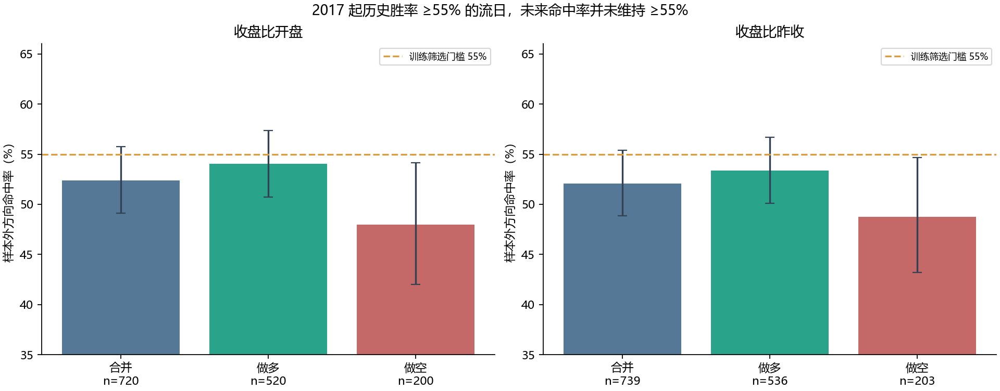
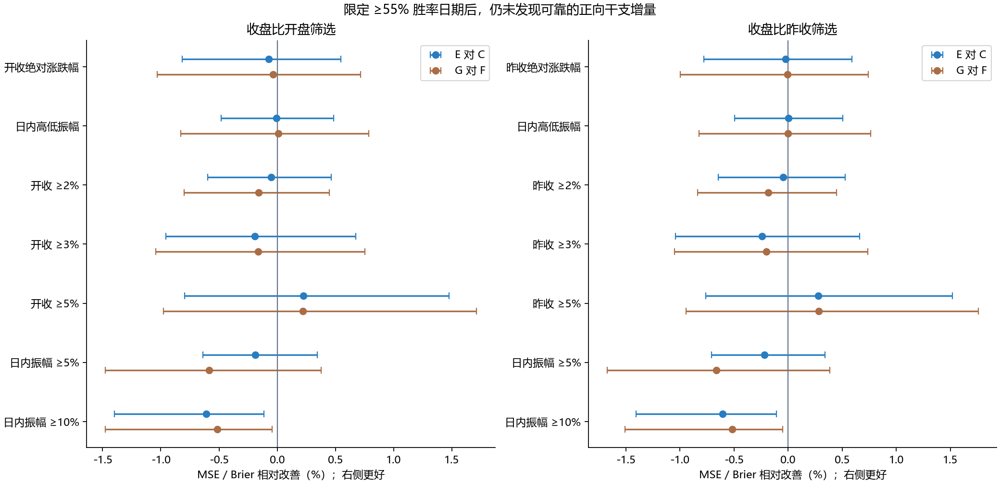

# jiexu-btc｜胜率 ≥55% 流日的波动预测复核报告

[逐干支附表](GANZHI_APPENDIX.md) · [复现说明](REPRODUCE.md) · [筛选逐日记录 CSV](results/selection_daily.csv) · [2017 起干支日 K CSV](results/daily_ganzhi_candles_2017.csv)

## 1. 结论

**结论 C：按照做多或做空历史胜率 ≥55% 缩小测试范围后，仍没有证明干支信息提供稳定、独立的波动强度预测优势。** 这不等于证明任何干支规律永远不存在，而是本次数据和锁定模型没有提供可开发的证据。

主样本外为 **2023-01-01—2026-10-20**；方向筛选始终使用 **2017 年实际可用起** 的已收盘日 K，不把 2023 作为方向历史起点。每个测试日先以过去同干支记录决定是否入选，随后才评分当日结果。另验证 2021 年起扩展区间、2022 年底固定名单、做多/做空分组和四类稳健性预测。

本次执行的是“限定测试日期”的新假设，复用上次锁定且逐日无未来信息的 17 个模型预测，重新计算筛选、全部指标、区间和检验。**没有在已经看到的测试结果上重新拟合或优化模型，也没有把训练样本只缩到入选日期。** 后者会成为另一个不同假设，不能把本报告当成已经验证。

## 2. 如何筛选，为什么没有直接用现在的名单回测

开收盘口径上涨为 C>O、下跌为 C<O；昨收口径为 C>前一日有效收盘、C<前收。做空胜率指该口径的下跌频率，不是扣除成本后的可实现做空收益。平盘保留在分母。使用原始 Decimal 价格判断方向，并以整数比较 `100×上涨次数 ≥55×n` 或 `100×下跌次数 ≥55×n`，避免四舍五入把 54.98% 当成 55%。

每天 UTC+8 00:00 只使用该时刻之前已收盘的有效日线；沿用现有干支历法标注每根日 K。2017-08-17 上市首根不完整日线、源收盘时间异常、未收盘日线排除；昨收口径另排除前一日源收盘异常。有效开收盘方向样本 3,348 根，昨收口径 3,345 根，起于 **2017-08-18**。测试目标沿用原研究共同有效集，保证模型的测试日期相同。

“现在筛到哪些干支”是描述清单；它包含后来行情，不能回头用于 2023 年预测。因此报告同时提供：逐日滚动名单、只用 2022 年底之前信息固定的名单，以及截至 2026-10-20 的当前名单。当前名单没有被用于历史预测。

| 方向口径 | 测试起点 | 全部日 | 入选日 | 保留比例 | 曾入选干支 | 做多日 | 做空日 | 当时训练 n |
| --- | --- | --- | --- | --- | --- | --- | --- | --- |
| 收盘比开盘 | 2021-01-01 | 2119 | 1150 | 54.27% | 59 | 815 | 335 | 19—55 |
| 收盘比开盘 | 2023-01-01 | 1389 | 720 | 51.84% | 48 | 520 | 200 | 32—55 |
| 收盘比昨收 | 2021-01-01 | 2119 | 1192 | 56.25% | 59 | 836 | 356 | 19—55 |
| 收盘比昨收 | 2023-01-01 | 1389 | 739 | 53.20% | 49 | 536 | 203 | 32—55 |

## 3. 方向胜率本身有没有延续

下面是筛选之后才发生的真实结果。置信区间使用原始日历上的 60 日区块重抽样。BTC 对照是在同一天、同一收益口径上按过去整体多数方向判断；本区间该基准始终偏向上涨，不能把做空命中率同另外一批日期的上涨率比较。

| 方向口径 | 筛选侧 | n | 训练胜率均值 | 样本外命中 | 95% 区间 | 同日 BTC 基准 | 超额命中 |
| --- | --- | --- | --- | --- | --- | --- | --- |
| 收盘比开盘 | 合并 | 720 | 59.49% | 377/720 = 52.36% | [49.09%, 55.74%] | 53.47% | -1.11% |
| 收盘比开盘 | 做多 | 520 | 59.43% | 281/520 = 54.04% | [50.72%, 57.36%] | 54.04% | +0.00% |
| 收盘比开盘 | 做空 | 200 | 59.64% | 96/200 = 48.00% | [42.00%, 54.17%] | 52.00% | -4.00% |
| 收盘比昨收 | 合并 | 739 | 59.51% | 385/739 = 52.10% | [48.88%, 55.38%] | 52.77% | -0.68% |
| 收盘比昨收 | 做多 | 536 | 59.31% | 286/536 = 53.36% | [50.09%, 56.68%] | 53.36% | +0.00% |
| 收盘比昨收 | 做空 | 203 | 60.03% | 99/203 = 48.77% | [43.20%, 54.64%] | 51.23% | -2.46% |

训练期入选日期的优势方向胜率平均约 59.5%，但样本外合并命中只有约 52%。尤其训练时偏空的日期，后来做空命中并未超过 50%。这是筛选后在新数据上减弱的实际结果；不能把 ≥55% 的历史门槛直接解释成未来 ≥55%。方向命中对 BTC 基准的差异也没有通过校正检验。

| 口径 | 年份 | 筛选侧 | n | 样本外命中 | 同日 BTC 基准 |
| --- | --- | --- | --- | --- | --- |
| 收盘比昨收 | 2023 | 合并 | 189 | 51.32% | 50.79% |
| 收盘比昨收 | 2023 | 做多 | 132 | 51.52% | 51.52% |
| 收盘比昨收 | 2023 | 做空 | 57 | 50.88% | 49.12% |
| 收盘比昨收 | 2024 | 合并 | 192 | 53.65% | 55.73% |
| 收盘比昨收 | 2024 | 做多 | 136 | 56.62% | 56.62% |
| 收盘比昨收 | 2024 | 做空 | 56 | 46.43% | 53.57% |
| 收盘比昨收 | 2025 | 合并 | 203 | 53.20% | 55.17% |
| 收盘比昨收 | 2025 | 做多 | 153 | 55.56% | 55.56% |
| 收盘比昨收 | 2025 | 做空 | 50 | 46.00% | 54.00% |
| 收盘比昨收 | 2026 | 合并 | 155 | 49.68% | 48.39% |
| 收盘比昨收 | 2026 | 做多 | 115 | 48.70% | 48.70% |
| 收盘比昨收 | 2026 | 做空 | 40 | 52.50% | 47.50% |
| 收盘比开盘 | 2023 | 合并 | 187 | 52.94% | 52.41% |
| 收盘比开盘 | 2023 | 做多 | 130 | 53.85% | 53.85% |
| 收盘比开盘 | 2023 | 做空 | 57 | 50.88% | 49.12% |
| 收盘比开盘 | 2024 | 合并 | 188 | 54.26% | 56.38% |
| 收盘比开盘 | 2024 | 做多 | 132 | 57.58% | 57.58% |
| 收盘比开盘 | 2024 | 做空 | 56 | 46.43% | 53.57% |
| 收盘比开盘 | 2025 | 合并 | 196 | 53.06% | 56.12% |
| 收盘比开盘 | 2025 | 做多 | 148 | 56.08% | 56.08% |
| 收盘比开盘 | 2025 | 做空 | 48 | 43.75% | 56.25% |
| 收盘比开盘 | 2026 | 合并 | 149 | 48.32% | 47.65% |
| 收盘比开盘 | 2026 | 做多 | 110 | 47.27% | 47.27% |
| 收盘比开盘 | 2026 | 做空 | 39 | 51.28% | 48.72% |

## 4. 波动预测模型与统一比较

与原研究完全一致：A 全历史均值；B30 过去 30 日；C7/C14/C90/C365 不同窗口；Cewma 为半衰期 14 日；C 为多尺度近期波动状态回归；D 为同干支向整体收缩 20 个样本；D_raw 为原始同干支；D_2023 为 2023 起同干支。E30 在 B30 上加入干支残差，E 在 C 上加入干支，F 在多尺度状态上控制星期，G 在 F 上加入干支。F_retro/G_retro 另用最终宏观公布日期，只是条件性分析。

主要看 **E 对 C、G 对 F**。E 对 B30 同时增加了更强的波动状态模型和干支信息，改善不能直接归因于干支。幅度目标是绝对涨跌幅与高低振幅；事件目标固定 ≥2%、≥3%、≥5%，高低振幅另列 ≥5%、≥10%。原始精度判定，二者不混合。

### 收盘比开盘筛选：全部模型主指标

| 模型 | 绝对收益 MAE | 绝对收益 RMSE | 振幅 MAE | 振幅 RMSE | ≥2% Brier | ≥3% Brier | ≥5% Brier | ≥3% AUC | ≥3% AP |
| --- | --- | --- | --- | --- | --- | --- | --- | --- | --- |
| A | 1.560% | 1.848% | 2.412% | 2.772% | 0.222826 | 0.150934 | 0.051893 | 0.5525 | 0.1788 |
| B30 | 1.175% | 1.620% | 1.430% | 2.019% | 0.208743 | 0.138470 | 0.045508 | 0.5505 | 0.1828 |
| C7 | 1.222% | 1.722% | 1.441% | 2.020% | 0.223868 | 0.152864 | 0.058059 | 0.5180 | 0.1702 |
| C14 | 1.198% | 1.660% | 1.444% | 2.021% | 0.215251 | 0.143153 | 0.049669 | 0.5418 | 0.1756 |
| C90 | 1.173% | 1.616% | 1.495% | 2.062% | 0.205088 | 0.136572 | 0.044037 | 0.5484 | 0.1822 |
| C365 | 1.207% | 1.626% | 1.577% | 2.111% | 0.206485 | 0.136268 | 0.043776 | 0.5311 | 0.1785 |
| Cewma | 1.164% | 1.613% | 1.418% | 1.990% | 0.206710 | 0.138254 | 0.045997 | 0.5457 | 0.1862 |
| C | 1.156% | 1.607% | 1.407% | 1.950% | 0.199599 | 0.133731 | 0.044068 | 0.6017 | 0.2337 |
| D | 1.576% | 1.863% | 2.442% | 2.808% | 0.226796 | 0.153429 | 0.053031 | 0.5261 | 0.1888 |
| D_raw | 1.589% | 1.883% | 2.462% | 2.839% | 0.230657 | 0.158011 | 0.057281 | 0.5233 | 0.1861 |
| D_2023 | 1.231% | 1.659% | 1.599% | 2.160% | 0.210837 | 0.140091 | 0.045073 | 0.4533 | 0.1499 |
| E30 | 1.180% | 1.622% | 1.437% | 2.024% | 0.208794 | 0.138590 | 0.045399 | 0.5509 | 0.2078 |
| E | 1.160% | 1.607% | 1.407% | 1.950% | 0.199702 | 0.133991 | 0.043970 | 0.5980 | 0.2346 |
| F | 1.101% | 1.569% | 1.261% | 1.815% | 0.193053 | 0.129700 | 0.043429 | 0.6691 | 0.2774 |
| G | 1.105% | 1.569% | 1.260% | 1.815% | 0.193360 | 0.129913 | 0.043334 | 0.6664 | 0.2743 |
| F_retro | 1.100% | 1.569% | 1.266% | 1.821% | 0.193224 | 0.129924 | 0.043508 | 0.6650 | 0.2786 |
| G_retro | 1.105% | 1.570% | 1.266% | 1.821% | 0.193431 | 0.130032 | 0.043360 | 0.6626 | 0.2729 |

开收绝对涨跌幅 按 rmse 的事后诊断第一名：**F**（0.015685）。该排名没有用于重新调参或宣称已选出未来最优模型。

日内高低振幅 按 rmse 的事后诊断第一名：**G**（0.018146）。该排名没有用于重新调参或宣称已选出未来最优模型。

开收 ≥2% 按 brier 的事后诊断第一名：**F**（0.193053）。该排名没有用于重新调参或宣称已选出未来最优模型。

开收 ≥3% 按 brier 的事后诊断第一名：**F**（0.129700）。该排名没有用于重新调参或宣称已选出未来最优模型。

开收 ≥5% 按 brier 的事后诊断第一名：**G**（0.043334）。该排名没有用于重新调参或宣称已选出未来最优模型。

### 收盘比昨收筛选：全部模型主指标

| 模型 | 绝对收益 MAE | 绝对收益 RMSE | 振幅 MAE | 振幅 RMSE | ≥2% Brier | ≥3% Brier | ≥5% Brier | ≥3% AUC | ≥3% AP |
| --- | --- | --- | --- | --- | --- | --- | --- | --- | --- |
| A | 1.561% | 1.845% | 2.412% | 2.769% | 0.222358 | 0.150536 | 0.051071 | 0.5439 | 0.1719 |
| B30 | 1.172% | 1.612% | 1.436% | 2.016% | 0.207688 | 0.137413 | 0.044607 | 0.5526 | 0.1814 |
| C7 | 1.211% | 1.707% | 1.438% | 2.014% | 0.222673 | 0.150788 | 0.057134 | 0.5286 | 0.1719 |
| C14 | 1.192% | 1.651% | 1.447% | 2.018% | 0.213617 | 0.141582 | 0.048873 | 0.5506 | 0.1774 |
| C90 | 1.169% | 1.607% | 1.498% | 2.061% | 0.204123 | 0.135509 | 0.043007 | 0.5501 | 0.1807 |
| C365 | 1.205% | 1.620% | 1.585% | 2.114% | 0.206095 | 0.135690 | 0.042719 | 0.5209 | 0.1717 |
| Cewma | 1.159% | 1.604% | 1.421% | 1.986% | 0.205490 | 0.136903 | 0.045090 | 0.5533 | 0.1875 |
| C | 1.155% | 1.600% | 1.407% | 1.943% | 0.199399 | 0.132697 | 0.043063 | 0.6059 | 0.2325 |
| D | 1.574% | 1.858% | 2.441% | 2.803% | 0.226390 | 0.153249 | 0.052031 | 0.5180 | 0.1844 |
| D_raw | 1.586% | 1.877% | 2.460% | 2.833% | 0.230327 | 0.157974 | 0.056226 | 0.5155 | 0.1821 |
| D_2023 | 1.227% | 1.651% | 1.602% | 2.160% | 0.210080 | 0.139357 | 0.044015 | 0.4505 | 0.1476 |
| E30 | 1.178% | 1.613% | 1.443% | 2.022% | 0.207729 | 0.137591 | 0.044466 | 0.5522 | 0.2054 |
| E | 1.159% | 1.600% | 1.407% | 1.943% | 0.199491 | 0.133017 | 0.042943 | 0.6009 | 0.2349 |
| F | 1.099% | 1.562% | 1.257% | 1.808% | 0.192612 | 0.129137 | 0.042455 | 0.6663 | 0.2723 |
| G | 1.103% | 1.562% | 1.257% | 1.808% | 0.192960 | 0.129398 | 0.042335 | 0.6644 | 0.2713 |
| F_retro | 1.098% | 1.563% | 1.262% | 1.814% | 0.192800 | 0.129255 | 0.042543 | 0.6633 | 0.2746 |
| G_retro | 1.102% | 1.563% | 1.262% | 1.814% | 0.193080 | 0.129420 | 0.042369 | 0.6598 | 0.2692 |

昨收绝对涨跌幅 按 rmse 的事后诊断第一名：**F**（0.015624）。该排名没有用于重新调参或宣称已选出未来最优模型。

日内高低振幅 按 rmse 的事后诊断第一名：**F**（0.018080）。该排名没有用于重新调参或宣称已选出未来最优模型。

昨收 ≥2% 按 brier 的事后诊断第一名：**F**（0.192612）。该排名没有用于重新调参或宣称已选出未来最优模型。

昨收 ≥3% 按 brier 的事后诊断第一名：**F**（0.129137）。该排名没有用于重新调参或宣称已选出未来最优模型。

昨收 ≥5% 按 brier 的事后诊断第一名：**G**（0.042335）。该排名没有用于重新调参或宣称已选出未来最优模型。

## 5. 干支信息的实际增量和统计区间

下表连续目标使用 **MSE** 改善，事件目标使用 **Brier** 改善；正数表示候选更好。区间是点态 95%，不是同时区间。主检验将两个筛选口径、11 个目标、两个损失指标、四组比较合计 **176 项** 一起做 Holm 校正。14 日和 180 日区块作为敏感性。

| 筛选口径 | 目标 | 比较 | 样本 | 损失改善 | 95% 区间 | Holm p |
| --- | --- | --- | --- | --- | --- | --- |
| 收盘比开盘 | 开收绝对涨跌幅 | E 对 C | 720 | -0.073% | [-0.816%, +0.545%] | 1.0000 |
| 收盘比开盘 | 开收绝对涨跌幅 | G 对 F | 720 | -0.034% | [-1.029%, +0.718%] | 1.0000 |
| 收盘比开盘 | 昨收绝对涨跌幅 | E 对 C | 720 | -0.071% | [-0.816%, +0.546%] | 1.0000 |
| 收盘比开盘 | 昨收绝对涨跌幅 | G 对 F | 720 | -0.039% | [-1.032%, +0.717%] | 1.0000 |
| 收盘比开盘 | 日内高低振幅 | E 对 C | 720 | -0.006% | [-0.482%, +0.487%] | 1.0000 |
| 收盘比开盘 | 日内高低振幅 | G 对 F | 720 | +0.010% | [-0.827%, +0.787%] | 1.0000 |
| 收盘比开盘 | 开收 ≥2% | E 对 C | 720 | -0.052% | [-0.596%, +0.464%] | 1.0000 |
| 收盘比开盘 | 开收 ≥2% | G 对 F | 720 | -0.159% | [-0.798%, +0.448%] | 1.0000 |
| 收盘比开盘 | 开收 ≥3% | E 对 C | 720 | -0.194% | [-0.958%, +0.673%] | 1.0000 |
| 收盘比开盘 | 开收 ≥3% | G 对 F | 720 | -0.164% | [-1.042%, +0.753%] | 1.0000 |
| 收盘比开盘 | 开收 ≥5% | E 对 C | 720 | +0.224% | [-0.794%, +1.474%] | 1.0000 |
| 收盘比开盘 | 开收 ≥5% | G 对 F | 720 | +0.220% | [-0.977%, +1.711%] | 1.0000 |
| 收盘比开盘 | 昨收 ≥2% | E 对 C | 720 | -0.052% | [-0.596%, +0.462%] | 1.0000 |
| 收盘比开盘 | 昨收 ≥2% | G 对 F | 720 | -0.160% | [-0.792%, +0.445%] | 1.0000 |
| 收盘比开盘 | 昨收 ≥3% | E 对 C | 720 | -0.242% | [-1.036%, +0.648%] | 1.0000 |
| 收盘比开盘 | 昨收 ≥3% | G 对 F | 720 | -0.194% | [-1.077%, +0.732%] | 1.0000 |
| 收盘比开盘 | 昨收 ≥5% | E 对 C | 720 | +0.223% | [-0.794%, +1.474%] | 1.0000 |
| 收盘比开盘 | 昨收 ≥5% | G 对 F | 720 | +0.222% | [-0.976%, +1.713%] | 1.0000 |
| 收盘比开盘 | 日内振幅 ≥5% | E 对 C | 720 | -0.188% | [-0.639%, +0.344%] | 1.0000 |
| 收盘比开盘 | 日内振幅 ≥5% | G 对 F | 720 | -0.586% | [-1.478%, +0.376%] | 1.0000 |
| 收盘比开盘 | 日内振幅 ≥10% | E 对 C | 720 | -0.608% | [-1.399%, -0.116%] | 1.0000 |
| 收盘比开盘 | 日内振幅 ≥10% | G 对 F | 720 | -0.515% | [-1.476%, -0.043%] | 1.0000 |
| 收盘比昨收 | 开收绝对涨跌幅 | E 对 C | 739 | -0.028% | [-0.777%, +0.587%] | 1.0000 |
| 收盘比昨收 | 开收绝对涨跌幅 | G 对 F | 739 | +0.011% | [-0.974%, +0.760%] | 1.0000 |
| 收盘比昨收 | 昨收绝对涨跌幅 | E 对 C | 739 | -0.025% | [-0.777%, +0.591%] | 1.0000 |
| 收盘比昨收 | 昨收绝对涨跌幅 | G 对 F | 739 | -0.007% | [-0.997%, +0.742%] | 1.0000 |
| 收盘比昨收 | 日内高低振幅 | E 对 C | 739 | +0.002% | [-0.495%, +0.504%] | 1.0000 |
| 收盘比昨收 | 日内高低振幅 | G 对 F | 739 | -0.001% | [-0.825%, +0.763%] | 1.0000 |
| 收盘比昨收 | 开收 ≥2% | E 对 C | 739 | -0.045% | [-0.647%, +0.532%] | 1.0000 |
| 收盘比昨收 | 开收 ≥2% | G 对 F | 739 | -0.180% | [-0.846%, +0.454%] | 1.0000 |
| 收盘比昨收 | 开收 ≥3% | E 对 C | 739 | -0.197% | [-0.951%, +0.678%] | 1.0000 |
| 收盘比昨收 | 开收 ≥3% | G 对 F | 739 | -0.174% | [-1.025%, +0.752%] | 1.0000 |
| 收盘比昨收 | 开收 ≥5% | E 对 C | 739 | +0.281% | [-0.760%, +1.521%] | 1.0000 |
| 收盘比昨收 | 开收 ≥5% | G 对 F | 739 | +0.283% | [-0.947%, +1.758%] | 1.0000 |
| 收盘比昨收 | 昨收 ≥2% | E 对 C | 739 | -0.046% | [-0.647%, +0.530%] | 1.0000 |
| 收盘比昨收 | 昨收 ≥2% | G 对 F | 739 | -0.181% | [-0.836%, +0.449%] | 1.0000 |
| 收盘比昨收 | 昨收 ≥3% | E 对 C | 739 | -0.241% | [-1.040%, +0.660%] | 1.0000 |
| 收盘比昨收 | 昨收 ≥3% | G 对 F | 739 | -0.203% | [-1.049%, +0.735%] | 1.0000 |
| 收盘比昨收 | 昨收 ≥5% | E 对 C | 739 | +0.280% | [-0.760%, +1.519%] | 1.0000 |
| 收盘比昨收 | 昨收 ≥5% | G 对 F | 739 | +0.284% | [-0.944%, +1.758%] | 1.0000 |
| 收盘比昨收 | 日内振幅 ≥5% | E 对 C | 739 | -0.218% | [-0.708%, +0.342%] | 1.0000 |
| 收盘比昨收 | 日内振幅 ≥5% | G 对 F | 739 | -0.664% | [-1.673%, +0.387%] | 1.0000 |
| 收盘比昨收 | 日内振幅 ≥10% | E 对 C | 739 | -0.605% | [-1.404%, -0.109%] | 1.0000 |
| 收盘比昨收 | 日内振幅 ≥10% | G 对 F | 739 | -0.515% | [-1.509%, -0.050%] | 1.0000 |

两个最关键的独立增量比较（E−C、G−F）均没有通过主检验校正。个别 ≥5% 事件 Brier 的小改善，其区间仍跨过零。相对 RMSE 改善进一步小于相对 MSE 改善。

| 筛选口径 | 目标 | E 对 C：RMSE 改善 | G 对 F：RMSE 改善 |
| --- | --- | --- | --- |
| 收盘比开盘 | 开收绝对涨跌幅 | +0.8006% | -0.0172% |
| 收盘比开盘 | 日内高低振幅 | +3.4265% | +0.0049% |
| 收盘比昨收 | 昨收绝对涨跌幅 | +0.7548% | -0.0034% |
| 收盘比昨收 | 日内高低振幅 | +3.6137% | -0.0005% |

### 必须披露的有利结果及其归因

主 176 项检验中确有通过校正的有利结果，全部是 E 对简单 B30 的比较，不能省略。但 E 对 C 没有显著增量，因此这些结果不足以证明干支独立有效；还应直接查看 C 相对 B30 的同目标改善。

| 筛选口径 | 目标 | 损失 | 比较 | 改善 | Holm p | C 对 B30 同损失改善 |
| --- | --- | --- | --- | --- | --- | --- |
| 收盘比开盘 | 开收 ≥2% | brier | E 对 B30 | +4.331% | 0.0174 | +4.380% |
| 收盘比开盘 | 开收 ≥2% | logloss | E 对 B30 | +3.618% | 0.0088 | +3.665% |
| 收盘比开盘 | 昨收 ≥2% | brier | E 对 B30 | +4.320% | 0.0174 | +4.371% |
| 收盘比开盘 | 昨收 ≥2% | logloss | E 对 B30 | +3.610% | 0.0088 | +3.657% |

## 6. 是否更容易提前识别大行情

同等预警比例采用入选日期预测值前 10%，属于整段预测排序诊断，不是当时已知阈值。逐日可执行的预警另以过去 365 个自然日已发布、且当时入选的预测分位点确定阈值，至少 60 个先前入选预测；其实际预警比例不能强行等于 10%。完整 10%/20% 指标、ROC-AUC、PR-AUC、Log Loss、固定概率区间校准均已导出。

| 筛选口径 | 事件 | 总事件/n | 模型 | 前10% 日数 | 识别事件 | 前10% 实际率 | ROC-AUC | PR-AUC(AP) | Log Loss |
| --- | --- | --- | --- | --- | --- | --- | --- | --- | --- |
| 收盘比开盘 | 开收 ≥2% | 206/720 | F | 72 | 33 | 45.83% | 0.6524 | 0.3900 | 0.567689 |
| 收盘比开盘 | 开收 ≥2% | 206/720 | G | 72 | 33 | 45.83% | 0.6517 | 0.3908 | 0.568167 |
| 收盘比开盘 | 开收 ≥3% | 117/720 | F | 72 | 23 | 31.94% | 0.6691 | 0.2774 | 0.420976 |
| 收盘比开盘 | 开收 ≥3% | 117/720 | G | 72 | 25 | 34.72% | 0.6664 | 0.2743 | 0.421427 |
| 收盘比开盘 | 开收 ≥5% | 33/720 | F | 72 | 5 | 6.94% | 0.6666 | 0.1076 | 0.181335 |
| 收盘比开盘 | 开收 ≥5% | 33/720 | G | 72 | 6 | 8.33% | 0.6815 | 0.1094 | 0.180191 |
| 收盘比开盘 | 日内振幅 ≥5% | 124/720 | F | 72 | 31 | 43.06% | 0.7440 | 0.3710 | 0.406159 |
| 收盘比开盘 | 日内振幅 ≥5% | 124/720 | G | 72 | 32 | 44.44% | 0.7414 | 0.3570 | 0.407994 |
| 收盘比开盘 | 日内振幅 ≥10% | 6/720 | F | 72 | 2 | 2.78% | 0.7035 | 0.0386 | 0.055207 |
| 收盘比开盘 | 日内振幅 ≥10% | 6/720 | G | 72 | 2 | 2.78% | 0.7073 | 0.0386 | 0.055351 |
| 收盘比昨收 | 昨收 ≥2% | 210/739 | F | 74 | 34 | 45.95% | 0.6513 | 0.3866 | 0.566791 |
| 收盘比昨收 | 昨收 ≥2% | 210/739 | G | 74 | 33 | 44.59% | 0.6506 | 0.3874 | 0.567587 |
| 收盘比昨收 | 昨收 ≥3% | 119/739 | F | 74 | 23 | 31.08% | 0.6663 | 0.2723 | 0.420035 |
| 收盘比昨收 | 昨收 ≥3% | 119/739 | G | 74 | 25 | 33.78% | 0.6644 | 0.2713 | 0.420574 |
| 收盘比昨收 | 昨收 ≥5% | 33/739 | F | 74 | 5 | 6.76% | 0.6659 | 0.1058 | 0.178380 |
| 收盘比昨收 | 昨收 ≥5% | 33/739 | G | 74 | 6 | 8.11% | 0.6813 | 0.1079 | 0.177108 |
| 收盘比昨收 | 日内振幅 ≥5% | 127/739 | F | 74 | 33 | 44.59% | 0.7500 | 0.3808 | 0.402291 |
| 收盘比昨收 | 日内振幅 ≥5% | 127/739 | G | 74 | 34 | 45.95% | 0.7475 | 0.3648 | 0.404221 |
| 收盘比昨收 | 日内振幅 ≥10% | 6/739 | F | 74 | 2 | 2.70% | 0.7049 | 0.0381 | 0.054339 |
| 收盘比昨收 | 日内振幅 ≥10% | 6/739 | G | 74 | 2 | 2.70% | 0.7085 | 0.0381 | 0.054483 |

排序指标共 64 项 E−C/G−F 的配对区块检验，没有通过 Holm 校正的增量。少数高阈值事件基数很小，前 10% 多识别一两次并不能支持稳定预警能力。`calibration.csv` 给出每档预测概率与实际发生率，`online_alerts.csv` 给出真实历史阈值预警，不使用几乎永远预测“无大行情”的准确率充当效果。

## 7. 入选日期的实际波动是否更高

| 筛选口径 | 目标 | 入选 n | 入选实际均值/发生率 | 同期全部 BTC | 差值(百分点) |
| --- | --- | --- | --- | --- | --- |
| 收盘比开盘 | 开收绝对涨跌幅 | 720 | 1.611% | 1.634% | -0.023% |
| 收盘比开盘 | 日内高低振幅 | 720 | 3.475% | 3.478% | -0.004% |
| 收盘比开盘 | 开收 ≥2% | 720 | 28.611% | 29.662% | -1.051% |
| 收盘比开盘 | 开收 ≥3% | 720 | 16.250% | 15.623% | +0.627% |
| 收盘比开盘 | 开收 ≥5% | 720 | 4.583% | 4.824% | -0.240% |
| 收盘比开盘 | 日内振幅 ≥5% | 720 | 17.222% | 15.911% | +1.311% |
| 收盘比开盘 | 日内振幅 ≥10% | 720 | 0.833% | 1.512% | -0.679% |
| 收盘比昨收 | 昨收绝对涨跌幅 | 739 | 1.604% | 1.634% | -0.030% |
| 收盘比昨收 | 日内高低振幅 | 739 | 3.474% | 3.478% | -0.004% |
| 收盘比昨收 | 昨收 ≥2% | 739 | 28.417% | 29.662% | -1.245% |
| 收盘比昨收 | 昨收 ≥3% | 739 | 16.103% | 15.623% | +0.480% |
| 收盘比昨收 | 昨收 ≥5% | 739 | 4.465% | 4.824% | -0.358% |
| 收盘比昨收 | 日内振幅 ≥5% | 739 | 17.185% | 15.911% | +1.275% |
| 收盘比昨收 | 日内振幅 ≥10% | 739 | 0.812% | 1.512% | -0.700% |

≥3% 发生率在入选日期略高，但绝对收益平均值、≥2% 和 ≥5% 发生率没有一致提高；高低振幅均值也十分接近同期普通 BTC。即使存在某项描述差异，也要由 F/G 的同日预测损失验证是否产生增量，不能据此直接改仓位。

## 8. 逐年、牛熊与震荡稳定性

牛/熊标签只用此前有效收盘：前一收盘相对过去 200 根均线，且过去 30 根涨跌达到预设的 ±20%；不满足为中间/震荡环境。这主要区分强趋势，不能把未达 20% 的日期都解释为价格横盘。标签不使用当日结果。它只是固定研究分组，不是对市场周期的唯一划分。逐年表显示相对 MSE/Brier 改善，正值更好。

### 逐年核心比较

| 筛选口径 | 分组 | 目标 | n | E 对 C | G 对 F |
| --- | --- | --- | --- | --- | --- |
| 收盘比开盘 | 2023 | 开收绝对涨跌幅 | 187 | +0.852% | +0.889% |
| 收盘比开盘 | 2023 | 日内高低振幅 | 187 | +0.664% | +0.905% |
| 收盘比开盘 | 2023 | 开收 ≥3% | 187 | +0.481% | +0.303% |
| 收盘比开盘 | 2023 | 开收 ≥5% | 187 | -0.565% | -0.314% |
| 收盘比开盘 | 2024 | 开收绝对涨跌幅 | 188 | -0.603% | -0.436% |
| 收盘比开盘 | 2024 | 日内高低振幅 | 188 | -0.381% | -0.547% |
| 收盘比开盘 | 2024 | 开收 ≥3% | 188 | -0.827% | -0.606% |
| 收盘比开盘 | 2024 | 开收 ≥5% | 188 | +1.001% | +0.791% |
| 收盘比开盘 | 2025 | 开收绝对涨跌幅 | 196 | -0.824% | -0.973% |
| 收盘比开盘 | 2025 | 日内高低振幅 | 196 | -0.449% | -0.528% |
| 收盘比开盘 | 2025 | 开收 ≥3% | 196 | -0.044% | -0.106% |
| 收盘比开盘 | 2025 | 开收 ≥5% | 196 | -0.991% | -0.658% |
| 收盘比开盘 | 2026 | 开收绝对涨跌幅 | 149 | -0.134% | -0.129% |
| 收盘比开盘 | 2026 | 日内高低振幅 | 149 | +0.000% | -0.121% |
| 收盘比开盘 | 2026 | 开收 ≥3% | 149 | +0.000% | +0.000% |
| 收盘比开盘 | 2026 | 开收 ≥5% | 149 | -0.013% | +0.040% |
| 收盘比昨收 | 2023 | 昨收绝对涨跌幅 | 189 | +0.963% | +0.984% |
| 收盘比昨收 | 2023 | 日内高低振幅 | 189 | +0.715% | +0.829% |
| 收盘比昨收 | 2023 | 昨收 ≥3% | 189 | +0.530% | +0.418% |
| 收盘比昨收 | 2023 | 昨收 ≥5% | 189 | -0.397% | -0.153% |
| 收盘比昨收 | 2024 | 昨收绝对涨跌幅 | 192 | -0.572% | -0.411% |
| 收盘比昨收 | 2024 | 日内高低振幅 | 192 | -0.381% | -0.510% |
| 收盘比昨收 | 2024 | 昨收 ≥3% | 192 | -0.978% | -0.767% |
| 收盘比昨收 | 2024 | 昨收 ≥5% | 192 | +1.036% | +0.835% |
| 收盘比昨收 | 2025 | 昨收绝对涨跌幅 | 203 | -0.770% | -0.945% |
| 收盘比昨收 | 2025 | 日内高低振幅 | 203 | -0.465% | -0.482% |
| 收盘比昨收 | 2025 | 昨收 ≥3% | 203 | -0.036% | -0.129% |
| 收盘比昨收 | 2025 | 昨收 ≥5% | 203 | -0.960% | -0.582% |
| 收盘比昨收 | 2026 | 昨收绝对涨跌幅 | 155 | -0.190% | -0.233% |
| 收盘比昨收 | 2026 | 日内高低振幅 | 155 | +0.000% | -0.122% |
| 收盘比昨收 | 2026 | 昨收 ≥3% | 155 | +0.000% | +0.000% |
| 收盘比昨收 | 2026 | 昨收 ≥5% | 155 | -0.012% | +0.036% |

### 市场环境核心比较

| 筛选口径 | 分组 | 目标 | n | E 对 C | G 对 F |
| --- | --- | --- | --- | --- | --- |
| 收盘比开盘 | bear | 开收绝对涨跌幅 | 22 | -0.409% | +0.044% |
| 收盘比开盘 | bear | 日内高低振幅 | 22 | -0.556% | -0.152% |
| 收盘比开盘 | bear | 开收 ≥3% | 22 | -0.396% | -0.284% |
| 收盘比开盘 | bear | 开收 ≥5% | 22 | -0.048% | +0.648% |
| 收盘比开盘 | bull | 开收绝对涨跌幅 | 111 | -1.427% | -1.284% |
| 收盘比开盘 | bull | 日内高低振幅 | 111 | -0.686% | -0.569% |
| 收盘比开盘 | bull | 开收 ≥3% | 111 | -2.182% | -1.259% |
| 收盘比开盘 | bull | 开收 ≥5% | 111 | +0.285% | +0.451% |
| 收盘比开盘 | sideways | 开收绝对涨跌幅 | 587 | +0.254% | +0.244% |
| 收盘比开盘 | sideways | 日内高低振幅 | 587 | +0.169% | +0.145% |
| 收盘比开盘 | sideways | 开收 ≥3% | 587 | +0.221% | +0.058% |
| 收盘比开盘 | sideways | 开收 ≥5% | 587 | +0.226% | +0.110% |
| 收盘比昨收 | bear | 昨收绝对涨跌幅 | 23 | -0.409% | +0.375% |
| 收盘比昨收 | bear | 日内高低振幅 | 23 | -0.551% | -0.148% |
| 收盘比昨收 | bear | 昨收 ≥3% | 23 | -0.384% | -0.270% |
| 收盘比昨收 | bear | 昨收 ≥5% | 23 | -0.047% | +0.635% |
| 收盘比昨收 | bull | 昨收绝对涨跌幅 | 113 | -1.292% | -1.141% |
| 收盘比昨收 | bull | 日内高低振幅 | 113 | -0.644% | -0.498% |
| 收盘比昨收 | bull | 昨收 ≥3% | 113 | -2.672% | -1.110% |
| 收盘比昨收 | bull | 昨收 ≥5% | 113 | +0.392% | +0.585% |
| 收盘比昨收 | sideways | 昨收绝对涨跌幅 | 603 | +0.279% | +0.227% |
| 收盘比昨收 | sideways | 日内高低振幅 | 603 | +0.163% | +0.112% |
| 收盘比昨收 | sideways | 昨收 ≥3% | 603 | +0.230% | -0.028% |
| 收盘比昨收 | sideways | 昨收 ≥5% | 603 | +0.269% | +0.156% |

## 9. 固定名单、扩展起点、长短分组与极端行情

固定名单只在 2022 年底计算一次，此后不增删干支。它避免滚动名单进入退出的影响，但只对应那个时点的固定池，不能替代当前名单。稳健性模型使用上次已严格滚动产生的训练内 99 分位封顶或剔除单个极端年份的预测，并保留原始真实测试涨跌幅评分。本次筛选器仍使用原始 2017 起方向历史，避免每个变体偷偷更换测试日期。

| 检验 | 全部项 | 全部有利显著项 | E−C/G−F 项 | 干支有利显著项 | 干支最小 Holm p |
| --- | --- | --- | --- | --- | --- |
| paired_60 | 176 | 4 | 88 | 0 | 1.0000 |
| paired_14 | 176 | 0 | 88 | 0 | 1.0000 |
| paired_180 | 176 | 15 | 88 | 0 | 1.0000 |
| paired_extended | 176 | 8 | 88 | 0 | 1.0000 |
| frozen_paired | 176 | 0 | 88 | 0 | 1.0000 |
| paired_long_short | 352 | 3 | 176 | 0 | 1.0000 |
| robustness_paired | 704 | 0 | 352 | 0 | 1.0000 |

E 对 B30 的部分改善对区块长度敏感，14 日区块下未通过主家族校正；无论这些敏感性如何，E 对 C、G 对 F 都没有检出显著干支增量。个别做空分组的大振幅结果来自更强的基础模型，而非已经证明干支有效。

### 2022 年底固定池的同等模型比较

| 筛选口径 | 目标 | 比较 | 样本 | 损失改善 | 95% 区间 | Holm p |
| --- | --- | --- | --- | --- | --- | --- |
| 收盘比开盘 | 开收绝对涨跌幅 | E 对 C | 580 | -0.321% | [-1.046%, +0.268%] | 1.0000 |
| 收盘比开盘 | 开收绝对涨跌幅 | G 对 F | 580 | -0.226% | [-1.047%, +0.435%] | 1.0000 |
| 收盘比开盘 | 昨收绝对涨跌幅 | E 对 C | 580 | -0.318% | [-1.044%, +0.269%] | 1.0000 |
| 收盘比开盘 | 昨收绝对涨跌幅 | G 对 F | 580 | -0.252% | [-1.082%, +0.415%] | 1.0000 |
| 收盘比开盘 | 日内高低振幅 | E 对 C | 580 | -0.125% | [-0.452%, +0.159%] | 1.0000 |
| 收盘比开盘 | 日内高低振幅 | G 对 F | 580 | +0.076% | [-0.566%, +0.650%] | 1.0000 |
| 收盘比开盘 | 开收 ≥3% | E 对 C | 580 | -0.237% | [-1.055%, +0.730%] | 1.0000 |
| 收盘比开盘 | 开收 ≥3% | G 对 F | 580 | -0.457% | [-1.488%, +0.685%] | 1.0000 |
| 收盘比开盘 | 开收 ≥5% | E 对 C | 580 | +0.297% | [-0.699%, +1.505%] | 1.0000 |
| 收盘比开盘 | 开收 ≥5% | G 对 F | 580 | +0.190% | [-0.793%, +1.367%] | 1.0000 |
| 收盘比开盘 | 昨收 ≥3% | E 对 C | 580 | -0.225% | [-1.033%, +0.743%] | 1.0000 |
| 收盘比开盘 | 昨收 ≥3% | G 对 F | 580 | -0.300% | [-1.208%, +0.746%] | 1.0000 |
| 收盘比开盘 | 昨收 ≥5% | E 对 C | 580 | +0.296% | [-0.698%, +1.502%] | 1.0000 |
| 收盘比开盘 | 昨收 ≥5% | G 对 F | 580 | +0.191% | [-0.790%, +1.366%] | 1.0000 |
| 收盘比昨收 | 开收绝对涨跌幅 | E 对 C | 580 | -0.244% | [-0.990%, +0.335%] | 1.0000 |
| 收盘比昨收 | 开收绝对涨跌幅 | G 对 F | 580 | -0.175% | [-1.035%, +0.494%] | 1.0000 |
| 收盘比昨收 | 昨收绝对涨跌幅 | E 对 C | 580 | -0.241% | [-0.988%, +0.338%] | 1.0000 |
| 收盘比昨收 | 昨收绝对涨跌幅 | G 对 F | 580 | -0.201% | [-1.075%, +0.481%] | 1.0000 |
| 收盘比昨收 | 日内高低振幅 | E 对 C | 580 | -0.074% | [-0.440%, +0.223%] | 1.0000 |
| 收盘比昨收 | 日内高低振幅 | G 对 F | 580 | +0.070% | [-0.604%, +0.625%] | 1.0000 |
| 收盘比昨收 | 开收 ≥3% | E 对 C | 580 | -0.307% | [-1.165%, +0.747%] | 1.0000 |
| 收盘比昨收 | 开收 ≥3% | G 对 F | 580 | -0.548% | [-1.644%, +0.674%] | 1.0000 |
| 收盘比昨收 | 开收 ≥5% | E 对 C | 580 | +0.474% | [-0.529%, +1.721%] | 1.0000 |
| 收盘比昨收 | 开收 ≥5% | G 对 F | 580 | +0.380% | [-0.606%, +1.615%] | 1.0000 |
| 收盘比昨收 | 昨收 ≥3% | E 对 C | 580 | -0.261% | [-1.106%, +0.776%] | 1.0000 |
| 收盘比昨收 | 昨收 ≥3% | G 对 F | 580 | -0.394% | [-1.357%, +0.714%] | 1.0000 |
| 收盘比昨收 | 昨收 ≥5% | E 对 C | 580 | +0.472% | [-0.530%, +1.717%] | 1.0000 |
| 收盘比昨收 | 昨收 ≥5% | G 对 F | 580 | +0.380% | [-0.604%, +1.615%] | 1.0000 |

## 10. 干支间差异、多重比较与极端样本

主测试中有入选记录的逐干支比较共 2134 项（两个筛选器 × 可用干支 ×11目标 ×E−C/G−F），一起 Holm 校正。通过预设的正改善、校正 p<0.05、至少 15 个样本、至少 3 年正改善及事件数门槛的行数为 **0**。因此不输出“已经验证的高波动流日赢家榜”。全部 60 个干支仍保留在清单与样本量表中，没有入选记录的干支明确显示 0。

控制年份、多尺度既有波动状态、星期和最终宏观日标签后，又对固定入选路径做年内独立旋转残差的探索性关联检验（22 项、每项 4,999 次）。没有通过 Holm 校正的关联。该置换保留局部波动结构，但没有在每次置换中重新学习方向筛选器，因此不是整个自适应筛选算法的精确零假设检验，不用于证明预测有效。真正的判断依据仍是滚动样本外配对损失。

筛选后的每个干支常常只有个位数到二十多次测试记录，做空子样本更少。区间宽、稀有事件少、只有四个主检验年份，都限制统计功效。未显著不等于已证明差异严格为零；同样，样本小也不能作为采用该信号的正面证据。

## 11. 当前筛选名单与历史排行

以下名单截至 2026-10-20 收盘，方向频率用 2017 起全部有效日 K，**只用于现在描述，不用于回看生成历史选股池**。当前名单、固定名单和逐日滚动名单会不同。完整 60 干支方向、全历史/2023 起幅度和样本外结果见附表和 CSV。

### 收盘比开盘：当前 34 个入选干支

| 方向 | 干支 | 有效历史 n | 该方向次数 | 历史胜率 | 主 OOS 入选 n | 样本外命中 |
| --- | --- | --- | --- | --- | --- | --- |
| 做多 | 丙申 | 56 | 36 | 64.29% | 23 | 65.22% |
| 做多 | 壬午 | 56 | 35 | 62.50% | 23 | 52.17% |
| 做多 | 甲申 | 56 | 35 | 62.50% | 23 | 60.87% |
| 做多 | 庚午 | 55 | 34 | 61.82% | 23 | 60.87% |
| 做多 | 己卯 | 56 | 34 | 60.71% | 20 | 65.00% |
| 做多 | 癸卯 | 56 | 34 | 60.71% | 23 | 56.52% |
| 做多 | 癸酉 | 55 | 33 | 60.00% | 23 | 56.52% |
| 做多 | 甲戌 | 55 | 33 | 60.00% | 23 | 65.22% |
| 做多 | 乙亥 | 55 | 33 | 60.00% | 23 | 60.87% |
| 做多 | 辛未 | 54 | 32 | 59.26% | 17 | 64.71% |
| 做多 | 乙丑 | 56 | 33 | 58.93% | 19 | 63.16% |
| 做多 | 戊寅 | 56 | 32 | 57.14% | 22 | 59.09% |
| 做多 | 庚辰 | 56 | 32 | 57.14% | 11 | 63.64% |
| 做多 | 丙戌 | 56 | 32 | 57.14% | 22 | 59.09% |
| 做多 | 己丑 | 56 | 32 | 57.14% | 23 | 47.83% |
| 做多 | 辛卯 | 56 | 32 | 57.14% | 23 | 56.52% |
| 做多 | 丁未 | 56 | 32 | 57.14% | 15 | 53.33% |
| 做多 | 癸丑 | 56 | 32 | 57.14% | 7 | 57.14% |
| 做多 | 庚寅 | 56 | 31 | 55.36% | 19 | 36.84% |
| 做多 | 乙巳 | 56 | 31 | 55.36% | 15 | 53.33% |
| 做多 | 乙卯 | 56 | 31 | 55.36% | 3 | 33.33% |
| 做多 | 丙辰 | 56 | 31 | 55.36% | 21 | 42.86% |
| 做多 | 戊午 | 56 | 31 | 55.36% | 12 | 33.33% |
| 做多 | 壬戌 | 56 | 31 | 55.36% | 21 | 52.38% |
| 做空 | 癸亥 | 56 | 35 | 62.50% | 24 | 41.67% |
| 做空 | 甲子 | 56 | 34 | 60.71% | 24 | 62.50% |
| 做空 | 壬寅 | 56 | 33 | 58.93% | 11 | 63.64% |
| 做空 | 己未 | 56 | 33 | 58.93% | 23 | 60.87% |
| 做空 | 己亥 | 56 | 32 | 57.14% | 23 | 56.52% |
| 做空 | 丙午 | 56 | 32 | 57.14% | 4 | 50.00% |
| 做空 | 壬申 | 55 | 31 | 56.36% | 3 | 66.67% |
| 做空 | 乙酉 | 56 | 31 | 55.36% | 23 | 39.13% |
| 做空 | 丁酉 | 56 | 31 | 55.36% | 0 | — |
| 做空 | 辛酉 | 56 | 31 | 55.36% | 19 | 47.37% |

### 收盘比昨收：当前 35 个入选干支

| 方向 | 干支 | 有效历史 n | 该方向次数 | 历史胜率 | 主 OOS 入选 n | 样本外命中 |
| --- | --- | --- | --- | --- | --- | --- |
| 做多 | 丙申 | 56 | 36 | 64.29% | 23 | 65.22% |
| 做多 | 壬午 | 56 | 35 | 62.50% | 23 | 52.17% |
| 做多 | 甲申 | 56 | 35 | 62.50% | 23 | 60.87% |
| 做多 | 庚午 | 55 | 34 | 61.82% | 23 | 60.87% |
| 做多 | 己卯 | 56 | 34 | 60.71% | 20 | 65.00% |
| 做多 | 癸卯 | 56 | 34 | 60.71% | 23 | 56.52% |
| 做多 | 癸酉 | 55 | 33 | 60.00% | 23 | 56.52% |
| 做多 | 甲戌 | 55 | 33 | 60.00% | 23 | 65.22% |
| 做多 | 乙亥 | 55 | 33 | 60.00% | 23 | 60.87% |
| 做多 | 辛未 | 54 | 32 | 59.26% | 17 | 64.71% |
| 做多 | 乙丑 | 56 | 33 | 58.93% | 19 | 63.16% |
| 做多 | 戊寅 | 56 | 32 | 57.14% | 22 | 59.09% |
| 做多 | 庚辰 | 56 | 32 | 57.14% | 11 | 63.64% |
| 做多 | 丙戌 | 56 | 32 | 57.14% | 22 | 59.09% |
| 做多 | 己丑 | 56 | 32 | 57.14% | 23 | 47.83% |
| 做多 | 丁未 | 56 | 32 | 57.14% | 15 | 53.33% |
| 做多 | 癸丑 | 56 | 32 | 57.14% | 7 | 57.14% |
| 做多 | 戊午 | 56 | 32 | 57.14% | 21 | 47.62% |
| 做多 | 癸未 | 56 | 31 | 55.36% | 10 | 30.00% |
| 做多 | 庚寅 | 56 | 31 | 55.36% | 19 | 36.84% |
| 做多 | 辛卯 | 56 | 31 | 55.36% | 19 | 47.37% |
| 做多 | 乙巳 | 56 | 31 | 55.36% | 15 | 53.33% |
| 做多 | 乙卯 | 56 | 31 | 55.36% | 3 | 33.33% |
| 做多 | 丙辰 | 56 | 31 | 55.36% | 21 | 42.86% |
| 做多 | 壬戌 | 56 | 31 | 55.36% | 21 | 52.38% |
| 做空 | 癸亥 | 56 | 35 | 62.50% | 24 | 41.67% |
| 做空 | 甲子 | 56 | 34 | 60.71% | 24 | 62.50% |
| 做空 | 己未 | 56 | 34 | 60.71% | 24 | 62.50% |
| 做空 | 壬寅 | 56 | 33 | 58.93% | 11 | 63.64% |
| 做空 | 己亥 | 55 | 32 | 58.18% | 23 | 56.52% |
| 做空 | 壬申 | 54 | 31 | 57.41% | 5 | 80.00% |
| 做空 | 丙午 | 56 | 32 | 57.14% | 4 | 50.00% |
| 做空 | 乙酉 | 56 | 31 | 55.36% | 23 | 39.13% |
| 做空 | 丁酉 | 56 | 31 | 55.36% | 0 | — |
| 做空 | 辛酉 | 56 | 31 | 55.36% | 19 | 47.37% |

## 12. 局限和最终开发建议

本次是看过上一轮全干支结果后提出的 ≥55% 新筛选，虽然每笔历史预测和筛选没有未来泄漏，整个研究仍属于同一历史数据上的追加探索，不能称为一份完全未被观察过的新确认样本。没有尝试 56%、57%、不同幅度门槛或事后最优开始年份。若后续要确认任何有利信号，需要先锁定规则，再等待真正未使用的新行情。

仓库保存的是 CPI/非农最终实际公布日期，缺少每个历史日事前可知的公告日程版本。因此正式主比较 F/G 只控制波动状态和星期；F_retro/G_retro 仅条件性描述。这项限制未因本次缩小范围而消失。

本报告只研究方向命中和波动预警，没有把预测幅度转换成虚构交易收益，也没有假设知道当日高低价可以成交。胜率、收益幅度、成本后收益是不同问题，不能互换。

**最终判断：保持 C，不建议因为缩小到历史胜率 ≥55% 就继续开发干支波动预测模型。** 可保留历史统计作为描述展示；无法据此提高仓位、设为自动交易条件，或承诺未来胜率。现有“2017 起方向 +2023 起幅度”仍只是不同统计窗口的展示方案，本次没有证明其具有可交易优势，也没有修改正式功能。

## 13. 可复现文件与实际完成的验证

| 检查 | 实际结果 |
| --- | --- |
| status | PASS |
| independent_scalar_gate_decisions | 4238 |
| selected_prediction_rows | 437954 |
| decimal_target_fields | 437954 |
| score_and_pair_checks | 550 |
| unit_tests | 12 |
| all_prediction_dates_identical_across_models | True |
| all_source_prices_and_gate_counts_verified | True |
| formal_logic_modified | False |

此外已按只读方式核对正式系统历法与方向计数：3,353 个源日期的干支标签、240 个“口径×历史截点×干支”方向池，共 **4,553 项检查通过**，确认方向从 2017 起统计，并非 2023 起。记录见 `production_rules_verification.json`。

11 个目标、17 个模型、两种方向筛选均有完整 CSV。交付包含真实源快照哈希、父研究代码/预测文件哈希、预先固定的新筛选协议、逐日入选的历史计数、逐日预测、完整模型指标、逐年/市场环境、长短、校准、预警和稳健性。原始交易所数据没有重抓或篡改，保证与上一轮可比。

方法参考：[滚动时间序列交叉验证](https://otexts.com/fpp3/tscv.html)、[Holm 多重比较校正](https://www.statsmodels.org/stable/generated/statsmodels.stats.multitest.multipletests.html)。数值均来自本目录实际执行输出，不来自外部示例。
